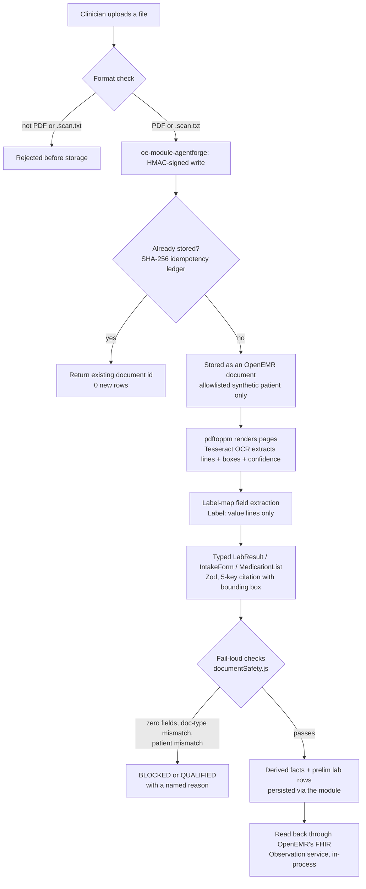
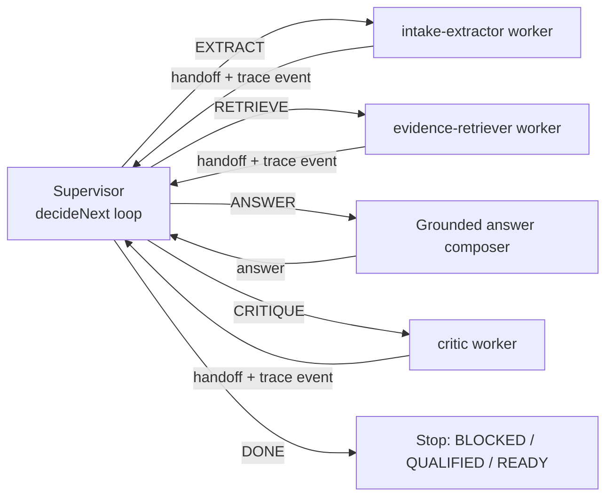
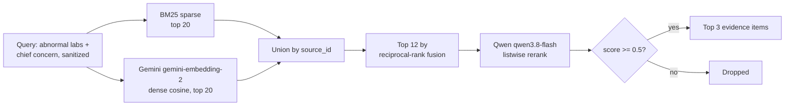
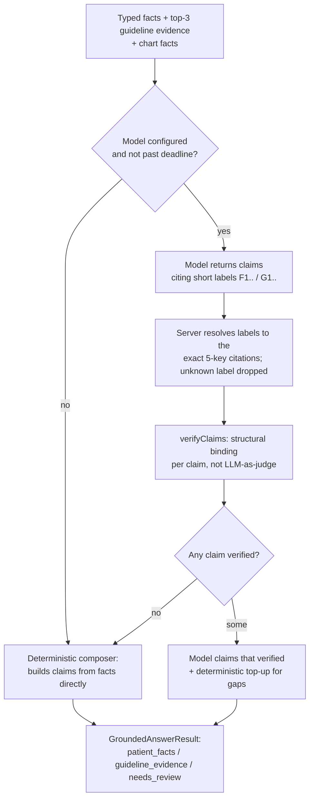
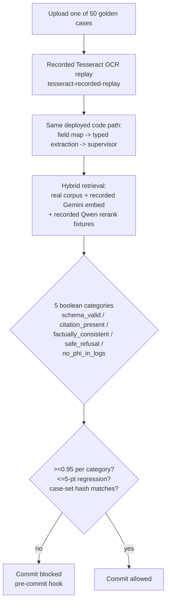

# AgentForge Week 2 architecture: the Clinical Co-Pilot

## 1. Summary

A primary-care physician is prepping for a follow-up visit. The chart has
structured OpenEMR data, but the new information — a scanned lab PDF and a
front-desk intake form — is buried in documents nobody has read yet. Week 2
gives the Week 1 chart-preparation agent two new abilities: it can read those
documents, and it can route the work across a small, inspectable graph
instead of one long function.

Upload flows through a server-side format check (PDF or a `.scan.txt` test
envelope, nothing else), into OpenEMR via the HMAC-authenticated
`oe-module-agentforge`, through local Tesseract OCR, into a Zod-typed
`LabResult`/`IntakeForm`/`MedicationList`, and out as either derived facts (persisted, with a
FHIR read-back) or a fail-loud refusal. A supervisor (`decideNext`) decides
when to extract, when to retrieve guideline evidence, when an LLM critic
reviews the answer, and when the answer is ready, logging its reason at every
step. Evidence retrieval is a real hybrid
pipeline — BM25 sparse search unioned with dense embeddings, reranked, and
cut at a relevance threshold — over a 42-chunk corpus of verbatim public
guideline text. The answer composer asks a hosted model for grounded claims,
but the model's output is never trusted directly: every claim is
independently re-derived from exactly the facts and guideline text it cites
(structural claim binding, not an LLM judging its own homework), and a claim
that fails is dropped, with a deterministic, template-built answer standing
in when too much is dropped. A 50-case eval gate plus a 34-case extension
suite, both enforced by a pre-commit hook (there is no CI runner on this
GitLab project), block any commit that regresses schema validity, citation completeness, factual consistency, safe
refusal, or PHI-in-logs by more than five points.

The key decisions, and what they cost: the supervisor is a hand-rolled state
machine, not LangGraph, because five states with logged reasons are easier to
audit than a graph library's abstractions for a scope this small — see
Tradeoffs. Reranking runs on Qwen (`qwen3.8-flash`, thinking off), not
Gemini, because the Gemini key is free-tier (20 requests/day) and a listwise
rerank on every request would exhaust it in minutes; dense embeddings stay on
Gemini, behind a `Reranker` interface a real dedicated reranker (Cohere) can
replace without touching retrieval. OpenEMR writes go through a bind-mounted
module authenticated by HMAC, not an interactive OAuth write grant, because
provisioning one needs a human login this environment doesn't have. The
answer model is `qwen3.8-flash` rather than the larger `qwen3.8-max`, because
OCR (~6 s) and retrieval (~3.5 s) already spend most of a 25-second budget.

The trust stance follows from one rule in `AGENTS.md`: never give a
simulation the name of the real thing, and fail loudly rather than guess.
Zero extracted fields, a document-type mismatch, or a patient mismatch is
never `READY`. A degraded retrieval result says `sparse_only`, `no_rerank`,
or `stub` — never silently `hybrid`. An unverified claim is dropped, not
softened. This is a synthetic-data checkpoint, not a clinical product; the
next section says exactly where that line sits.

## 2. What this is not

> - **Synthetic data only.** Every patient, document, and lab value in this
>   system is fabricated for evaluation. No real PHI has ever been processed,
>   uploaded, or stored here.
> - **OCR tuned to fixed form layouts.** Local Tesseract reads the label
>   layouts this project's fixtures use (`Label: value` lines, and numbered
>   `Medication 1:` rows on a medication list). A different
>   layout — a table, a handwritten form, a real-world scan — extracts
>   nothing and the document is refused or qualified; it is not guessed at.
> - **Lab read-back does not use the OpenEMR FHIR HTTP API.** It calls
>   OpenEMR's own FHIR Observation service in-process, inside the module.
>   (The public FHIR API was enabled on 2026-09-25 for the patient dashboard
>   port, `PATIENT_DASHBOARD_MIGRATION.md`; the Co-Pilot does not depend on
>   it.)
> - **The Gemini key is Free Tier.** It is used for dense embeddings only.
>   Reranking, which would exhaust the free tier's daily quota, moved to
>   Qwen behind a pluggable interface.
> - **Lab results are persisted as preliminary (`prelim`).** They are
>   unreviewed AI extraction pending clinician review, and OpenEMR's FHIR
>   mapper reports them as `status: unknown`, never `final`.
> - **The public demo's chart is a synthetic fixture.** The no-login demo
>   (synthetic-demo tokens, `fixture-patient-NNN`) reads chart facts from
>   `docs/agentforge/fixtures/clinical-cases.json` through `FixtureAdapter`,
>   not from OpenEMR, and answers label them "Synthetic chart fixture"
>   (`source_type: synthetic_chart_fixture`, `chartSource.js`). Uploads,
>   derived facts, lab rows and lab-trend reads do go through real OpenEMR
>   (the module, HMAC, the write ledger, the FHIR Observation read-back).
>   A clinician session launched from OpenEMR (E9, `docs/agentforge/PLAN.md`
>   D13, §3f) reads the chart through OpenEMR's REST API instead. It is live
>   on production only for the designated synthetic patient `AF-LIVE-01`, and
>   was observed on `b942391f` as `grader`
>   (`docs/agentforge/evidence/E9-live-chart-live.md`). Problems and
>   allergies are read through fallback routes that work with the current
>   service grant (the OpenEMR 8.0.0 finding and E9c in §3f).
> - **Week 1 is frozen** at `84f232b`, on its own route (`/agentforge`) and
>   its own pinned image. Nothing in this document changes it.
> - **There is no GitLab CI runner.** The enforced gate is the tracked
>   `.githooks/pre-commit` hook; `.gitlab-ci.yml` mirrors it for when a
>   runner exists but does not itself execute.
> - Whatever else this document, or the code it describes, calls out as a
>   gap, a degraded mode, or "wired, not yet observed live" is a real limit,
>   not a rounding error.

**Freeze.** The submitted build is tag `w2-final` = `ee036f38`, a re-freeze of `d5a0df7e` (`w2-final-rc1`) with two changes: presentation-only UI polish and a critic veto that now marks a verified safety flag *questioned* instead of hiding it (§3d). On `ee036f38`: live acceptance 26/26, deployed Bruno 27/27, load test 400/400 with 0 errors (`docs/agentforge/evidence/`). Rows below that cite `d5a0df7e` or earlier SHAs are the observations made on those SHAs.

### Scope: how we read the PRD's "Core Deliverables" list

The PRD's "Core Deliverables" list (p. 5–6) puts ten items under one heading
with the same bullet. Elsewhere the same PRD calls this "a controlled
expansion of the Week 1 agent into two document types, two workers, and one
regression gate" (p. 4). We read the first five items as core and the last
five as extensions, and built the core first. On 2026-09-26 the owner decided
to build all ten (`docs/agentforge/PLAN.md`, D12), and all ten are built and
deployed. The release freeze is tag `w2-final`, SHA `d5a0df7e`, deployed to
`/agentforge-w2` and `/dashboard` on 2026-09-27 at about 02:10 UTC. Live
acceptance on that SHA passed 26/26 (`docs/agentforge/evidence/LEDGER.md`).
Its rows cover X-1 to X-4 and every core item except the 50-case dataset,
which runs offline; X-5 is not observable live (see its row). Entries that
cite an earlier SHA were observed there in more detail; the ledger row is
the re-check on `d5a0df7e`.

| PRD item | Our reading | State |
|---|---|---|
| Two document types: lab PDF and intake form | Core | Built and live (§3a); on `d5a0df7e`: `LEDGER.md` W2-C1, W2-C1-READBACK, W2-C2, W2-C11, W2-INTAKE-C1, W2-INTAKE-NO-PHI, W2-SF-WRONGTYPE, W2-SF-CROSSPATIENT |
| One supervisor and two workers | Core | Built and live (§3b); decision sequence EXTRACT → RETRIEVE → ANSWER → CRITIQUE → DONE in `LEDGER.md` W2-C6 on `d5a0df7e` |
| Basic hybrid RAG plus rerank | Core | Built and live (§3c); `LEDGER.md` W2-C4 on `d5a0df7e` |
| 50-case golden dataset with boolean rubrics | Core | Built (§3e, `EVAL_GATE.md`) |
| PR-blocking eval CI and an observable deployed demo | Core | Built: pre-commit gate (§3e), `/observability`; the trace fields in `LEDGER.md` W2-C10 on `d5a0df7e` |
| X-1 Click-to-source UI with a simple document preview | Extension | Observed live on `521af47`: the lab-a preview had 12 citation links and 12 boxes, every link targets a box, and clicking the A1c citation highlighted its box (`docs/agentforge/evidence/E1-click-to-source-live.md`). On `d5a0df7e`, `LEDGER.md` X-1: 12 links, 12 boxes, none without a box. Gated by `x1-*` extension cases. |
| X-2 Critic agent that rejects uncited claims or unsafe action suggestions | Extension | Observed live on `e56eab86` with `openai/gpt-4.1-nano`: the UI showed "critic: reviewed", and the trace had one `CRITIQUE` decision and a critic duration of 1182 ms (`docs/agentforge/evidence/E2-critic-live.md`). The critic can only veto claims (§3b); `verifyClaims` stays the authority. Nine `x2-*` cases check the veto wiring with a fake critic model; the model choice came from `scripts/benchmark-critic-models.mjs` (`E2-critic-model-benchmark.json`). On `d5a0df7e`: `LEDGER.md` X-2 (critic `reviewed`, 841 ms). |
| X-3 A third document type (medication list) | Extension | Observed live on `d952660b`: "Medication list · Layout A" reached READY with 19 cited fields and a reviewed critic; two low-OCR-confidence medications went to "Needs review"; the OpenEMR ledger shows the `medication_list` and derived-facts writes (`docs/agentforge/evidence/E4-E5-E8-live.md`). On `d5a0df7e`: `LEDGER.md` X-3 and X-3-MISLABEL. 15 `x3-*` cases. |
| X-4 Lab trend chart from extracted Observation data | Extension | Observed live on `e0f9eb35`: after lab uploads, "Lab trends" showed A1C and hemoglobin charts read back from OpenEMR's FHIR Observation service, each point linked to its source (`E4-E5-E8-live.md`). On `d5a0df7e`: `LEDGER.md` X-4. Five `x4-*` cases. |
| X-5 Contextual retrieval improvements | Extension | Built and deployed since `e56eab86` (MR !96), fallback path only: BM25 query expansion raised recall@3 from 0.886 to 0.939 on 22 labeled queries (§3c, `KEY_METRICS.md`). It changes results only when BM25 ranks alone (`local-lexical`, or the hybrid `sparse_only` fallback), so it is not observable on the public URL unless the Gemini embed call fails. The normal hybrid path is unchanged on purpose. Two `x5-*` cases fail when it is off (`docs/agentforge/evidence/E3-retrieval-regression.txt`). |

## 3. How it works

### (a) Document ingestion flow

**`attach_and_extract` in this build.** The PRD's
`attach_and_extract(patient_id, file_path, doc_type)` is two HTTP calls.
`POST /v1/source-documents` stores the source file in OpenEMR and returns its
`document_id`. `POST /v1/scan-supervisor` extracts that document to the strict
Zod schemas and persists the derived facts. Persistence differs by type:

- **Lab PDF:** one `procedure_result` row per LOINC-mapped result (under one
  `procedure_order`/`_report`, all `prelim`), read back through OpenEMR's FHIR
  Observation service.
- **Intake form and medication list:** a derived-facts JSON document stored
  in OpenEMR. Medication and allergy list entries are written only through the
  clinician-confirm lane (A3); the Node service does not call that route yet,
  so no list entry is written today.

Live evidence on `d5a0df7e`: `LEDGER.md` W2-C1, W2-C1-READBACK, W2-C11,
W2-INTAKE-C1 and X-3.

Uploads are rejected before storage unless the content is a PDF or the
hand-authored `.scan.txt` test envelope that carries the same tagged-field
shape the OCR step produces (`sourceDocuments.js` restricts `document_type`
to `lab_pdf`/`intake_form`/`medication_list`; `service.js`'s `prepareScanSource` is the only
path into extraction). Storage itself goes through
`interface/modules/custom_modules/oe-module-agentforge/public/api.php`, an
internal-only endpoint Caddy answers 404 for everywhere else in that module
directory; every request is signed with HMAC-SHA-256 over a canonical string
(method, route, patient uuid, body hash, timestamp, nonce, query,
context-token hash — `openemrModuleClient.js`) using a key derived from
`AGENTFORGE_MODULE_HMAC_SECRET`, held only by `openemr` and `agentforge-w2`.
Every write is limited to `AGENTFORGE_DEMO_WRITE_PATIENT_UUIDS`, whatever the
caller's token issuer, and a write needs a write-scoped token — a read-scoped
one gets `persistence_not_authorized`, never a silent success.

Idempotency is a SHA-256 of the document content: re-uploading the same
bytes returns the same OpenEMR document id and adds zero new rows
(`openemrModuleWriteback.js`; proven live by `w2-openemr-smoke.mjs`, 48/48
checks). OCR is real `pdftoppm` + Tesseract 5.5.2 in production; the 50-case
gate and unit tests replay OCR recorded once from that exact stack
(`tesseract-recorded-replay`) so they run deterministically on machines
without the binaries (Windows, most graders), while a separate parity test
re-runs live OCR wherever the tools exist and fails on drift. Each field
carries the OCR confidence of the line it came from; a field below 0.85
confidence is flagged `low_confidence_requires_human_review` rather than
shown as verified. `documentSafety.js`'s checks run after every extraction:
zero facts or a patient-identity mismatch (name/DOB read from the document
vs. the chart) is `BLOCKED`; a doc-type mismatch, an unverifiable identity,
or an incomplete extraction is `QUALIFIED` — the workflow never reports
`READY` on any of these. A `BLOCKED` workflow writes no derived facts or lab
rows (the source PDF is already stored at upload), and a call without a
workflow state throws. Only a `READY` or `QUALIFIED` workflow persists a
derived-facts JSON document and, for a lab PDF, one
`procedure_order`/`_report` plus one `procedure_result` per LOINC-mapped
result, all marked `prelim`. Read-back is OpenEMR's own FHIR Observation
service called in-process (`read_path: openemr-fhir-service-in-process`),
not the `/fhir` HTTP API. That API was enabled on 2026-09-25 for the
dashboard port; the read-back does not depend on it.

**Medication lists (`medication_list`, the third type).** The label map reads
the header lines (patient name, DOB, list date, prescriber or source) and
numbered rows (`Medication 1:` or `Rx 1:`), and splits each row into name,
dose, unit, frequency and route (`pdfScanAdapter.js` `parseMedicationRow`).
Every part cites the verbatim row line with its box and carries that line's
confidence; a part the row does not show is `not_found_on_form` and keeps the
extraction from being `complete` (`typedExtraction.js`
`buildTypedMedicationList`, Zod `MedicationList`). So does a line that reads
like a drug row but has no usable row label, or a gap in the row numbers: a
dropped drug is never `READY`. Type detection scores lab, intake and
medication-list vocabulary and claims a type only with a two-hit margin over
both others; medication-list words count only when the page has a list
anchor (title, prescriber, list date, numbered rows), so an intake with a
medication table stays an intake. Any declared-versus-detected mismatch is
`QUALIFIED doc_type_mismatch`; the printed name and DOB are checked against
the chart like an intake form. The source PDF and a derived-facts JSON are
stored through the module (`DocumentType::MedicationList`), idempotently.
No medication is written to the chart on upload: the module's
`clinical-list-items` route accepts only clinician-confirmed `medication`
items from a medication list (an allergy item is rejected), and, as for
intake forms, the Node clinical-action lane does not call that route yet
(A3 in `docs/agentforge/PLAN.md`). Tests: `agentforge/test/medication-list.test.js`,
the medication-list cases in `oe-module-agentforge/tests/run.php`, and the
`x3-*` extension cases; deliberate-regression proof in
`docs/agentforge/evidence/E4-medlist-regression.txt`.

**Lab trend (E5).** `GET lab-observations` without `source_document_id`
returns the patient's lab history: the Observations of every `lab` ledger row
the module wrote for that patient whose source is a lab PDF the module stored
for the same patient. Other chart labs are never returned. Each entry carries
its source document id and the collection date (`LabHistoryAssembler.php`).
The service groups them by test and unit (`labTrend.js`), and
`GET /v1/patients/:patient/lab-trends[/chart]` serves the JSON or the SVG
fragment with the same read-scoped demo-context check as the source-document
routes. In fixture mode the read-back comes from an in-memory synthetic store,
labeled `in-memory-synthetic-lab-store`, not OpenEMR. No table change.

### (b) Worker graph

`supervisor.js#decideNext(state) -> {next, reason}` is a pure function called
in a loop; every decision is pushed to `workflow.decisions[]` and traced —
"routing decisions inspectable" is a Week 2 requirement, not a nice-to-have.
The reasons it can return:

| Condition | `next` | `reason` |
|---|---|---|
| No extraction yet, none cached | `EXTRACT` | `extraction_needed` |
| No extraction yet, cached for this content hash + OCR mode | `EXTRACT` | `extraction_cached` (loads the cache; still an extraction, not a `RETRIEVE`) |
| Extraction just ran, fail-loud check blocks | `DONE` | the blocking reason (`patient_mismatch`, `no_fields_extracted`, `extraction_contract_invalid`) |
| Extraction valid, mean confidence < 0.7, no retry yet | `EXTRACT` | `low_confidence_retry` (re-OCRs once at Tesseract `--psm 4`, keeps whichever result has the higher mean confidence and is not contract-invalid) |
| Facts ready, question is a pure record lookup ("what was the hemoglobin value?") | `ANSWER` | `record_lookup_only` (RETRIEVE is skipped entirely) |
| Facts ready, ordinary question | `RETRIEVE` | `evidence_needed` |
| Facts and (if not skipped) evidence ready | `ANSWER` | `facts_and_evidence_ready` |
| Loop safety cap (7 steps: the longest normal path, EXTRACT, retry, RETRIEVE, ANSWER, CRITIQUE, DONE, takes 6) hit | `DONE` | `max_steps_reached` (QUALIFIED, never BLOCKED — whatever was gathered is still returned) |
| Answer composed, critic configured, answer has claims, scan budget left ≥ critic timeout | `CRITIQUE` | `answer_needs_review` |
| Answer composed, no critic model configured | `DONE` | `critic_disabled` (answer labeled `critic_status: disabled`) |
| Answer composed, no claims | `DONE` | `no_claims_to_review` (`skipped_no_claims`) |
| Answer composed, scan budget left < critic timeout | `DONE` | `critic_skipped_budget` (`skipped_budget`; the deadline is never widened) |
| Critic has run | `DONE` | `critique_reviewed` or `critique_failed` |

The extraction cache is keyed by a SHA-256 of the extracted content plus the
OCR mode, not by document id, so a re-uploaded or re-fixtured document with
identical bytes still hits the cache; it is bounded to 50 entries with FIFO
eviction. `isRecordLookupQuestion` has one canonical definition (imported by
both the supervisor and the answer composer, so they cannot silently
disagree): a direct "what is/was the X value/result/level" question, unless
it also names a guideline-seeking word (target, recommended, threshold,
normal, abnormal, should) — "What is the target A1C value?" still retrieves
evidence.

There are three workers. The PRD's two come first: `runExtractionWorker`
(`activeWorkers.js`, traced as `scan-form-extraction-worker`) wraps the OCR →
label-map → typed-extraction pipeline behind a fixed input/output contract;
`runEvidenceWorker` (traced as `evidence-retrieval-worker`) formulates its own query from this document's abnormal
lab results and intake chief concern (a client-supplied `message` is only
ever appended, never sent as the query verbatim) and calls the injected
guideline retriever. A pure record-lookup question skips it entirely — no
guideline call is made when the answer needs none. Every retrieval attempt
is recorded on the trace with the provider that actually answered (which may
have degraded mid-call), never a static label. The third worker is the
critic (traced as `critic-worker`), described next.

The critic worker (`critic.js#runCriticWorker`, E2) is an LLM critic that can
only veto claims. It gets each shipped claim's text and the `quote_or_value`
strings of its citations, which the clinician already sees, and nothing else:
no patient reference, document id, name, date of birth or phone. A claim
citing a patient-identity field (`patient.name`, `patient.date_of_birth`,
`patient.phone`, an address and the like; not `lab.*.test_name` or a
medication name) is not sent; it ships unreviewed and is counted in the
answer's `critic_claims_not_sent`. If every claim is held back, the status is
`skipped_identity_only`. For an answer built from a live OpenEMR read
without `AGENTFORGE_LIVE_EXTERNAL_PROVIDER_APPROVED`, the critic is not
called and the status is `skipped_not_approved` (§3f). The composer already keeps demographics out of
claims, so this is a defense-in-depth path. It must return strict JSON with
one verdict per claim: `keep`, or `reject` with `UNCITED`,
`UNSUPPORTED_BY_SOURCE` or `UNSAFE_ACTION`. Verdicts are applied by claim
index; the critic's own text is never read back, and a verdict for a claim it
was not sent is ignored. A rejection is final: every fact or guideline chunk
a rejected claim cited is barred, so neither the composer's deterministic
top-up nor any fallback can bring a claim citing it back, whatever its text.
The top-up may still fill a gap for a fact no rejected claim cited; such a
claim was added after the critic ran and is counted in
`critic_topup_unreviewed`, not as reviewed. If the vetoes remove every claim,
the answer ships with none. `critic_rejected` equals the number of claims
removed from what ships, and the UI shows it together with any unreviewed
count. Safety flags (§3d) are the exception: a veto never hides a flag that
passed `verifyClaims`; it ships marked `critic_status: 'questioned'` with the
reason code, counted in `critic_flags_questioned`. Why a model next to `verifyClaims`: the
verifier is structural and has known gaps (a verbatim guideline span is exempt
from its directive check; its directive patterns are a fixed list, so "The
patient has to be taking lisinopril 10 mg daily." passes). The critic is a
second, fallible check on those gaps, not proof of correctness.
`critic_status` on the answer is `reviewed` only when the model returned a
valid verdict for every claim sent; a provider error, timeout, the scan
deadline or invalid JSON is `failed`, and the answer then ships exactly as the
verifier left it. The provider is the OpenRouter lane with its own env
(`AGENTFORGE_CRITIC_MODEL`, no default; `AGENTFORGE_CRITIC_TIMEOUT_MS`,
default 4000). The trace gets a `critic` stage, a model-usage entry and a
`critic` block with status, duration, tokens, cost (`null` with
`cost_source` when the model has no known price) and verdict counts by
reason code, claims removed and claims topped up unreviewed; no claim text.
A failed or budget-skipped critic makes the per-encounter runtime evaluation
`degraded`; claims shipped unreviewed (held back or topped up) make it
`needs_review`.

### (c) RAG design

The corpus (`agentforge/corpus/guidelines/corpus.json`, verified by
`verify-corpus.mjs`) is 42 chunks of verbatim, contiguous, public-domain text
from USPSTF, CDC, NIDDK, NHLBI, and NLM MedlinePlus, each chunk's exact
source URL, section, and stated date recorded alongside it — no paraphrase,
no splicing across non-adjacent text. `guidelineEvidence.js`'s
`createGeminiHybridGuidelineRetriever` unions real BM25 (Okapi, IDF, k1/b)
candidates with real cosine-similarity candidates over precomputed corpus
embeddings (`corpus/embeddings.json`, built offline against a live Gemini
key, never rebuilt by the deployed server), fuses the union by
reciprocal-rank (`k=60`) down to the best 12, and sends only those 12 to a
listwise reranker — a full candidate list overflowed Qwen's output budget
live (`RERANK_JSON_INVALID`) before that cap was added. The reranker prompt
asks for short candidate numbers (`{"n": 3, "score": 0.8}`), not the
candidates' own hyphenated ids, for the same reason: long ids cost enough
output tokens to truncate the JSON. Results below a 0.5 relevance threshold
are dropped; at most 3 survive.

Dense retrieval and reranking are independent collaborators behind a
`Reranker` interface (`reranker.js`) — an owner decision (2026-09-24) made
because the Gemini key is free-tier (20 requests/day, 5/minute) and a
listwise rerank on every request would exhaust it immediately. Reranking
therefore defaults to Qwen (`AGENTFORGE_RERANK_PROVIDER=qwen`); a Gemini
reranker adapter and a real, working Cohere adapter both exist behind the
same interface (Cohere is implemented and unit-tested but not deployed — it
proves the seam, not a live choice). Before anything leaves the process for
an external call, the query is reduced to words this corpus's own vocabulary
recognizes (`sanitizeForExternalModel`) — a name, DOB, phone number, or any
other free text a clinician typed is dropped, never sent to Gemini or Qwen;
the unsanitized query still runs against local BM25, which never leaves the
process. Every degraded mode is labeled honestly and never silently
relabeled as a full hybrid result: `sparse_only` (no embeddings/reranker
configured, or the embed step failed), `no_rerank` (dense succeeded but the
reranker failed — the already-paid-for dense signal is kept via
reciprocal-rank fusion rather than thrown away), or `stub` (the pipeline ran
its full shape, but a step used the deterministic test/gate stand-in because
no matching recorded fixture existed).

**Contextual retrieval (E3, X-5).** `node agentforge/scripts/benchmark-retrieval.mjs`
scores 22 labeled queries (`agentforge/test/fixtures/retrieval-benchmark.json`,
built from the golden documents' findings, chief concerns and clinician
questions) offline, with no key. Only BM25 can be scored on all 22. The
dense, `no_rerank` and full hybrid stages are scored only where a recorded
Gemini embed (and, for the full pipeline, a recorded Qwen rerank) exists for
that exact request: 7 of the 22. A query without a recording is counted as
unmeasured, not scored from the stub.

- *Query rewriting, kept.* `retrievalContext.js#queryExpansionTerms` adds the
  condition words for each lab test the query names (A1C adds diabetes,
  prediabetes, glucose and sugar; hgb or hemoglobin adds anemia, hematocrit
  and iron), from `RETRIEVAL_QUERY_EXPANSIONS` in `clinicalVocabulary.js`. A
  test's words are skipped when the query already names its condition.
  Without that rule the expansion outweighed a question's own words ("How
  often should HbA1c be repeated…" lost its answer from first place). The
  added words come from a fixed list, never from the query, and are used
  only by the local BM25 search. BM25 on the 22 queries: recall@3 0.886 →
  0.939, MRR@3 0.879 → 0.909, hit@1 0.773 → 0.818, with no query worse.
- *Where it applies.* It changes the answer only when BM25 ranks alone: the
  `local-lexical` provider and the hybrid retriever's `sparse_only` fallback
  (embed call failed or no embeddings). The hybrid rerank pool keeps the
  unexpanded BM25 ranking on purpose. Expanding it lowered pool recall@12
  (1.000 → 0.976) on the 7 measurable queries, and it would have changed 5 of
  the 14 rerank requests the gate replays from recorded fixtures. In the
  normal deployed hybrid path, the expansion therefore changes nothing: the
  embed text, the rerank text, the rerank pool and the corpus embeddings are
  the same as before, and no fixture needs re-recording.
- *Contextual chunk headers, not kept.* Indexing a `publisher | title |
  section` header changed no BM25 ranking. BM25 already indexed title and
  section, and the corpus embeddings were already built from title, section
  and text with the title passed to Gemini, so re-embedding (42 requests, one
  per chunk; `build-corpus-embeddings.mjs` does not batch) would buy nothing.
- *Domain filter: not built.* The benchmark gave no case it would fix.

Guarded by `x5-retrieval-lexical-hgb-question` and
`x5-retrieval-hybrid-fallback-both-findings` in the extension suite; turning
the expansion off fails both
(`docs/agentforge/evidence/E3-retrieval-regression.txt`).

### (d) Verification and the grounded answer

`claimBinding.js#verifyClaims` is structural claim binding, not an LLM
judging its own output: each claim's citation must resolve by exact
`source_id` + `field_or_chunk_id` to an allowed fact, and the claim text
must then be derivable from exactly what that citation points to.
`patient_fact` claims may cite only patient-record sources: `document`,
`openemr_record` (a chart read through `OpenEMRRestAdapter`) or
`synthetic_chart_fixture` (a chart read from the synthetic fixtures, which is
what the public demo uses; `chartSource.js`);
every cited value must appear verbatim (normalized for case, spacing, and
unit formatting); every other word must be a neutral reporting word or come
from the cited value itself (a closed vocabulary); an interpretive word
(high/low/critical) needs a typed abnormal flag or reference range behind
it; a negation needs a cited value that is itself negated. `guideline`
claims may cite only `guideline` sources and must contain a verbatim span of
at least 8 words from the cited chunk; a lab-name alias map
(`LAB_NAME_ALIASES`) is scoped to the specific cited result, not applied
globally. Directive language (imperative, second-person, or a
recommendation to act) fails in either kind. A claim that fails any of this
is dropped, and the drop count survives as `unverified_dropped` even through
a fallback.

**The composer's output contract.** The prompt lists every fact and
guideline chunk once, each with a short label (`F1`, `F2`, ... for patient
facts; `G1`, `G2`, ... for guideline chunks). The model returns `{claims:
[{kind, text, refs: ["F1"]}]}`: it cites by label only and never echoes a
citation object. `answerComposer.js#materializeClaims` resolves each label
to the exact 5-key citation it names, drops any label that is not listed,
and only then runs `verifyClaims`, unchanged. The model is never trusted to
reproduce an id or a quote. An earlier contract asked it to echo full
citation objects per claim; one live call spent more than 14 s generating
whole guideline chunks back and was cut off by the request deadline. Label
references cut the prompt by about 45% and the expected output by about 70%
on the golden lab + intake case. A test pins the failure mode: mapping an
unknown label to "the first fact" must fail.

The prompt states the verifier's rules instead of leaving the model to
discover them by rejection. Each fact line ends with the exact text the
claim must contain; the prompt lists the closed framing vocabulary and
requires an 8-word verbatim run for guideline claims. The verifier itself is
unchanged. Measured with the real `qwen3.8-flash` inside the deployed
container on four golden documents, twice each: before, 31 of 59 model
claims verified (52%), and none of the 28 rejections was an invented value;
every one was a paraphrase or a split lab the verifier cannot bind. After,
22 of 24 verified (92%). The model now proposes fewer claims (about 3 per
answer instead of 7) and the deterministic top-up fills the rest, so most
answers are labeled `model+deterministic-topup`.

If the model's own claims all fail verification, the composer falls back
to `DeterministicAnswerComposer`, which builds claims directly from the
typed facts using a closed, pre-approved vocabulary so they are guaranteed
to verify. If the model verifies *something* but missed facts or evidence
that were actually available, those specific gaps are filled
deterministically (`composer: 'model+deterministic-topup'`) rather than
left out. `model_rejected_reason` records why a real model's output could
not be used as-is (`invalid_json`, `provider_error`,
`all_claims_unverified`, or `deadline`). Facts below 0.85 confidence are
excluded from claims entirely and listed under `needs_review`. Demographics
(name, DOB, phone, sex) never reach the prompt or the model's claims — they
are identity data, already checked by `documentSafety.js`, not a clinical
finding. The result separates `patient_facts` from `guideline_evidence`, per
the assignment's "separate patient-record facts from guideline evidence."
The server validates this exact shape before persisting anything derived —
an invalid answer is a 500, never an unvalidated write.

**Questions that name another patient (E8).** The briefing follow-up, the
scan answer and `/v1/follow-up-evidence` check the question text
(`patientMentions.js`). A question that names another patient is refused as
blocked `out_of_scope_patient`, with no chart read and no model call; a scan
still extracts and stores its document, and only the answer is refused. With
the fixture adapter (the public demo) the check matches ids (patient refs,
chart ids and UUIDs, separators normalized) and another patient's full,
capitalized name in either order. With the live OpenEMR adapter it matches
id patterns only: that adapter has no patient list, so another patient's
name or MRN is not detected there. A chart note that contains instructions
is withheld from the model and from the display (`untrusted_narrative`).
Tests: `cross-patient-question.test.js`, `answer-paths-scope.test.js` and
the extension case `x8-scope-other-patient-question`; regression proof in
`docs/agentforge/evidence/E8-w1-trust-regression.txt`.

**Clinical rules and "not documented" answers (F-CLIN).** Three
deterministic rules in `clinicalRules.js` run inside `partitionAnswerInputs`,
on the facts that cleared the 0.85 confidence threshold. The critic's top-up
reuses the same partition, so it cannot re-add a result a rule held back. A
rule does one of two things. It adds a cited flag to `safety_flags`, or it
moves a lab result from the answer to `needs_review` with a reason code. A
rule never changes a value or converts a unit. A flag's `citations` are the
unchanged 5-key citations of the facts that triggered it. Its `text` is a
fixed, non-directive template. The only patient-derived parts are a numeric
value, a unit from a closed set, an ISO date and a drug name from the closed
class lists, for example "Recorded allergy to a penicillin and a recorded
penicillin-class medication (amoxicillin)." No raw document or chart line is
copied into it. Flags are checked like claims.
`answerComposer.js#verifySafetyFlags` runs each flag's grounding facts
through `verifyClaims`: the typed lab result, the document line, the chart
field, or the guideline chunk. A flag that fails is dropped and counted in
`safety_flags_dropped`, which is a review issue in the trace. The critic
receives flags as `safety_flag` items with every citation quote, including the
guideline chunk's threshold text. A veto does not hide a verified flag: it
stays in the Safety flags section marked "Questioned by the critic", is
counted in `critic_flags_questioned` (trace issue `critic_questioned_flags`,
needs review), and never in `safety_flags_dropped`.

| Rule | Flag or review | Threshold and source |
|---|---|---|
| Critical potassium | `critical_value` for K+ ≤ 3.0 or ≥ 6.0 mmol/L (mEq/L accepted, since they are equal for K+). Any other unit goes to review as `rule_unit_unrecognized`, and a non-numeric value as `rule_value_unparseable`. A critical value the document flags `normal` (or the opposite direction) goes to review as `flag_contradicts_range`. The name is normalized, so "Potassium (K)", "K, serum" and "Serum K" count and "Vitamin K" does not | Adult (no hemolysis) limits from Parrish Medical Center, "Clinical Laboratory Critical Value List" (revised 2017-01-31). The guideline corpus has no potassium chunk. Critical limits vary by laboratory: a 2002 survey of 623 US labs found low limits from 2.5 to 3.0 mmol/L |
| A1C diabetes range | `diabetes_range` for A1C ≥ 6.5 %. If the document flags that result `normal` or `low`, it goes to review as `flag_contradicts_range` and is not stated. A value of 20 % or more goes to review as `implausible_value` | CDC "A1C Ranges", corpus chunk `cdc-a1c-diagnostic-ranges` ("Diabetes: 6.5% or above"), cited in the flag. The module throws at first use if the chunk stops saying it |
| Allergy vs medication class | `drug_allergy_conflict` when a documented penicillin allergy meets a penicillin-class drug (including Augmentin, Zosyn and Unasyn), or a sulfonamide allergy meets a sulfonamide antibiotic (including TMP-SMX and SMX/TMP). This works across the intake form, medication list and chart. Only a whole-entry "none"/NKDA/NKA statement means no allergy. A named substance with an unknown reaction is an allergy. A medication recorded as stopped or ended is skipped | MedlinePlus drug pages for amoxicillin (a685001), ampicillin (a685002) and co-trimoxazole (a684026); WHO ATC groups J01C and J01E |

A document citation is read by its quoted line only, because some document
field ids are fixed labels (the legacy intake layout calls every allergy line
`allergy.penicillin`). A chart citation also contributes its field id, which
names the drug or allergen there. The PDF lab label map now reads potassium
rows, as optional fields, so a report without potassium is still complete.
The answer panel shows a "Safety flags" section, with citation links and the
threshold source. The trace records only the flag codes and a count
(`verification.safety_flag_codes`, `safety_flag_count`), plus the new review
reason codes. Known limits: no age-specific limits (the fixtures are adults),
no cross-class reactivity (e.g. penicillin and cephalosporins), and no rule
for a fact below the confidence threshold, which is already in
`needs_review`.

`notDocumented.js` handles W1 debt item 20. A closed list of measurement
concepts says how a question asks for each one (blood pressure, heart rate,
temperature, weight, BMI, potassium, A1C, hemoglobin, glucose, sodium,
creatinine, eGFR, cholesterol). It also says how a fact records one: a typed
lab result, a chart field with a number in it, or a quote that prints a
reading ("BP 128/82"). A word match is not a reading. Patient 001's
"blood-pressure follow-up" visit reason does not document a blood pressure.
Questions about a target, threshold or recommendation are not value
questions. Absence is claimed only for a kind of data that a source actually
read. Neither chart adapter reads vitals or labs, so a missing blood pressure
gets `status: 'not_retrieved'` and the text "not available from the sources
read (vital signs are not retrieved)". A lab missing from a lab report that
was read gets `not_documented`. If a question asks only for such values, the
answer says so, with no claims and no model call. The scan answer does this
with `composer: 'not-documented'`, a `not_documented` entry per concept and
the sources checked. The briefing follow-up answers in the same form. Safety
flags and `needs_review` still ship. A concept whose chart field was withheld is
not reported as not documented. A question that also names another topic
("documented medication and blood pressure") keeps its normal answer plus the
`not_documented` entry.

Tests: `clinical-rules.test.js` and `not-documented.test.js` cover
boundaries, units, false positives, the review blockers and the answer
wiring. The extension suite has 13 `xc-*` cases (listed in `EVAL_GATE.md`).
`docs/agentforge/evidence/F-CLIN-regression.txt` shows each deliberate
regression failing both. Disabling the potassium rule and the not-documented
path fails 8 unit tests and 4 cases. Restoring the old substring "no allergy"
filter fails `xc-fc-07`. Letting flags bypass `verifyClaims` fails
`xc-sr-05`. F-CLIN is merged and deployed. The A1C diabetes-range flag was
observed on the public URL on `99eaf8f8`
(`docs/agentforge/evidence/F-lanes-live.md`); the freeze SHA `d5a0df7e`
contains it, but the flag was not re-observed there.

### (e) Eval gate

The gate (`npm run eval:gate --prefix agentforge`, 50 cases, 9-13 per
category) runs the exact deployed code path — `AgentForgeService
.ingestSourceDocument` → OCR → field map → typed extraction → supervisor and
workers → the same HTTP response validator `server.js` applies — on 10
golden PDFs plus `.scan.txt` fixtures. The one non-live step is OCR itself,
replayed from a real Tesseract 5.5.2 recording made once inside the exact
`Dockerfile` image, so the gate is deterministic on machines without the
binaries; a separate parity test re-runs live OCR wherever the tools exist
and fails on drift. Guideline retrieval, as of this commit, is **not** the
deterministic stand-in every earlier checkpoint used: `test/fixtures/
retrieval/COMPLETE.json` records a completed fixture set (42-chunk corpus
embeddings fingerprint, `alibaba-qwen`/`qwen3.8-flash` rerank fixtures for
15 queries), and `w2RegressionGate.js` uses those real recorded vectors and
rerank results whenever the fingerprint and rerank provider/model match the
gate's own configuration — falling back to the deterministic stand-in only
on a mismatch, never silently. The gate as it runs today exercises real
hybrid retrieval scores and a real rerank ordering, recorded rather than
live.

Thresholds (`JUDGE_CONFIG` in `w2RegressionGate.js`): every category at or
above 95%, no more than a 5-point drop from the committed baseline, zero
tolerance on `no_phi_in_logs`, and exactly 50 cases with a case-set hash
(covering thresholds, case specs, the manifest, every truth file and OCR
recording, and the guideline corpus) that must match the baseline or the
gate fails until an explicit `--update-baseline` run. The current committed
baseline is 50/50 across schema_valid (9), citation_present (9),
factually_consistent (11), safe_refusal (12), and no_phi_in_logs (9).
`docs/agentforge/evidence/W2_REGRESSION_MATRIX.md` re-runs the gate against
29 independently chosen regressions (16 from an external review, 10 more
from a second reviewer, plus 3 added while fixing the first two rounds) on a
scratch copy of the tree: the no-edit control (R0) passes every check, and
all 29 regression rows fail the gate alone — most fail unit tests too, but
four (N1, N2, N5, X1) are caught only by the gate, because they depend on
the OCR recordings, the truth files, or the retrieval ranking that only a
full end-to-end run exercises. A separate trust-probe suite
(`npm run eval:trust-probes`) exercises 10 adversarial answer-claim probes
(invented value, misquoted field, borrowed value, paraphrased guideline,
patient fact cited to a guideline, treatment directive, low-confidence fact
shown as verified, unsupported negation, uncited claim) and reports 10/10
blocked. The enforced gate is `.githooks/pre-commit`
(`git config --local core.hooksPath .githooks`); this GitLab project has no
CI runner, so `.gitlab-ci.yml` mirrors the same checks for when one exists
but does not itself run them.

**How quality was earned.** The gate started at 6 of 16 caught regressions
and reached 29/29 only after two independent reviewers added their own
regression rows on top of the original set, forcing real end-to-end
assertions (OCR-recording content, retrieval ranking, trace redaction)
rather than shape checks. Live deploys found bugs unit tests never would:
the "thinking off" flag for the answer model was read under the wrong
environment-variable name for a while, so every deployed answer paid the
full reasoning-latency cost silently; the Gemini key's free-tier daily quota
was discovered by exhausting it in testing, not by reading documentation
first; a config mistake briefly mixed a real embedding client with a stub
reranker and vice versa, producing a `provider` label that looked hybrid but
wasn't; a long candidate-id scheme truncated the reranker's JSON output mid
list on any request with enough candidates; and the answer composer echoing
full citation objects (rather than short labels) cost enough tokens to blow
the request deadline on one real run. The lesson that generalizes: never
make an LLM echo long identifiers or exact quotes back — give it short
labels (a candidate number, a fact tag) and resolve them to the real values
server-side, where a bug is a rejected id, not a truncated response.

### (f) Chart sources: fixture and live OpenEMR

The scan answer's "patient record" facts and the briefing come from one of
two chart adapters, chosen per request by `chartSourceRouter.js` from the
HMAC-verified context token and nothing else (no query parameter, header or
body field; a copied claims object is refused):

| Token (verified claims) | Minted by | Chart read | Citation `source_type` | Label |
|---|---|---|---|---|
| `issuer: synthetic-demo`, `authn: synthetic` | the public demo (`/v1/demo-context` and friends) | `FixtureAdapter`, `docs/agentforge/fixtures/clinical-cases.json` | `synthetic_chart_fixture` | Chart source: synthetic fixture |
| `issuer: openemr-module`, `authn: openemr-session` | the module launcher (`oe-module-agentforge/public/index.php`) from a logged-in OpenEMR session, after the ACL checks | `OpenEMRRestAdapter`, OpenEMR standard REST API (GET only, server-held OAuth read token) | `openemr_record` | Chart source: OpenEMR (live) |

- With `AGENTFORGE_OPENEMR_LIVE_READS=off` (the default), a launcher token
  is refused with `openemr_live_reads_disabled` (a blocked briefing, a 403
  scan). It is never served from the fixture chart.
- The source is visible everywhere: the briefing's `operations` entry
  (`retrieve_openemr_read` or `retrieve_synthetic_fixture_read`), each
  chart citation's `source_type`, a `chart_source` object on scan responses
  (and `retrieval.chart_source` on follow-up evidence), the trace's
  per-group retrieval `adapter` (`openemr` or `fixture`), and a badge on the
  page.
- Every REST row must name the requested patient (uuid or pid), or it is
  dropped (`rowBelongsToPatient`).
- **Who may launch.** The launcher mints tokens only when the signed-in user
  holds every ACO the REST routes it reads enforce (`patients/demo`,
  `patients/med`, `patients/docs`, `encounters/notes`, `encounters/auth_a`;
  `LaunchTokenMinter::REQUIRED_READ_ACOS`), and only for a patient on
  `AGENTFORGE_LIVE_PATIENT_UUIDS`, the designated synthetic patients. Anyone
  else gets a 403 ("AgentForge is enabled only for designated synthetic
  patients"). A scan also re-checks that its token may read that chart (a
  read or write-source-document scope, same patient and clinician).
- **Accepted residual: reads run as a service identity.** The REST reads use
  the service's OAuth read token, so per-user authorization happens once, at
  launch. OpenEMR sensitivity levels and facility restrictions that would
  hide part of a chart from this user are not reproduced by the service.
- **Launch tokens are single-use (F-LIVE).** The launcher's tokens (280 s)
  arrive in the URL. The first page load exchanges them, once, for an
  in-memory launch session (`launchSession.js`): the session secret goes
  only into an `HttpOnly; Secure; SameSite=Strict` cookie
  (`af_launch_<tag>`, path = the public base path, `Max-Age` = the token's
  remaining life), and the page gets handles
  (`launch-session.<tag>.read|write`) that resolve only with that cookie.
  A second load of the same link answers 401 ("Launch link already used or
  expired") without a cookie, and the API never accepts an
  `openemr-module` token directly (403), so a copied link or token is
  useless after the first load. The session ends when the token would
  have; a service restart ends it too (relaunch from OpenEMR). The page
  still strips the URL (`history.replaceState`), and every response is
  `Cache-Control: no-store` with `Referrer-Policy: no-referrer`. The public
  demo's tokens are unchanged. Residuals: the session cookie is a bearer
  secret for up to 280 s in the browser that opened the link; two launches
  for the same patient and user in the same second mint identical tokens,
  so the second is refused as a replay.
- **Labels.** A response built from a live read says `synthetic_only: false`
  (scan and follow-up evidence) and carries `chart_source.designated_patient`;
  the page header says "Live OpenEMR chart (synthetic patient)" for a
  designated patient instead of "Synthetic demonstration only".
- The launcher also hands over a `write-source-document` token when the user
  has document write ACL and the patient is on
  `AGENTFORGE_DEMO_WRITE_PATIENT_UUIDS`. The module and the W2 service apply
  that allowlist to every issuer, so a real session cannot write to any
  other patient.
- A live read makes an outbound call only with
  `AGENTFORGE_LIVE_EXTERNAL_PROVIDER_APPROVED=true` **and** the verified
  patient on `AGENTFORGE_LIVE_PATIENT_UUIDS`
  (`chartSourceRouter.js#liveEgressAllowed`). Otherwise it makes none
  (`chartSource.js#isLiveChartRead` decides what is a live read): the answer uses
  the deterministic composer; the critic is skipped with `critic_status:
  skipped_not_approved`; guideline evidence is ranked by local BM25 only (no
  Gemini embed, no Qwen or Gemini rerank, even though the query is
  sanitized); a configured external scan provider (Gemini OCR) is not used;
  and a live briefing is blocked (`live_external_provider_not_approved`).
  The same holds for `/v1/follow-up-evidence`. The only other network
  traffic is to OpenEMR itself (REST reads, module writes) inside the Docker
  network; `agentforge-w2` has no Langfuse keys, and its trace export would
  carry codes and counts only. Tested with recording fakes of every seam
  (`x9-live-chart-no-egress-unapproved`) and with a recording model server
  over HTTP (`live-chart-http.test.js`).
- `AGENTFORGE_OPENEMR_LIVE_READS=on` without the OpenEMR access settings
  logs the missing setting names at startup, keeps `/ready` at 503
  (`openemrLiveReadsConfiguration`), and refuses each live request with
  `openemr_live_reads_not_configured`.
- **E9c fallback reads (2026-09-27).** When the patient-scoped problem or allergy route returns no rows for this patient, the adapter tries a second route and keeps only rows whose pid and puuid match the patient:
  - allergies come from `/patient/{pid}/allergy`, which on 8.0.0 filters on `lists.pid`, so it is still scoped to one patient by the server;
  - problems come from the unscoped `/medical_problem` list, filtered in the adapter, because no patient-scoped problem route answers for this grant. That over-fetches other patients' problem rows into memory. It is acceptable only because live reads are limited to designated synthetic patients, and it goes away with a clinician grant (runbook step 7).

  A group read this way reports `attempts: 2`. It stays `unverified_empty` only if the fallback also finds nothing. Tests: `agentforge/test/openemr-list-fallback.test.js`; regression proof: `docs/agentforge/evidence/E9c-list-fallback-regression.txt`.
- **OpenEMR 8.0.0 finding (E9b, 2026-09-26; narrowed to AgentForge's service grant).** The dashboard BFF calls the same routes with a signed-in `grader`'s tokens and gets rows (owner check, 2026-09-26), so the empty results are specific to AgentForge's refresh-token grant (user `admin`, 2026-09-18). A re-authorization helper for a clinician grant exists (`deploy/vultr/README.md` runbook step 7), and the client's `grant_types` were changed to `authorization_code|refresh_token` (from `password|refresh_token`, owner approval), but the helper has **not been run**: it needs a clinician at OpenEMR's consent screen. Until then problems and allergies stay `unverified_empty` on the live path.
  Observed on production with the service's read token (user `admin`, scopes
  include `user/medical_problem.rs` and `user/allergy.rs`):
  `GET /apis/default/api/patient/{uuid}/medical_problem` and
  `GET /apis/default/api/patient/{uuid}/allergy` return 200 `[]` for AF-LIVE-01
  (pid 9) and for pid 7, though both have rows. The unscoped
  `GET .../medical_problem` returns 14 rows across pids 2 to 9 and
  `GET .../allergy` 9 rows, both including pid 9, and a `?puuid=` parameter is
  ignored. `GET .../patient/9/allergy` (the numeric pid in the `:puuid` slot)
  returns pid 9's row, and `GET .../patient/9/medical_problem` returns 500.
  Encounters (`/patient/{uuid}/encounter`) and medications
  (`/patient/{pid}/medication`) return the patient's rows; the document route
  returns 500. **Narrowed later the same day:** the dashboard BFF calls the
  same `/patient/{puuid}/allergy` and `/patient/{puuid}/medical_problem`
  routes with a signed-in `grader`'s tokens and gets rows, so the empty
  answers are specific to AgentForge's grant (a refresh token issued to
  `admin` on 2026-09-18, scopes `openid offline_access api:oemr
  user/{patient,encounter,medical_problem,allergy,medication,document}.rs`).
  The fix is to re-authorize the read client as a clinician
  (`scripts/openemr-authorize-read-client.mjs`, runbook in
  `deploy/vultr/README.md`). The helper has not been run, so the fix is not
  observed. AgentForge therefore treats an empty answer from the two
  patient-scoped list routes as `unverified_empty`
  (`error_class: openemr_scoped_list_empty`), not as a confirmed absence: the
  briefing is qualified ("Problems could not be confirmed from OpenEMR",
  reason `problems:unverified_empty`), the group is withheld, and the scan
  answer lists it under needs review (`openemr_unconfirmed_empty`). The same
  status applies on any live route that returns only other patients' rows
  (`openemr_rows_for_other_patients_only`). Medications and encounters keep
  `empty`, because their routes returned the patient's own rows and an empty
  encounter list is a 404. The adapter does not use the numeric-pid route (it
  works only because this build compares `:puuid` with the pid) and does not
  fetch every patient's list to filter one (not minimum necessary). The fixture
  path is unchanged.
- **Medication dose (F-LIVE).** `GET /patient/{pid}/medication` returns
  `SELECT * FROM lists` rows (`ListService::getAll`, this repo's 8.2.0-dev
  code; production 8.0.0 also showed no dose in the live mapping). `lists` has no dose
  column and the structured `lists_medication.drug_dosage_instructions` is
  not joined, so this route cannot tell the dose. Each medication row now
  also yields `medication.<name>.dose`: a dose field if the row has one
  (`drug_dosage_instructions`, `dosage`, `dose`), else the literal "dose not
  available from this OpenEMR route", never blank. The row's free-text
  `comments` (where the seed puts "10 mg daily") becomes a separate
  `medication.<name>.comment` fact, rendered "Lisinopril
  instructions/comment: …", never as a dose. Both cite the same OpenEMR row.
- **OAuth transport (F-LIVE).** `OpenEMRRefreshTokenProvider` accepts a
  token URL that is https or exactly the Docker-internal `http://openemr`
  origin (`INTERNAL_HTTP_TOKEN_ORIGIN`: port absent or 80, no credentials),
  and refuses every other http URL (`OPENEMR_TOKEN_URL_NOT_HTTPS`); the
  service treats a refused URL like a missing setting (`/ready` 503, live
  requests refused). Production uses `http://openemr/oauth2/default/token`:
  `openemr` is the Compose service name, so the refresh stays on the Docker
  bridge network and never leaves the VM. The re-authorization helper uses
  the same token-URL rule for the code exchange, but requires the public
  https authorize URL (`--authorize-url`, the one the clinician's browser
  opens; never derived from the token URL), refuses a bare code (state must match), writes the cache
  only when the id token's `sub` is the expected user's `users.uuid`
  (`--expect-user`, `--expect-user-uuid`), writes it atomically at mode
  0600, and refuses to run while `agentforge-w2` answers.
- **Notes are not read (F-LIVE).** The only standard REST route for a
  patient's documents, `GET /patient/{pid}/document`, requires a `path`
  query naming one document category, lists only that category, and returns
  rows without a pid or patient uuid (`DocumentService::getAllAtPath`), so no
  row could pass `rowBelongsToPatient`. Without `path` it answers 404 on
  8.2.0-dev and 500 on production 8.0.0. The SOAP-note route needs
  `user/soap_note.rs` and one call per encounter, and FHIR
  `DocumentReference` needs FHIR scopes; the grant has neither. So the
  adapter no longer calls a notes route and reports `notes` as
  `not_requested` (`attempts: 0`, `error_class:
  openemr_notes_route_unavailable`). The briefing is qualified with
  `notes:not_requested` ("Notes were not read from OpenEMR"), the follow-up
  evidence with `patient_notes_unavailable`, and the scan badge says "not
  read: notes". The retrieval contract accepts `not_requested` only with
  zero attempts.
- Evidence: `agentforge/test/chart-source-router.test.js`,
  `agentforge/test/live-chart-http.test.js`,
  `agentforge/test/openemr-rest-adapter.test.js`,
  `agentforge/test/launch-session.test.js`,
  `agentforge/test/openemr-authorize-read-client.test.js`, the
  `x9-live-chart-*` extension cases,
  `docs/agentforge/evidence/E9-live-chart-regression.txt` and
  `docs/agentforge/evidence/F-LIVE-regression.txt`. The F-LIVE changes are
  merged (`e8718318`), tested and deployed on `d5a0df7e`, but not observed in
  an OpenEMR-launched session: the single-use cookie and the dose wording
  appear only there (`docs/agentforge/evidence/F-lanes-live.md`). The
  seeded patient and the operator steps are in `deploy/vultr/README.md`.

## 4. Tradeoffs

**Hand-rolled supervisor vs. LangGraph.** *Chose:* a pure function
(`decideNext`) over five states (EXTRACT, RETRIEVE, ANSWER, CRITIQUE, DONE),
called in a loop, with every decision pushed to a trace array.
*Gave up:* LangGraph's built-in state persistence, streaming, and ecosystem
of pre-built nodes; adding a worker means extending this loop by hand, not
composing a library primitive (the critic was added this way). *When we'd switch:* if the graph grows
past a handful of states with real branching (parallel workers, retries with
backoff policies, human-in-the-loop interrupts), a pure function stops being
easier to audit than a library built for exactly that, and the trade
reverses.

**Structural claim binding vs. LLM-as-judge.** *Chose:* `verifyClaims`
re-derives each claim's content from exactly its cited values by token- and
number-level matching — no second model call, no judge prompt. *Gave up:*
semantic entailment. The checker cannot tell that "1,000 mg" and "1 g" are
the same value, cannot resolve "last week" against a stored date, and can be
fooled by a claim that juxtaposes two true cited facts in a misleading
order. *What we added:* an LLM critic layered *on top of*, not instead of,
structural binding (E2, §3b). It can only remove claims, so it cannot
reintroduce what the verifier rejected; it covers gaps the verifier has
(fixed directive patterns, the verbatim-guideline exemption), not the
number/unit gaps above. *When we'd go further:* if those fail-closed
number/unit gaps start rejecting a meaningful share of genuinely correct
claims in practice (not observed yet; the fallback path absorbs every
current rejection into a deterministic answer), a model check that can
*accept* a claim the verifier rejected would be the next step, and it would
need its own benchmark first.

**Local Tesseract OCR vs. a VLM.** *Chose:* `pdftoppm` + Tesseract, tuned to
the two label layouts these fixtures use, because it is free, runs
in-process with no external call to gate on, and its confidence-per-line
output is exactly what the low-confidence-retry and review-flagging logic
needs. *Gave up:* everything Tesseract can't read — tables, handwriting, or
any layout that doesn't follow `Label: value` lines — extracts nothing and
is refused, not guessed. A free small local VLM was tried and scored 0/8 on
a redacted crop benchmark; a larger local VLM (PaddleOCR-VL via llama.cpp)
recovered 8/8 values as raw text but failed the typed JSON contract at 0/8.
*When we'd switch:* once a managed VLM's output can be forced through the
same schema, quote-verification, and bounding-box checks Tesseract's output
already passes — not before, since an ungated VLM output is exactly the
"hallucinated field label with overstated confidence" the assignment warns
about.

**HMAC module writes vs. OAuth write scopes.** *Chose:* `oe-module-agentforge`
verifies an HMAC-SHA-256 signature over a canonical request string, using a
key derived from a shared secret held only by `openemr` and `agentforge-w2`.
*Gave up:* OpenEMR's own OAuth scope model for writes — the saved OAuth
token in this environment has read scopes only, and provisioning a
write-scoped one needs an interactive OpenEMR login this deployment doesn't
have set up. *When we'd switch:* once a write-scoped OAuth client can be
registered and a token refreshed non-interactively, that becomes the
standard path and the HMAC scheme narrows to what it should always have
been — a fallback for environments that can't do interactive OAuth grants,
not the primary write path.

**Provider table**

| Role | Provider (deployed default) | Fallback / trigger |
|---|---|---|
| Answer composer | `qwen3.8-flash`, thinking off (`AGENTFORGE_MODEL_*`) | Deterministic composer on invalid JSON, provider error, all-claims-unverified, or a per-request deadline (`AGENTFORGE_SCAN_DEADLINE_MS`, default 25 s). Not `qwen3.8-max`: OCR (~6 s) + retrieval (~3.5 s) leave too little of the budget for the larger model's ~2x latency. |
| Dense retrieval | `gemini-embedding-2` (Gemini, free tier) | `degraded: sparse_only` if the key, the precomputed embeddings file, or the embed call itself is missing/fails. |
| Reranker | `qwen3.8-flash` via the `Reranker` interface (`AGENTFORGE_RERANK_PROVIDER=qwen`) | `degraded: no_rerank` (sparse+dense reciprocal-rank fusion) if only the reranker fails; a real Cohere adapter exists behind the same interface for a later swap. |
| Critic | `openai/gpt-4.1-nano` via OpenRouter (`AGENTFORGE_CRITIC_MODEL`, set on the VM; `AGENTFORGE_CRITIC_TIMEOUT_MS=2500` there, compose default 4000). Chosen by `benchmark-critic-models.mjs` (`docs/agentforge/evidence/E2-critic-live.md`). | Runs only if at least the critic timeout remains of the 25 s scan budget, else `critic_status: skipped_budget`. A provider error, timeout or invalid JSON is `failed`. Either way the answer ships as the verifier left it, never labeled reviewed. Unset model: `disabled`. |
| OCR | Tesseract 5.5.2 + `pdftoppm`, local, in-process | None — this is the only extraction path; an unreadable document is refused (`document_unreadable`, HTTP 422), not retried against another engine. |

### Week 1 debt

The PRD asks for Week 1 debt to be "documented and resolved before adding new
surface area". This table lists all 25 items from the Week 1 review
(`.scratch/assignments/REVIEW_2026-09-24.md` §2, audited on `0a1f3e06` and
updated for E8 on `fd6c959b`, for F-API rows 15, 17 and 19, for F-OBS rows 6, 9, 13
and 18, and for F-CLIN rows 3 and 20). Status is for the W2 route (`/agentforge-w2`)
at the freeze SHA `d5a0df7e`, which contains all of this work. `99eaf8f8`
observations still hold for the code: `git diff --stat 99eaf8f8 d5a0df7e`
shows only two docs files. F-OBS regression proof: `docs/agentforge/evidence/F-OBS-regression.txt`.

**Totals (recomputed at the freeze):** 17 resolved, 3 accepted (4, 7, 12),
1 partly (10), and 4 deployed and tested but not fully observed live (3, 9,
18, 20).

| # | Item | Status on W2 | Evidence | Frozen W1 route (`84f232b`) |
|---|---|---|---|---|
| 1 | Verifier used `.some`, so invented sentences passed | Resolved | `verifier.js` checks every clinical sentence (`UNANCHORED_CLAIM`); `claimBinding.js` binds every W2 claim; `verifier.test.js` warfarin probe | Still `.some` |
| 2 | Production code read the eval answer key (`expected`) | Resolved (E8) | Briefing trust derived from record data (`recordTrust.js`); `test/no-eval-oracle.test.js` walks the import graph from `server.js` | Still reads it |
| 3 | No clinical domain rules | Deployed and tested (F-CLIN); one of three rules observed live | The A1C diabetes-range flag was observed on the public URL on `99eaf8f8` (`docs/agentforge/evidence/F-lanes-live.md`); the potassium and allergy rules were not. `clinicalRules.js`: critical potassium, A1C diabetes range with `flag_contradicts_range`, and allergy vs medication class (§3d); `clinical-rules.test.js`, extension cases `xc-fc-01`–`06`, `xc-sr-01`, `xc-sr-02`; `docs/agentforge/evidence/F-CLIN-regression.txt` | Same |
| 4 | No LLM tool calling; follow-ups routed by regex | Accepted (D4) | `decideNext` is deterministic by design (§4) | Same |
| 5 | Fixture chart data labeled as an OpenEMR read | Resolved (E8) | `chartSource.js`: fixture facts cite `synthetic_chart_fixture`, "Synthetic chart fixture"; `chart-citation-source.test.js` | Still reports an OpenEMR read (`retrieve_openemr_read`) |
| 6 | `/ready` does not probe OpenEMR or observability | Resolved (F-OBS) | Observed on `99eaf8f8`: `/ready` 200 with `openemrModule`, `traceStore` and five other dependencies `ready` (`docs/agentforge/evidence/F-lanes-live.md`). `/ready` probes the OpenEMR module's signed `health` route when `AGENTFORGE_PERSISTENCE_MODE=openemr-module` (set for W2), checks the trace store (a corrupt file is moved aside at startup and reported as `TRACE_STORE_CORRUPT`, never a crash loop) with a probe write, and probes Langfuse only when it is configured (not on W2). A failure gives 503 with the names in `failing` and a reason code. Probes are cached 30 s and concurrent calls share one in-flight probe. The chart is still the fixture for the public demo; the E9 REST probe is unchanged. `f-obs-server.test.js`, module test in `tests/run.php` | Same |
| 7 | Unauthenticated token minting and ops endpoints; one role | Accepted (D4, D8) | `/v1/demo-context`, `/v1/source-document-context`, `/v1/traces`, `/v1/metrics`, `/v1/alerts` need no auth (`server.js`); the planned ops token was not built. Writes stay limited to the allowlisted synthetic patients | Same |
| 8 | A question naming another patient was answered | Resolved (E8) | Refused as `out_of_scope_patient` on every answer path (§3d); ids and full names on fixtures, id patterns only on live OpenEMR; `x8-scope-other-patient-question` | Not fixed |
| 9 | Correlation id missing from several calls and logs | Deployed and tested (F-OBS); partly observed | On `d5a0df7e` the scan trace is named by an `af-<uuid>` request id (`LEDGER.md` W2-C10); propagation to the downstream calls is not observable on the public URL. One id per request: a caller's `x-correlation-id` only if it is a UUID or 16-64 lowercase hex (a name- or date-like value is dropped), else `af-<uuid>`; echoed on the response. It names the scan trace and is sent on getCase, the chart reads, the OAuth token refresh, the guideline embed and rerank calls and every module call; server error logs carry it. `correlation-propagation.test.js` checks every call of one scan request; `f-obs-server.test.js` checks the HTTP wiring. Briefings keep their existing id, now also on getCase | Same |
| 10 | Hand-rolled schemas; outputs unvalidated | Partly | W2 contracts are strict Zod (`schemas.js`); W1 briefing contracts and `getCase` output are not | Same |
| 11 | Cost always $0 | Resolved | `pricing.js`; unknown cost is `null`; traces record `cost_usd` (`W2_COST_LATENCY.md`) | Still $0 |
| 12 | Langfuse gets one flat span | Accepted (D8) | Not configured on W2 | Same |
| 13 | Dashboard: 100-trace cap, no polling, wrong window label | Resolved (F-OBS) | Observed on `99eaf8f8`: 2 traces before and 2 after a container restart, `traceLimit` 500 (`F-lanes-live.md`). 10 s polling, p99 and the window label (earlier). The cap is `AGENTFORGE_TRACE_LIMIT` (default 500), shown on the dashboard and in `/v1/metrics` `traceLimit`. W2 traces are on the `w2tracevolume` named volume (7-day retention), so a redeploy no longer empties the dashboard. `f-obs-server.test.js`, `w2-trace-volume.test.js` | Not fixed |
| 14 | p95 alert at 2 s fires on every scan | Resolved (E8) | W2 compose sets `AGENTFORGE_ALERT_P95_MS=30000`; live `/v1/alerts` on `d5a0df7e`: observed 21260 ms, not triggered (`LEDGER.md` W2-ALERT-P95) | Still 2 s |
| 15 | Load test: no p99, 8% timeouts, stale commit | Resolved (F-API) | Freeze run on `d5a0df7e`: 400/400 requests, 0 errors; 10 users p50 46 ms / p95 2.34 s / p99 9.58 s, 50 users p50 82 ms / p95 3.52 s / p99 11.75 s (`docs/agentforge/LOAD_TEST.md`, `docs/agentforge/evidence/load/`). `agentforge/scripts/load-test.mjs`: 10 and 50 users, ≥ 200 requests per level, route mix with a capped scan share, p50/p95/p99, error rate, per-route breakdown and raw JSON named by the target's SHA; percentile math tested (`agentforge/test/load-test.test.js`); local dry run on `7a625da0` (`docs/agentforge/evidence/load/dry-run/`) | Same |
| 16 | Cost analysis has no LLM spend | Resolved; the Qwen figure is an estimate | Measured per-scan model cost and dev spend in `W2_COST_LATENCY.md` §5: Vultr ≈ $7 of a $30 credit (owner readback), OpenRouter < $0.05, Gemini $0; Qwen is estimated because the owner cannot access its console | Same |
| 17 | API collection is a localhost PowerShell script | Resolved (F-API) | Deployed run on `d5a0df7e`: 27/27 requests, 64/64 assertions (`docs/agentforge/evidence/bruno-deployed-d5a0df7e.md`). Bruno collection `agentforge/api/bruno` (W1 and W2 endpoints, `local` and `deployed` environments, chained token → upload → scan); `collection.ps1` removed; 27/27 requests, 64/64 assertions on a local server from `4c630f5b` (`docs/agentforge/evidence/bruno/4c630f5b-local.json`) | Same |
| 18 | Alerts computed only on request | Deployed and tested (F-OBS); background monitor not observed live | `/v1/alerts` answered on `d5a0df7e` (`LEDGER.md` W2-ALERT-P95), but no `agentforge_alert_transition` log line has been observed on the VM. `AlertMonitor` evaluates every `AGENTFORGE_ALERT_EVAL_INTERVAL_MS` (default 60 s) and on `GET /v1/alerts`, and logs each rule's ok/firing change once as a JSON line with codes only (`agentforge_alert_transition`). No notification channel: the log line is the alert. `observability/test/f-obs.test.js`, `f-obs-server.test.js` | Same |
| 19 | Evals never test unauthorized or ambiguous cases | Resolved (F-API) | The W1 runner (`evals/lib/adversarial.js`, run by `runner.js --service` and in the hook) sends 6 unauthorized cases (tampered payload, tampered signature, expired token, valid token for another patient, another patient's conversation, no token) and 3 ambiguous ones ("what changed?" with no prior visit, two identity records, a question naming two patients) to the running service; each fails when its protection is removed (`docs/agentforge/evidence/W1-evals-adversarial-regression.txt`). Run against a local server, not yet the public URL. The W2 gates also cover cross-patient scans and questions (`EVAL_GATE.md`) | Same |
| 20 | Missing BP question dumps evidence instead of "not documented" | Deployed and tested (F-CLIN); not observed live | `notDocumented.js` on the scan answer and the briefing follow-up (§3d); `not-documented.test.js`, `xc-sr-03`, `xc-sr-04`; `/v1/follow-up-evidence` is unchanged | Same |
| 21 | `AUDIT.md`, `ARCHITECTURE.md`, `USER.md` not at the root | Resolved (MR !99) | All at the repo root | n/a (docs) |
| 22 | Root `USERS.md` was a stale planning draft | Resolved (MR !99) | Replaced with the current version | n/a |
| 23 | `START_HERE.md` said nothing was built | Resolved | Rewritten as an index (`40cd32a2`) | n/a |
| 24 | `ARCHITECTURE.md` contradicted the code | Resolved (MR !99) | Contradictions fixed | n/a |
| 25 | SSH user and key path published in docs | Resolved | `git grep` on `main` finds neither; the old text remains in git history | n/a |

Why some items are accepted: D4 put the role model and LLM tool-calling out of
scope, and D8 limited Week 1 work to trust-critical debt that W2 depends on
(`docs/agentforge/PLAN.md`). The accepted items are operational (auth on
demo and ops routes, Langfuse span shape)
or are W1 features W2 does not build on (tool calling). Domain rules and
"not documented" answers were later built for W2 (F-CLIN, items 3 and 20). The
frozen `/agentforge` route keeps all of its Week 1 debt, including the `.some`
verifier and $0 cost: it is the W1 submission snapshot, image-only, and
`/agentforge-w2` supersedes it.

## 5. Risks

| Risk | Likelihood / impact | Mitigation | Residual |
|---|---|---|---|
| A real-world document layout (table, handwriting, non-fixture form) extracts zero or wrong fields | High likelihood outside the two fixture layouts / high impact if unnoticed | `documentSafety.js` blocks on zero fields and qualifies on a doc-type mismatch; low-confidence fields are flagged, not shown as verified | Layouts within the fixed label-map schema but with subtly different labels than the map recognizes can still silently extract nothing for that field, distinct from the loud zero-field case |
| Free-tier Gemini quota (20 req/day) exhausted mid-demo | Medium likelihood under real traffic / medium impact (degrades, doesn't fail) | Reranking already moved off Gemini to Qwen; dense retrieval degrades to `sparse_only`, honestly labeled, never a crash | A burst of dense-embedding calls can still exhaust the daily quota faster than expected; no backoff/queueing exists yet |
| Structural claim binding rejects a true claim on a formatting edge case (unit conversion, non-decimal number) | Medium likelihood / low-medium impact (falls back, doesn't fabricate) | Deterministic top-up and full fallback absorb every rejection into a still-correct answer, never a gap the clinician doesn't see | The physician sees a less fluent, template-built sentence more often than a model-composed one whenever this triggers |
| OpenEMR module write partially fails after the file is written (rollback race) | Low likelihood / medium impact | `write_failed` is returned rather than a silent partial success; the ledger transaction is what's rolled back | An orphaned encrypted file can remain under `sites/default/documents/<pid>/`, referenced by no `documents` row, until manually cleaned up |
| No CI runner means the pre-commit hook is the only enforcement point | Low likelihood of bypass (hook is tracked and required by AGENTS.md) / high impact if bypassed (`--no-verify`) | `.gitlab-ci.yml` mirrors the hook so a runner can be turned on without new authoring; AGENTS.md forbids weakening either gate | A contributor who skips hook installation (`git config --local core.hooksPath .githooks`) or force-pushes with `--no-verify` is not blocked by anything server-side today |
| OCR + retrieval + the answer model together exceed the request deadline on a large document | Medium likelihood as claim counts grow / medium impact (falls back to deterministic on deadline, not a hang) | Label-reference output contract (§3d) keeps model output short; `AGENTFORGE_SCAN_DEADLINE_MS` bounds the whole request and forces a deterministic answer past it | A slow provider day turns more answers into template-built ones; the live model-vs-fallback rate is tracked in `KEY_METRICS.md` |

## 6. Links

- [`KEY_METRICS.md`](KEY_METRICS.md) — north-star and supporting metrics, guardrails, and their measurement sources.
- [`EVAL_GATE.md`](EVAL_GATE.md) — full rubric, thresholds, and known limits of the 50-case gate.
- [`docs/agentforge/PLAN.md`](docs/agentforge/PLAN.md) — the decision record (D1–D13) and execution slices this document describes.
- [`docs/agentforge/evidence/W2_REGRESSION_MATRIX.md`](docs/agentforge/evidence/W2_REGRESSION_MATRIX.md) — the 29-row regression proof.
- [`deploy/vultr/README.md`](deploy/vultr/README.md) — deployment topology, secrets, and every optional provider lane.
