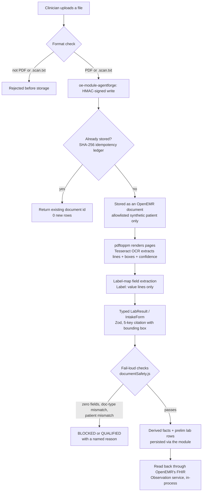
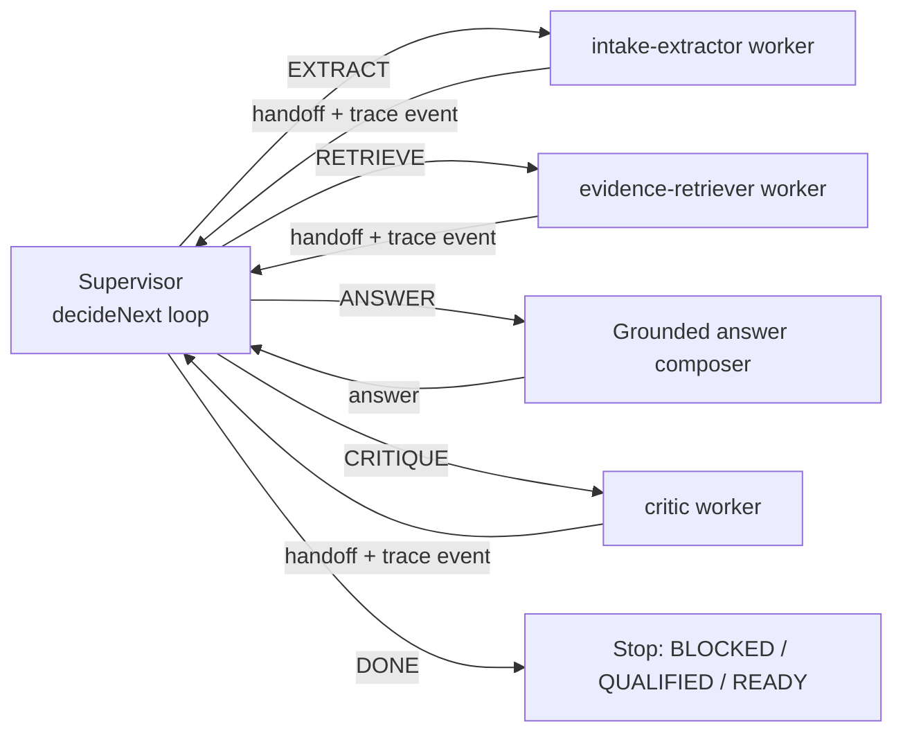
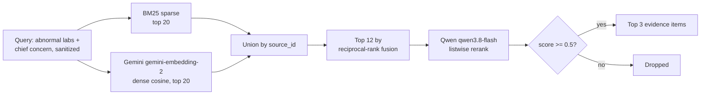
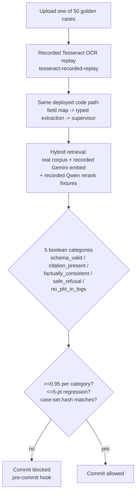

# AgentForge Week 2 architecture: the Clinical Co-Pilot

## 1. Summary

A primary-care physician is prepping for a follow-up visit. The chart has
structured OpenEMR data, but the new information — a scanned lab PDF and a
front-desk intake form — is buried in documents nobody has read yet. Week 2
gives the Week 1 chart-preparation agent two new abilities: it can read those
documents, and it can route the work across a small, inspectable graph
instead of one long function.

Upload flows through a server-side format check (PDF or a `.scan.txt` test
envelope, nothing else), into OpenEMR via the HMAC-authenticated
`oe-module-agentforge`, through local Tesseract OCR, into a Zod-typed
`LabResult`/`IntakeForm`, and out as either derived facts (persisted, with a
FHIR read-back) or a fail-loud refusal. A supervisor (`decideNext`) decides
when to extract, when to retrieve guideline evidence, and when the answer is
ready, logging its reason at every step. Evidence retrieval is a real hybrid
pipeline — BM25 sparse search unioned with dense embeddings, reranked, and
cut at a relevance threshold — over a 42-chunk corpus of verbatim public
guideline text. The answer composer asks a hosted model for grounded claims,
but the model's output is never trusted directly: every claim is
independently re-derived from exactly the facts and guideline text it cites
(structural claim binding, not an LLM judging its own homework), and a claim
that fails is dropped, with a deterministic, template-built answer standing
in when too much is dropped. A 50-case eval gate, enforced by a pre-commit
hook (there is no CI runner on this GitLab project), blocks any commit that
regresses schema validity, citation completeness, factual consistency, safe
refusal, or PHI-in-logs by more than five points.

The key decisions, and what they cost: the supervisor is a hand-rolled state
machine, not LangGraph, because four states with logged reasons are easier to
audit than a graph library's abstractions for a scope this small — see
Tradeoffs. Reranking runs on Qwen (`qwen3.8-flash`, thinking off), not
Gemini, because the Gemini key is free-tier (20 requests/day) and a listwise
rerank on every request would exhaust it in minutes; dense embeddings stay on
Gemini, behind a `Reranker` interface a real dedicated reranker (Cohere) can
replace without touching retrieval. OpenEMR writes go through a bind-mounted
module authenticated by HMAC, not an interactive OAuth write grant, because
provisioning one needs a human login this environment doesn't have. The
answer model is `qwen3.8-flash` rather than the larger `qwen3.8-max`, because
OCR (~6 s) and retrieval (~3.5 s) already spend most of a 25-second budget.

The trust stance follows from one rule in `AGENTS.md`: never give a
simulation the name of the real thing, and fail loudly rather than guess.
Zero extracted fields, a document-type mismatch, or a patient mismatch is
never `READY`. A degraded retrieval result says `sparse_only`, `no_rerank`,
or `stub` — never silently `hybrid`. An unverified claim is dropped, not
softened. This is a synthetic-data checkpoint, not a clinical product; the
next section says exactly where that line sits.

## 2. What this is not

> - **Synthetic data only.** Every patient, document, and lab value in this
>   system is fabricated for evaluation. No real PHI has ever been processed,
>   uploaded, or stored here.
> - **OCR tuned to fixed form layouts.** Local Tesseract reads the two label
>   layouts this project's fixtures use (`Label: value` lines). A different
>   layout — a table, a handwritten form, a real-world scan — extracts
>   nothing and the document is refused or qualified; it is not guessed at.
> - **Lab read-back does not use the OpenEMR FHIR HTTP API.** It calls
>   OpenEMR's own FHIR Observation service in-process, inside the module.
>   (The public FHIR API was enabled on 2026-09-25 for the patient dashboard
>   port, `PATIENT_DASHBOARD_MIGRATION.md`; the Co-Pilot does not depend on
>   it.)
> - **The Gemini key is Free Tier.** It is used for dense embeddings only.
>   Reranking, which would exhaust the free tier's daily quota, moved to
>   Qwen behind a pluggable interface.
> - **Lab results are persisted as preliminary (`prelim`).** They are
>   unreviewed AI extraction pending clinician review, and OpenEMR's FHIR
>   mapper reports them as `status: unknown`, never `final`.
> - **Week 1 is frozen** at `84f232b`, on its own route (`/agentforge`) and
>   its own pinned image. Nothing in this document changes it.
> - **There is no GitLab CI runner.** The enforced gate is the tracked
>   `.githooks/pre-commit` hook; `.gitlab-ci.yml` mirrors it for when a
>   runner exists but does not itself execute.
> - Whatever else this document, or the code it describes, calls out as a
>   gap, a degraded mode, or "wired, not yet observed live" is a real limit,
>   not a rounding error.

### Scope: how we read the PRD's "Core Deliverables" list

The PRD's "Core Deliverables" list (p. 5–6) puts ten items under one heading
with the same bullet. Elsewhere the same PRD calls this "a controlled
expansion of the Week 1 agent into two document types, two workers, and one
regression gate" (p. 4). It also says "A critic agent is extension work, not
core" (§4), and it closes by saying the best submissions "feel narrower than
the original spec and stronger because of it". We read the first five items
as core and the last five as extensions, and we built the core first. On
2026-09-26 the owner decided to build all ten (`docs/agentforge/PLAN.md`,
D12). The State column is current and is updated as each item lands.

| PRD item | Our reading | State |
|---|---|---|
| Two document types: lab PDF and intake form | Core | Built and live (§3a) |
| One supervisor and two workers | Core | Built and live (§3b) |
| Basic hybrid RAG plus rerank | Core | Built and live (§3c) |
| 50-case golden dataset with boolean rubrics | Core | Built (§3e, `EVAL_GATE.md`) |
| PR-blocking eval CI and an observable deployed demo | Core | Built: pre-commit gate (§3e), `/observability` |
| Critic agent that rejects uncited claims or unsafe action suggestions | Extension (§4) | Built, not yet observed live: an LLM critic that can only veto claims (`critic.js`, §3b). It runs after `verifyClaims` (§3d), which stays the authority, and can remove a claim as `UNCITED`, `UNSUPPORTED_BY_SOURCE` or `UNSAFE_ACTION`, never add or rewrite one. It is off until `AGENTFORGE_CRITIC_MODEL` is set on the VM (every answer then says `critic_status: disabled`). The extension suite checks the veto wiring with a fake critic model (`EVAL_GATE.md`); a real model's judgment is measured by `scripts/benchmark-critic-models.mjs`, not by the gate. |
| Click-to-source UI with a simple document preview | Extension | Built: the scan result shows the PDF pages with a box per cited field; a citation's "View source region" link highlights its box (`ui.js`, `renderScanSourcePreview`). The page-image route is checked live (`docs/agentforge/evidence/LEDGER.md`, W2-C8); the drawn overlay has not yet been observed on the public URL. |
| A third document type (referral fax, medication list) | Extension | Not built. Two types that work reliably come first (PRD, "Common Pitfalls"). |
| Lab trend chart from extracted Observation data | Extension | Not built. Extracted labs are persisted and readable as FHIR `Observation` (§3a), which is the data such a chart would use. |
| Contextual retrieval improvements (better chunking, query rewriting, domain filters) | Extension | Query rewriting built and measured (§3c): lab test names are expanded into condition words for BM25. It changes results only where BM25 alone ranks (the `local-lexical` provider and the hybrid `sparse_only` fallback), not the normal hybrid path. Two extension cases guard it. Contextual chunk headers were measured and changed nothing, so they are off. No domain filter. Not yet observed on the public URL. |

## 3. How it works

### (a) Document ingestion flow

Uploads are rejected before storage unless the content is a PDF or the
hand-authored `.scan.txt` test envelope that carries the same tagged-field
shape the OCR step produces (`sourceDocuments.js` restricts `document_type`
to `lab_pdf`/`intake_form`; `service.js`'s `prepareScanSource` is the only
path into extraction). Storage itself goes through
`interface/modules/custom_modules/oe-module-agentforge/public/api.php`, an
internal-only endpoint Caddy answers 404 for everywhere else in that module
directory; every request is signed with HMAC-SHA-256 over a canonical string
(method, route, patient uuid, body hash, timestamp, nonce, query,
context-token hash — `openemrModuleClient.js`) using a key derived from
`AGENTFORGE_MODULE_HMAC_SECRET`, held only by `openemr` and `agentforge-w2`.
Every write is limited to `AGENTFORGE_DEMO_WRITE_PATIENT_UUIDS`, whatever the
caller's token issuer, and a write needs a write-scoped token — a read-scoped
one gets `persistence_not_authorized`, never a silent success.

Idempotency is a SHA-256 of the document content: re-uploading the same
bytes returns the same OpenEMR document id and adds zero new rows
(`openemrModuleWriteback.js`; proven live by `w2-openemr-smoke.mjs`, 48/48
checks). OCR is real `pdftoppm` + Tesseract 5.5.2 in production; the 50-case
gate and unit tests replay OCR recorded once from that exact stack
(`tesseract-recorded-replay`) so they run deterministically on machines
without the binaries (Windows, most graders), while a separate parity test
re-runs live OCR wherever the tools exist and fails on drift. Each field
carries the OCR confidence of the line it came from; a field below 0.85
confidence is flagged `low_confidence_requires_human_review` rather than
shown as verified. `documentSafety.js`'s checks run after every extraction:
zero facts or a patient-identity mismatch (name/DOB read from the document
vs. the chart) is `BLOCKED`; a doc-type mismatch, an unverifiable identity,
or an incomplete extraction is `QUALIFIED` — the workflow never reports
`READY` on any of these. Only after that gate passes does the service
persist a derived-facts JSON document and, for a lab PDF, one
`procedure_order`/`_report` plus one `procedure_result` per LOINC-mapped
result, all marked `prelim`. Read-back is OpenEMR's own FHIR Observation
service called in-process (`read_path: openemr-fhir-service-in-process`) —
the deployment's `/fhir` HTTP API stays disabled, so this is not that API.

### (b) Worker graph

`supervisor.js#decideNext(state) -> {next, reason}` is a pure function called
in a loop; every decision is pushed to `workflow.decisions[]` and traced —
"routing decisions inspectable" is a Week 2 requirement, not a nice-to-have.
The reasons it can return:

| Condition | `next` | `reason` |
|---|---|---|
| No extraction yet, none cached | `EXTRACT` | `extraction_needed` |
| No extraction yet, cached for this content hash + OCR mode | `EXTRACT` | `extraction_cached` (loads the cache; still an extraction, not a `RETRIEVE`) |
| Extraction just ran, fail-loud check blocks | `DONE` | the blocking reason (`patient_mismatch`, `no_fields_extracted`, `extraction_contract_invalid`) |
| Extraction valid, mean confidence < 0.7, no retry yet | `EXTRACT` | `low_confidence_retry` (re-OCRs once at Tesseract `--psm 4`, keeps whichever result has the higher mean confidence and is not contract-invalid) |
| Facts ready, question is a pure record lookup ("what was the hemoglobin value?") | `ANSWER` | `record_lookup_only` (RETRIEVE is skipped entirely) |
| Facts ready, ordinary question | `RETRIEVE` | `evidence_needed` |
| Facts and (if not skipped) evidence ready | `ANSWER` | `facts_and_evidence_ready` |
| Loop safety cap (7 steps: the longest normal path, EXTRACT, retry, RETRIEVE, ANSWER, CRITIQUE, DONE, takes 6) hit | `DONE` | `max_steps_reached` (QUALIFIED, never BLOCKED — whatever was gathered is still returned) |
| Answer composed, critic configured, answer has claims, scan budget left ≥ critic timeout | `CRITIQUE` | `answer_needs_review` |
| Answer composed, no critic model configured | `DONE` | `critic_disabled` (answer labeled `critic_status: disabled`) |
| Answer composed, no claims | `DONE` | `no_claims_to_review` (`skipped_no_claims`) |
| Answer composed, scan budget left < critic timeout | `DONE` | `critic_skipped_budget` (`skipped_budget`; the deadline is never widened) |
| Critic has run | `DONE` | `critique_reviewed` or `critique_failed` |

The extraction cache is keyed by a SHA-256 of the extracted content plus the
OCR mode, not by document id, so a re-uploaded or re-fixtured document with
identical bytes still hits the cache; it is bounded to 50 entries with FIFO
eviction. `isRecordLookupQuestion` has one canonical definition (imported by
both the supervisor and the answer composer, so they cannot silently
disagree): a direct "what is/was the X value/result/level" question, unless
it also names a guideline-seeking word (target, recommended, threshold,
normal, abnormal, should) — "What is the target A1C value?" still retrieves
evidence.

The two workers: `runExtractionWorker` (`activeWorkers.js`) wraps the OCR →
label-map → typed-extraction pipeline behind a fixed input/output contract;
`runEvidenceWorker` formulates its own query from this document's abnormal
lab results and intake chief concern (a client-supplied `message` is only
ever appended, never sent as the query verbatim) and calls the injected
guideline retriever. A pure record-lookup question skips it entirely — no
guideline call is made when the answer needs none. Every retrieval attempt
is recorded on the trace with the provider that actually answered (which may
have degraded mid-call), never a static label.

The critic worker (`critic.js#runCriticWorker`, E2) is an LLM critic that can
only veto claims. It gets each shipped claim's text and the `quote_or_value`
strings of its citations, which the clinician already sees, and nothing else:
no patient reference, document id, name, date of birth or phone. A claim
citing a patient-identity field (`patient.name`, `patient.date_of_birth`,
`patient.phone`, an address and the like; not `lab.*.test_name` or a
medication name) is not sent; it ships unreviewed and is counted in the
answer's `critic_claims_not_sent`. If every claim is held back, the status is
`skipped_identity_only`. The composer already keeps demographics out of
claims, so this is a defense-in-depth path. It must return strict JSON with
one verdict per claim: `keep`, or `reject` with `UNCITED`,
`UNSUPPORTED_BY_SOURCE` or `UNSAFE_ACTION`. Verdicts are applied by claim
index; the critic's own text is never read back, and a verdict for a claim it
was not sent is ignored. A rejection is final: every fact or guideline chunk
a rejected claim cited is barred, so neither the composer's deterministic
top-up nor any fallback can bring a claim citing it back, whatever its text.
The top-up may still fill a gap for a fact no rejected claim cited; such a
claim was added after the critic ran and is counted in
`critic_topup_unreviewed`, not as reviewed. If the vetoes remove every claim,
the answer ships with none. `critic_rejected` equals the number of claims
removed from what ships, and the UI shows it together with any unreviewed
count. Why a model next to `verifyClaims`: the
verifier is structural and has known gaps (a verbatim guideline span is exempt
from its directive check; its directive patterns are a fixed list, so "The
patient has to be taking lisinopril 10 mg daily." passes). The critic is a
second, fallible check on those gaps, not proof of correctness.
`critic_status` on the answer is `reviewed` only when the model returned a
valid verdict for every claim sent; a provider error, timeout, the scan
deadline or invalid JSON is `failed`, and the answer then ships exactly as the
verifier left it. The provider is the OpenRouter lane with its own env
(`AGENTFORGE_CRITIC_MODEL`, no default; `AGENTFORGE_CRITIC_TIMEOUT_MS`,
default 4000). The trace gets a `critic` stage, a model-usage entry and a
`critic` block with status, duration, tokens, cost (`null` with
`cost_source` when the model has no known price) and verdict counts by
reason code, claims removed and claims topped up unreviewed; no claim text.
A failed or budget-skipped critic makes the per-encounter runtime evaluation
`degraded`; claims shipped unreviewed (held back or topped up) make it
`needs_review`.

### (c) RAG design

The corpus (`agentforge/corpus/guidelines/corpus.json`, verified by
`verify-corpus.mjs`) is 42 chunks of verbatim, contiguous, public-domain text
from USPSTF, CDC, NIDDK, NHLBI, and NLM MedlinePlus, each chunk's exact
source URL, section, and stated date recorded alongside it — no paraphrase,
no splicing across non-adjacent text. `guidelineEvidence.js`'s
`createGeminiHybridGuidelineRetriever` unions real BM25 (Okapi, IDF, k1/b)
candidates with real cosine-similarity candidates over precomputed corpus
embeddings (`corpus/embeddings.json`, built offline against a live Gemini
key, never rebuilt by the deployed server), fuses the union by
reciprocal-rank (`k=60`) down to the best 12, and sends only those 12 to a
listwise reranker — a full candidate list overflowed Qwen's output budget
live (`RERANK_JSON_INVALID`) before that cap was added. The reranker prompt
asks for short candidate numbers (`{"n": 3, "score": 0.8}`), not the
candidates' own hyphenated ids, for the same reason: long ids cost enough
output tokens to truncate the JSON. Results below a 0.5 relevance threshold
are dropped; at most 3 survive.

Dense retrieval and reranking are independent collaborators behind a
`Reranker` interface (`reranker.js`) — an owner decision (2026-09-24) made
because the Gemini key is free-tier (20 requests/day, 5/minute) and a
listwise rerank on every request would exhaust it immediately. Reranking
therefore defaults to Qwen (`AGENTFORGE_RERANK_PROVIDER=qwen`); a Gemini
reranker adapter and a real, working Cohere adapter both exist behind the
same interface (Cohere is implemented and unit-tested but not deployed — it
proves the seam, not a live choice). Before anything leaves the process for
an external call, the query is reduced to words this corpus's own vocabulary
recognizes (`sanitizeForExternalModel`) — a name, DOB, phone number, or any
other free text a clinician typed is dropped, never sent to Gemini or Qwen;
the unsanitized query still runs against local BM25, which never leaves the
process. Every degraded mode is labeled honestly and never silently
relabeled as a full hybrid result: `sparse_only` (no embeddings/reranker
configured, or the embed step failed), `no_rerank` (dense succeeded but the
reranker failed — the already-paid-for dense signal is kept via
reciprocal-rank fusion rather than thrown away), or `stub` (the pipeline ran
its full shape, but a step used the deterministic test/gate stand-in because
no matching recorded fixture existed).

**Contextual retrieval (E3, X-5).** `node agentforge/scripts/benchmark-retrieval.mjs`
scores 22 labeled queries (`agentforge/test/fixtures/retrieval-benchmark.json`,
built from the golden documents' findings, chief concerns and clinician
questions) offline, with no key. Only BM25 can be scored on all 22. The
dense, `no_rerank` and full hybrid stages are scored only where a recorded
Gemini embed (and, for the full pipeline, a recorded Qwen rerank) exists for
that exact request: 7 of the 22. A query without a recording is counted as
unmeasured, not scored from the stub.

- *Query rewriting, kept.* `retrievalContext.js#queryExpansionTerms` adds the
  condition words for each lab test the query names (A1C adds diabetes,
  prediabetes, glucose and sugar; hgb or hemoglobin adds anemia, hematocrit
  and iron), from `RETRIEVAL_QUERY_EXPANSIONS` in `clinicalVocabulary.js`. A
  test's words are skipped when the query already names its condition.
  Without that rule the expansion outweighed a question's own words ("How
  often should HbA1c be repeated…" lost its answer from first place). The
  added words come from a fixed list, never from the query, and are used
  only by the local BM25 search. BM25 on the 22 queries: recall@3 0.886 →
  0.939, MRR@3 0.879 → 0.909, hit@1 0.773 → 0.818, with no query worse.
- *Where it applies.* It changes the answer only when BM25 ranks alone: the
  `local-lexical` provider and the hybrid retriever's `sparse_only` fallback
  (embed call failed or no embeddings). The hybrid rerank pool keeps the
  unexpanded BM25 ranking on purpose. Expanding it lowered pool recall@12
  (1.000 → 0.976) on the 7 measurable queries, and it would have changed 5 of
  the 14 rerank requests the gate replays from recorded fixtures. In the
  normal deployed hybrid path, the expansion therefore changes nothing: the
  embed text, the rerank text, the rerank pool and the corpus embeddings are
  the same as before, and no fixture needs re-recording.
- *Contextual chunk headers, not kept.* Indexing a `publisher | title |
  section` header changed no BM25 ranking. BM25 already indexed title and
  section, and the corpus embeddings were already built from title, section
  and text with the title passed to Gemini, so re-embedding (42 requests, one
  per chunk; `build-corpus-embeddings.mjs` does not batch) would buy nothing.
- *Domain filter: not built.* The benchmark gave no case it would fix.

Guarded by `x5-retrieval-lexical-hgb-question` and
`x5-retrieval-hybrid-fallback-both-findings` in the extension suite; turning
the expansion off fails both
(`docs/agentforge/evidence/E3-retrieval-regression.txt`).

### (d) Verification and the grounded answer

`claimBinding.js#verifyClaims` is structural claim binding, not an LLM
judging its own output: each claim's citation must resolve by exact
`source_id` + `field_or_chunk_id` to an allowed fact, and the claim text
must then be derivable from exactly what that citation points to.
`patient_fact` claims may cite only `document`/`openemr_record` sources;
every cited value must appear verbatim (normalized for case, spacing, and
unit formatting); every other word must be a neutral reporting word or come
from the cited value itself (a closed vocabulary); an interpretive word
(high/low/critical) needs a typed abnormal flag or reference range behind
it; a negation needs a cited value that is itself negated. `guideline`
claims may cite only `guideline` sources and must contain a verbatim span of
at least 8 words from the cited chunk; a lab-name alias map
(`LAB_NAME_ALIASES`) is scoped to the specific cited result, not applied
globally. Directive language (imperative, second-person, or a
recommendation to act) fails in either kind. A claim that fails any of this
is dropped, and the drop count survives as `unverified_dropped` even through
a fallback.

**The composer's output contract.** The prompt lists every fact and
guideline chunk once, each with a short label (`F1`, `F2`, ... for patient
facts; `G1`, `G2`, ... for guideline chunks). The model returns `{claims:
[{kind, text, refs: ["F1"]}]}`: it cites by label only and never echoes a
citation object. `answerComposer.js#materializeClaims` resolves each label
to the exact 5-key citation it names, drops any label that is not listed,
and only then runs `verifyClaims`, unchanged. The model is never trusted to
reproduce an id or a quote. An earlier contract asked it to echo full
citation objects per claim; one live call spent more than 14 s generating
whole guideline chunks back and was cut off by the request deadline. Label
references cut the prompt by about 45% and the expected output by about 70%
on the golden lab + intake case. A test pins the failure mode: mapping an
unknown label to "the first fact" must fail.

The prompt states the verifier's rules instead of leaving the model to
discover them by rejection. Each fact line ends with the exact text the
claim must contain; the prompt lists the closed framing vocabulary and
requires an 8-word verbatim run for guideline claims. The verifier itself is
unchanged. Measured with the real `qwen3.8-flash` inside the deployed
container on four golden documents, twice each: before, 31 of 59 model
claims verified (52%), and none of the 28 rejections was an invented value;
every one was a paraphrase or a split lab the verifier cannot bind. After,
22 of 24 verified (92%). The model now proposes fewer claims (about 3 per
answer instead of 7) and the deterministic top-up fills the rest, so most
answers are labeled `model+deterministic-topup`.

If the model's own claims all fail verification, the composer falls back
to `DeterministicAnswerComposer`, which builds claims directly from the
typed facts using a closed, pre-approved vocabulary so they are guaranteed
to verify. If the model verifies *something* but missed facts or evidence
that were actually available, those specific gaps are filled
deterministically (`composer: 'model+deterministic-topup'`) rather than
left out. `model_rejected_reason` records why a real model's output could
not be used as-is (`invalid_json`, `provider_error`,
`all_claims_unverified`, or `deadline`). Facts below 0.85 confidence are
excluded from claims entirely and listed under `needs_review`. Demographics
(name, DOB, phone, sex) never reach the prompt or the model's claims — they
are identity data, already checked by `documentSafety.js`, not a clinical
finding. The result separates `patient_facts` from `guideline_evidence`, per
the assignment's "separate patient-record facts from guideline evidence."
The server validates this exact shape before persisting anything derived —
an invalid answer is a 500, never an unvalidated write.

### (e) Eval gate

The gate (`npm run eval:gate --prefix agentforge`, 50 cases, 9-13 per
category) runs the exact deployed code path — `AgentForgeService
.ingestSourceDocument` → OCR → field map → typed extraction → supervisor and
workers → the same HTTP response validator `server.js` applies — on 10
golden PDFs plus `.scan.txt` fixtures. The one non-live step is OCR itself,
replayed from a real Tesseract 5.5.2 recording made once inside the exact
`Dockerfile` image, so the gate is deterministic on machines without the
binaries; a separate parity test re-runs live OCR wherever the tools exist
and fails on drift. Guideline retrieval, as of this commit, is **not** the
deterministic stand-in every earlier checkpoint used: `test/fixtures/
retrieval/COMPLETE.json` records a completed fixture set (42-chunk corpus
embeddings fingerprint, `alibaba-qwen`/`qwen3.8-flash` rerank fixtures for
15 queries), and `w2RegressionGate.js` uses those real recorded vectors and
rerank results whenever the fingerprint and rerank provider/model match the
gate's own configuration — falling back to the deterministic stand-in only
on a mismatch, never silently. The gate as it runs today exercises real
hybrid retrieval scores and a real rerank ordering, recorded rather than
live.

Thresholds (`JUDGE_CONFIG` in `w2RegressionGate.js`): every category at or
above 95%, no more than a 5-point drop from the committed baseline, zero
tolerance on `no_phi_in_logs`, and exactly 50 cases with a case-set hash
(covering thresholds, case specs, the manifest, every truth file and OCR
recording, and the guideline corpus) that must match the baseline or the
gate fails until an explicit `--update-baseline` run. The current committed
baseline is 50/50 across schema_valid (9), citation_present (9),
factually_consistent (11), safe_refusal (12), and no_phi_in_logs (9).
`docs/agentforge/evidence/W2_REGRESSION_MATRIX.md` re-runs the gate against
29 independently chosen regressions (16 from an external review, 10 more
from a second reviewer, plus 3 added while fixing the first two rounds) on a
scratch copy of the tree: the no-edit control (R0) passes every check, and
all 29 regression rows fail the gate alone — most fail unit tests too, but
four (N1, N2, N5, X1) are caught only by the gate, because they depend on
the OCR recordings, the truth files, or the retrieval ranking that only a
full end-to-end run exercises. A separate trust-probe suite
(`npm run eval:trust-probes`) exercises 10 adversarial answer-claim probes
(invented value, misquoted field, borrowed value, paraphrased guideline,
patient fact cited to a guideline, treatment directive, low-confidence fact
shown as verified, unsupported negation, uncited claim) and reports 10/10
blocked. The enforced gate is `.githooks/pre-commit`
(`git config --local core.hooksPath .githooks`); this GitLab project has no
CI runner, so `.gitlab-ci.yml` mirrors the same checks for when one exists
but does not itself run them.

**How quality was earned.** The gate started at 6 of 16 caught regressions
and reached 29/29 only after two independent reviewers added their own
regression rows on top of the original set, forcing real end-to-end
assertions (OCR-recording content, retrieval ranking, trace redaction)
rather than shape checks. Live deploys found bugs unit tests never would:
the "thinking off" flag for the answer model was read under the wrong
environment-variable name for a while, so every deployed answer paid the
full reasoning-latency cost silently; the Gemini key's free-tier daily quota
was discovered by exhausting it in testing, not by reading documentation
first; a config mistake briefly mixed a real embedding client with a stub
reranker and vice versa, producing a `provider` label that looked hybrid but
wasn't; a long candidate-id scheme truncated the reranker's JSON output mid
list on any request with enough candidates; and the answer composer echoing
full citation objects (rather than short labels) cost enough tokens to blow
the request deadline on one real run. The lesson that generalizes: never
make an LLM echo long identifiers or exact quotes back — give it short
labels (a candidate number, a fact tag) and resolve them to the real values
server-side, where a bug is a rejected id, not a truncated response.

## 4. Tradeoffs

**Hand-rolled supervisor vs. LangGraph.** *Chose:* a four-state pure function
(`decideNext`) called in a loop, with every decision pushed to a trace array.
*Gave up:* LangGraph's built-in state persistence, streaming, and ecosystem
of pre-built nodes; adding a fifth worker means extending this loop by hand,
not composing a library primitive. *When we'd switch:* if the graph grows
past a handful of states with real branching (parallel workers, retries with
backoff policies, human-in-the-loop interrupts), a pure function stops being
easier to audit than a library built for exactly that, and the trade
reverses.

**Structural claim binding vs. LLM-as-judge.** *Chose:* `verifyClaims`
re-derives each claim's content from exactly its cited values by token- and
number-level matching — no second model call, no judge prompt. *Gave up:*
semantic entailment. The checker cannot tell that "1,000 mg" and "1 g" are
the same value, cannot resolve "last week" against a stored date, and can be
fooled by a claim that juxtaposes two true cited facts in a misleading
order. *When we'd switch:* if the fail-closed number/unit gaps above start
rejecting a meaningful share of genuinely correct claims in practice (not
observed yet — the current fallback path absorbs every current rejection
into a deterministic answer), an LLM-as-judge layered *on top of*, not
instead of, structural binding would close that gap without giving up the
never-fooled-by-fluent-language property.

**Local Tesseract OCR vs. a VLM.** *Chose:* `pdftoppm` + Tesseract, tuned to
the two label layouts these fixtures use, because it is free, runs
in-process with no external call to gate on, and its confidence-per-line
output is exactly what the low-confidence-retry and review-flagging logic
needs. *Gave up:* everything Tesseract can't read — tables, handwriting, or
any layout that doesn't follow `Label: value` lines — extracts nothing and
is refused, not guessed. A free small local VLM was tried and scored 0/8 on
a redacted crop benchmark; a larger local VLM (PaddleOCR-VL via llama.cpp)
recovered 8/8 values as raw text but failed the typed JSON contract at 0/8.
*When we'd switch:* once a managed VLM's output can be forced through the
same schema, quote-verification, and bounding-box checks Tesseract's output
already passes — not before, since an ungated VLM output is exactly the
"hallucinated field label with overstated confidence" the assignment warns
about.

**HMAC module writes vs. OAuth write scopes.** *Chose:* `oe-module-agentforge`
verifies an HMAC-SHA-256 signature over a canonical request string, using a
key derived from a shared secret held only by `openemr` and `agentforge-w2`.
*Gave up:* OpenEMR's own OAuth scope model for writes — the saved OAuth
token in this environment has read scopes only, and provisioning a
write-scoped one needs an interactive OpenEMR login this deployment doesn't
have set up. *When we'd switch:* once a write-scoped OAuth client can be
registered and a token refreshed non-interactively, that becomes the
standard path and the HMAC scheme narrows to what it should always have
been — a fallback for environments that can't do interactive OAuth grants,
not the primary write path.

**Provider table**

| Role | Provider (deployed default) | Fallback / trigger |
|---|---|---|
| Answer composer | `qwen3.8-flash`, thinking off (`AGENTFORGE_MODEL_*`) | Deterministic composer on invalid JSON, provider error, all-claims-unverified, or a per-request deadline (`AGENTFORGE_SCAN_DEADLINE_MS`, default 25 s). Not `qwen3.8-max`: OCR (~6 s) + retrieval (~3.5 s) leave too little of the budget for the larger model's ~2x latency. |
| Dense retrieval | `gemini-embedding-2` (Gemini, free tier) | `degraded: sparse_only` if the key, the precomputed embeddings file, or the embed call itself is missing/fails. |
| Reranker | `qwen3.8-flash` via the `Reranker` interface (`AGENTFORGE_RERANK_PROVIDER=qwen`) | `degraded: no_rerank` (sparse+dense reciprocal-rank fusion) if only the reranker fails; a real Cohere adapter exists behind the same interface for a later swap. |
| OCR | Tesseract 5.5.2 + `pdftoppm`, local, in-process | None — this is the only extraction path; an unreadable document is refused (`document_unreadable`, HTTP 422), not retried against another engine. |

## 5. Risks

| Risk | Likelihood / impact | Mitigation | Residual |
|---|---|---|---|
| A real-world document layout (table, handwriting, non-fixture form) extracts zero or wrong fields | High likelihood outside the two fixture layouts / high impact if unnoticed | `documentSafety.js` blocks on zero fields and qualifies on a doc-type mismatch; low-confidence fields are flagged, not shown as verified | Layouts within the fixed label-map schema but with subtly different labels than the map recognizes can still silently extract nothing for that field, distinct from the loud zero-field case |
| Free-tier Gemini quota (20 req/day) exhausted mid-demo | Medium likelihood under real traffic / medium impact (degrades, doesn't fail) | Reranking already moved off Gemini to Qwen; dense retrieval degrades to `sparse_only`, honestly labeled, never a crash | A burst of dense-embedding calls can still exhaust the daily quota faster than expected; no backoff/queueing exists yet |
| Structural claim binding rejects a true claim on a formatting edge case (unit conversion, non-decimal number) | Medium likelihood / low-medium impact (falls back, doesn't fabricate) | Deterministic top-up and full fallback absorb every rejection into a still-correct answer, never a gap the clinician doesn't see | The physician sees a less fluent, template-built sentence more often than a model-composed one whenever this triggers |
| OpenEMR module write partially fails after the file is written (rollback race) | Low likelihood / medium impact | `write_failed` is returned rather than a silent partial success; the ledger transaction is what's rolled back | An orphaned encrypted file can remain under `sites/default/documents/<pid>/`, referenced by no `documents` row, until manually cleaned up |
| No CI runner means the pre-commit hook is the only enforcement point | Low likelihood of bypass (hook is tracked and required by AGENTS.md) / high impact if bypassed (`--no-verify`) | `.gitlab-ci.yml` mirrors the hook so a runner can be turned on without new authoring; AGENTS.md forbids weakening either gate | A contributor who skips hook installation (`git config --local core.hooksPath .githooks`) or force-pushes with `--no-verify` is not blocked by anything server-side today |
| OCR + retrieval + the answer model together exceed the request deadline on a large document | Medium likelihood as claim counts grow / medium impact (falls back to deterministic on deadline, not a hang) | Label-reference output contract (§3d) keeps model output short; `AGENTFORGE_SCAN_DEADLINE_MS` bounds the whole request and forces a deterministic answer past it | A slow provider day turns more answers into template-built ones; the live model-vs-fallback rate is tracked in `KEY_METRICS.md` |

## 6. Links

- [`KEY_METRICS.md`](KEY_METRICS.md) — north-star and supporting metrics, guardrails, and their measurement sources.
- [`EVAL_GATE.md`](EVAL_GATE.md) — full rubric, thresholds, and known limits of the 50-case gate.
- [`docs/agentforge/PLAN.md`](docs/agentforge/PLAN.md) — the decision record (D1-D11) and execution slices this document describes.
- [`docs/agentforge/evidence/W2_REGRESSION_MATRIX.md`](docs/agentforge/evidence/W2_REGRESSION_MATRIX.md) — the 29-row regression proof.
- [`deploy/vultr/README.md`](deploy/vultr/README.md) — deployment topology, secrets, and every optional provider lane.
