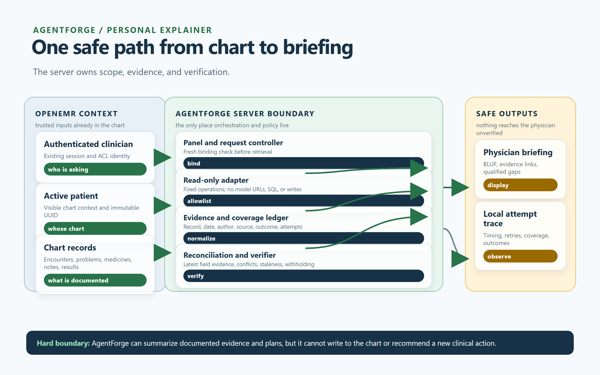
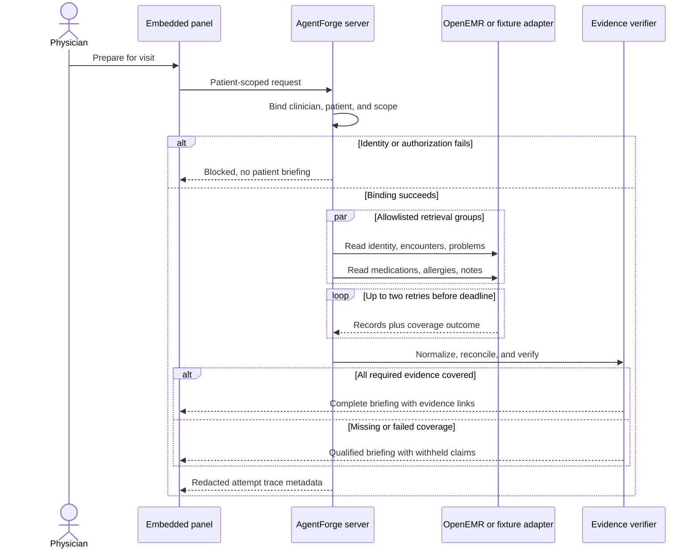
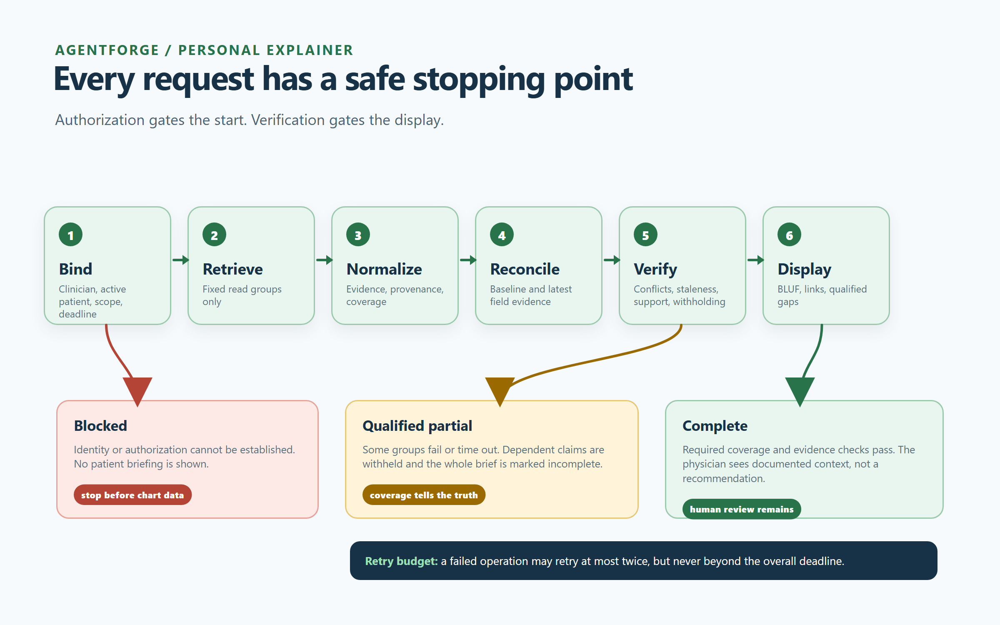

# AgentForge architecture

## Executive summary

AgentForge is a read-only, clinician-reviewed preparation layer embedded in
OpenEMR. Its first workflow is a primary-care physician preparing for a
returning patient's visit. The system accepts an already authenticated
physician, the visibly active patient, and a patient-scoped request. It checks
that binding before any chart retrieval, retrieves only the record groups
needed by the briefing, normalizes every result into an evidence object, and
produces a compact orientation followed by documented changes since the
comparison baseline. A separate verification stage checks patient scope,
provenance, dates, coverage, claim support, and discrepancy status before the
result can be displayed.

The narrowest OpenEMR seam is a custom module with a server-side adapter and a
small controller owned by AgentForge. The module is the embedded-panel and
session boundary; the adapter is the only component allowed to call OpenEMR
data services. This keeps model or presentation code away from general API
routes, SQL, arbitrary URLs, and write methods. The adapter may use existing
OpenEMR service classes in-process for the local demonstration, but it must
reapply authorization and active-patient binding at the AgentForge boundary.
The existing REST and FHIR routes remain useful integration references and a
future external deployment seam, not a model-facing tool surface.

Stage 5 starts with a fixture adapter and deterministic evaluator/renderer.
The seven synthetic cases in `fixtures/clinical-cases.json` exercise complete,
duplicate, conflicting, stale, missing-provenance, untrusted-note, and partial
retrieval behavior without loading data into OpenEMR. A future model provider
can be placed behind the same bounded synthesis interface only after provider,
retention, BAA, and PHI decisions are made. Until then, no hosted LLM or PHI
processing is part of the architecture.

Every retrieval group writes an attempt trace containing correlation ID,
patient and clinician references in redacted form, operation name, outcome,
duration, retry number, and coverage. It does not write raw chart content by
default. A successful empty result is distinct from no prior visit, failed,
timed-out, unauthorized, and not-requested coverage. The retry budget is at
most two automatic retries per failed operation and is always constrained by
the overall deadline. Partial results are prominently qualified; claims that
depend on unavailable evidence are withheld. Failure to establish identity or
authorization blocks the briefing entirely.

The UI exposes the active patient and authorization state, an overall
complete/qualified/partial disposition, a short orientation, and expandable
BLUF sections for changes, plans, discrepancies, and missing coverage. Each
displayed claim links to a server-resolved source reference showing record
type, author when available, exact date, and supporting excerpt or original
record. AgentForge never writes notes, diagnoses, medications, orders,
appointments, messages, or other patient data and never treats chart text as
an instruction.

## Observed OpenEMR integration surface

The code inspection supports the following boundaries:

| Observed surface | Evidence in this repository | Architectural consequence |
| --- | --- | --- |
| Standard API routes expose separate patient, encounter, SOAP-note, problem, allergy, medication, and document operations. | `apis/routes/_rest_routes_standard.inc.php` lines 76-510 | AgentForge needs a composed adapter and coverage ledger; no single route represents a visit brief. |
| Standard routes contain both read and write methods. | `apis/routes/_rest_routes_standard.inc.php` lines 84-185, 233-325, and 504-510 | The adapter has a compile-time/read-only allowlist containing GET-equivalent reads only; POST/PUT/PATCH/DELETE are unreachable. |
| Route authorization is checked through ACLs, while OAuth scopes are checked separately. | `src/RestControllers/Config/RestConfig.php`; `src/Common/Http/HttpRestRouteHandler.php` | AgentForge performs an explicit authorization check before orchestration and records its result; a logged-in browser session is not assumed to authorize an API call. |
| FHIR patient-context requests carry a patient UUID and route handlers pass it to resource controllers. | `apis/routes/_rest_routes_fhir_r4_us_core_3_1_0.inc.php` lines 73-94; `src/Common/Http/HttpRestRequest.php` lines 544-605 | Patient context must be explicit and immutable for one run. Patient switching creates a new binding and a fresh check. |
| OpenEMR services accept patient-bound searches for several resources, but identifier shapes differ. | `src/Services/EncounterService.php` lines 152-185; `src/Services/ConditionService.php` lines 121-178; `src/Services/PatientService.php` lines 632-646; `src/Services/DocumentService.php` lines 96-121 | Normalize UUID/PID at the adapter boundary; never let a model choose identifiers or filters. |
| Custom modules register namespaces and subscribe to menu/patient-menu events. | `interface/modules/custom_modules/oe-module-dashboard-context/openemr.bootstrap.php`; `oe-module-prior-authorizations/openemr.bootstrap.php` | The embedded panel belongs in a custom module, with a patient-menu entry guarded by clinician ACL. |
| Existing health probes cover installation, database, filesystem, session, OAuth keys, and cache. | `meta/health/index.php`; `src/Health/HealthChecker.php` | AgentForge readiness must add adapter, verification, and local trace-store checks; OpenEMR `ready` alone is insufficient. |

The standard API is a viable later network seam only if the adapter owns an
OAuth/API credential, sends patient-scoped requests, validates every response,
and rejects every non-read operation. The first embedded implementation avoids
that extra network and credential surface while preserving the same normalized
adapter contract for later replacement with an HTTP client.

## 🧩 Component boundaries and data flow

_System boundary diagram showing where patient scope is checked, where OpenEMR
data is normalized, and where only verified claims can leave the server._

```mermaid
flowchart LR
    accTitle: AgentForge component boundaries
    accDescr: Authenticated OpenEMR context enters a server-side AgentForge boundary, passes through an allowlisted adapter and evidence verifier, and exits only as a qualified physician briefing plus a redacted attempt trace.

    subgraph openemr_context[OpenEMR context]
        clinician_session[Authenticated clinician session]
        active_patient[Active patient context]
        chart_sources[Chart source records]
    end

    subgraph agentforge_boundary[AgentForge server boundary]
        panel_controller[Panel and request controller]
        read_adapter[Read-only adapter]
        evidence_ledger[Evidence and coverage ledger]
        verifier[Reconciliation and verifier]
    end

    subgraph safe_outputs[Safe outputs]
        physician_brief[Qualified physician briefing]
        local_trace[Local redacted attempt trace]
    end

    clinician_session --> panel_controller
    active_patient --> panel_controller
    panel_controller -->|fixed patient binding| read_adapter
    chart_sources -->|allowlisted reads| read_adapter
    read_adapter -->|records and outcomes| evidence_ledger
    evidence_ledger --> verifier
    verifier -->|verified claims only| physician_brief
    verifier --> local_trace

    classDef context fill:#e8f0f7,stroke:#315a75,color:#173247
    classDef boundary fill:#e9f5ef,stroke:#28734a,color:#163d29
    classDef output fill:#fff3d9,stroke:#9a6a00,color:#4d3500
    class clinician_session,active_patient,chart_sources context
    class panel_controller,read_adapter,evidence_ledger,verifier boundary
    class physician_brief,local_trace output
```





_Figure 1: The adapter is the only chart-data caller; the verifier is the only
path to a displayed claim._

## 🔒 Safety-critical request lifecycle

_Sequence diagram showing the normal path, the authorization stop, bounded
retrieval retries, and the qualified partial-result path._





_Figure 2: Authorization failure blocks the briefing; retrieval failure can
produce only a prominently qualified result._

The adapter owns the fixed operation map. Initial groups are `identity`,
`encounters`, `problems`, `medications`, `allergies`, `notes`, and any later
group explicitly added with a use-case mapping. Each operation receives the
immutable `patient_uuid`, the authenticated `clinician_uuid`, the comparison
baseline, and a deadline. It returns records plus a coverage outcome; it never
returns a free-form tool result.

## Canonical contracts

### Prepare request

```json
{
  "correlation_id": "opaque-request-id",
  "clinician_uuid": "authenticated-user",
  "patient_uuid": "active-patient",
  "demo_token": "server-verified-short-lived-context",
  "case_id": "synthetic-case-id"
}
```

The server creates the correlation ID if the caller does not supply one. The
`demo_token` is a short-lived signed user-context assertion; the server
verifies it and binds the clinician, active patient, read scope, issuer,
authentication method, role, and expiry before retrieval. The client cannot
provide SQL, a URL, an HTTP method, an arbitrary resource name, a second
patient identifier, or a body-level authorization claim. Comparison baseline
and visit mode are server-owned orchestration details, not request fields.
Follow-up requests reuse conversation history only when the active patient and
verified user-context binding still match.

### Evidence record

Each record contains `field`, `value`, `recorded_at`, `author` (nullable),
`source_ref`, `record_type`, `patient_uuid`, and
`reassessment_documented`. Narrative text is data and remains untrusted. The
renderer may quote a bounded excerpt, but control instructions embedded in a
note never affect routing, authorization, reconciliation, or disposition.

### Coverage outcome

Each group returns exactly one of `success`, `empty`, `failed`, `timeout`,
`unauthorized`, or `not_requested`, plus `records`, `attempts`, elapsed time,
and a redacted error class when applicable. `empty` means retrieval succeeded
and found no records. `failed` and `timeout` make dependent claims
unverifiable. `unauthorized` blocks the whole briefing when it concerns the
identity or active-patient binding; otherwise it produces an appropriately
qualified result.

### Briefing result

The result contains `disposition` (`complete`, `partial`, `qualified`, or
`blocked`), active-patient binding, comparison baseline and fallback reason,
orientation sections, documented changes, evidence links, coverage, withheld
claims, verification outcome, and trace metadata. It contains no clinical
recommendation and no write operation.

## Safety and verification invariants

- No identity or authorization binding: return `blocked` with no patient data.
- Active patient mismatch: discard cached/intermediate records and recheck.
- Same-date incompatible latest values: withhold the field unless later chart
  evidence explicitly resolves the conflict; recency alone is insufficient.
- Missing author, stale value, or missing source: retain only as visibly
  qualified evidence.
- A newer value is not called reassessed unless
  `reassessment_documented` is true.
- Missing or failed coverage qualifies the whole result and withholds claims
  that depend on that group.
- Empty results are not retrieval failures and are not interpreted as
  non-completion.
- Chart text cannot alter system instructions or tool selection.
- Only the physician reviews and decides; AgentForge surfaces evidence and
  documented plans without recommending action.

## Capability-to-use-case traceability

| Capability | UC-1 | UC-2 | UC-3 | UC-4 | UC-5 |
| --- | --- | --- | --- | --- | --- |
| Active patient, clinician, and authorization binding | x | x | x | x | x |
| Allowlisted patient-scoped retrieval | x | x | x | x | x |
| Normalized provenance and source links | x | x | x | x | x |
| Comparison baseline and field-level latest evidence | x | x | x | x | x |
| Orientation and BLUF rendering | x |  |  |  | x |
| Concern-specific follow-up context |  | x | x | x | x |
| Plan follow-through classification |  |  | x |  | x |
| Conflict and explicit-resolution handling |  | x |  | x | x |
| Empty/failed/timeout coverage ledger | x | x | x | x | x |
| Bounded retries and deadline | x | x | x | x | x |
| Claim/evidence verification before display | x | x | x | x | x |
| Redacted attempt observability | x | x | x | x | x |

No first-release capability is intentionally unmapped to a use case.

## Stage 5 implementation slices

### Checkpoint implementation status

The current checkpoint slice implements the separate service, simulated
OpenEMR adapter, deterministic provider, authorized synthetic Qwen lane,
provider retry/fallback policy,
verifier, golden evaluator, redacted local observability, Caddy same-origin
routing, and a signed-context OpenEMR launcher. The service remains
synthetic-only. The launcher uses a short-lived context and the service
validates its signature, patient binding, clinician binding, and read-only
scope; a URL patient ID is never treated as authorization. The optional
`/v1/demo-context` route is an explicit synthetic context issuer for evaluator
rehearsal, not a live identity provider.

The provider interface is failure-shaped: a configured OpenAI-compatible
provider may be retried twice, then the deterministic provider is used as a
visible fallback. Retry and fallback outcomes are recorded without raw prompt,
response, or patient content. The Qwen lane is authorized only for no-PHI
synthetic evaluation; no hosted provider is approved for PHI processing. Real
OpenEMR retrieval and PHI controls remain out of scope permanently for this
synthetic build.

1. **Contracts and fixture adapter:** define strict request, evidence,
   coverage, briefing, and trace schemas; load only the synthetic corpus.
2. **Deterministic reconciliation and verifier:** implement baseline selection,
   latest-field selection, provenance/staleness flags, explicit-resolution
   rules, note isolation, and dependent-claim withholding.
3. **Bounded orchestration:** add per-operation two-retry budgets, an overall
   deadline, coverage accounting, and local redacted traces.
4. **Fixture evaluator:** turn every expected disposition in
   `clinical-cases.json` into a pass/fail test, including authorization and
   patient-switch cases added to the harness.
5. **OpenEMR launcher seam:** the checkpoint includes the custom module shell,
   Caddy route, and signed synthetic context handoff behind the same boundary.
   The simulated adapter enforces the verified context; the data remains
   fixture-backed forever.
6. **Panel and follow-up UI:** render the verified result and source links;
   keep all chart mutations absent from the module surface.

### Stop conditions

Stop before live-data integration if any fixture has an unsupported claim,
incorrect conflict resolution, patient-context leak, missing attempt trace, or
write-capable code path. Stop before hosted-model integration until provider
suitability, retention/deletion, access control, and BAA/compliance decisions
are explicit. Stop before PHI until trusted TLS, secret rotation, backup /
restore, incident response, and deployment review are complete.

## Decision log

The durable ADR-style rationale for the audit, grilling/planning sessions, and
checkpoint implementation is maintained in `DECISIONS.md`. This document is
the architecture source of truth; the decision log records why each boundary
was selected and how it can migrate.

## Open decisions and measurements

- Exact OpenEMR module endpoint and menu event wiring.
- Whether the service-backed adapter or OAuth/API client is used after the
  fixture gate; both must satisfy the same contract.
- Local trace storage schema, retention, deletion, and dashboard mechanism.
- Measured retrieval, synthesis, verification, queue, and end-to-end latency
  targets; current audit timings are health-probe baselines only.
- Broader model/provider choice and any PHI processing boundary.

These are intentionally unresolved rather than hidden behind defaults.
