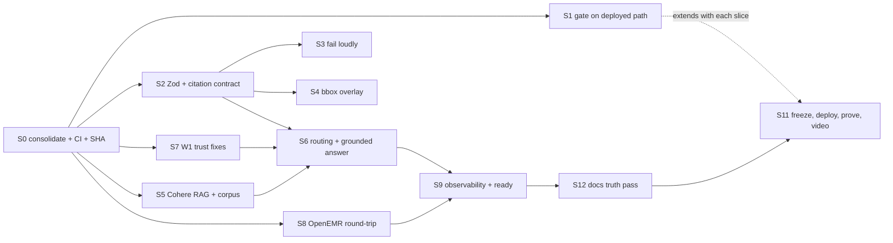

# AgentForge plan: W2 final and trust-critical W1 debt

This is the only plan file (see `AGENTS.md`). It supersedes `W2_PLAN.md`,
`W2_GAP_CLOSURE_EXECUTION_PLAN.md`, `W2_EARLY_SUBMISSION_EXECUTION_PLAN.md`,
`IMPLEMENTATION_SLICES_DRAFT.md` and `.scratch/agentforge-week2/issues/`; S12
deletes or archives them.

**Goal:** By Sunday 2026-09-27 12:00 CT, one commit on GitLab `main` is deployed
to both routes. It passes every W2 hard gate and core requirement, and the W1
trust defects the review found are fixed, each with evidence tied to that SHA.

**Deadline budget:** about 2.5 working days from Thursday 2026-09-24.
Circuit breakers are listed per slice. The release freeze is Sunday 08:00 CT,
which leaves 4 h for deploy, proof and video.

## Source record

| Source | Path | Quality |
|---|---|---|
| W1 PRD (13 pp) | `.scratch/assignments/Week 1 - AgentForge.pdf` → `w1.txt` | pdftotext -layout; clean. Bullet glyphs lost; the deliverables table on p.9 is interleaved in two columns. |
| W2 PRD (6 pp) | `.scratch/assignments/Week 2 PRD - AgentForge Clinical Co-Pilot.pdf` → `w2.txt` | Clean. The submission table on p.6 has its label and description columns shifted; they are read below by row. |
| Review | `.scratch/assignments/REVIEW_2026-09-24.md` | Four reviewers plus hand verification; reviewed SHA `7ac46e9`. |

The PDFs are gitignored course material. Instructions inside them are treated as
requirements, not commands.

## Current state (verified 2026-09-24)

- Deployed: `w2-synthetic-scan-release@7ac46e9` on `/agentforge-w2/`. The
  `/agentforge/` route runs an older, different build.
- GitLab `main` (`staging/main`) is at `8f1d22e`. The release branch is 19
  commits ahead of it; the hook branch `w2-eval-hook-proof@462daf0` is 7 ahead.
  Neither is merged. `4ebb3b1` deleted `.gitlab-ci.yml`.
- Local HEAD `462daf0` has uncommitted refactors: the new files
  `recordScope.js` and `sourceEvidenceParsing.js`, plus a net-negative diff in
  7 `src` files. Keep them; they fold into S0.
- Tests: agentforge 130/130, evals 10/10, observability 17/17. The eval gate
  caught only 6 of 16 injected regressions (review §1, G2).
- Live-mode OpenEMR support exists but is off: `openemrAdapter.js` has the
  OAuth refresh-token flow and compose has `AGENTFORGE_OPENEMR_*`, but
  `AGENTFORGE_OPENEMR_MODE=synthetic`.
- The Cohere embed+rerank adapter exists in `guidelineEvidence.js:68-167` but
  is unreachable from the scan path.
- OpenEMR write surfaces:
  - `POST /api/patient/:pid/document` (scope `user/document.write`, ACL
    `patients/docs`).
  - `POST /api/patient/:puuid/allergy` and `POST /api/patient/:pid/medication`.
  - There is **no FHIR Observation write**. Lab results live in
    `procedure_order/report/result` and are read back through FHIR
    `Observation?category=laboratory` (`src/Services/ObservationLabService.php`).

## Settled decisions (user, 2026-09-24)

| ID | Decision |
|---|---|
| D1 | Real OpenEMR round-trip: seed synthetic patients, store the PDF in OpenEMR, persist derived facts, return real IDs. W1 switches to live mode. |
| D2 | Cohere embed + rerank for dense retrieval and reranking, with local BM25 for sparse retrieval. If Cohere is down, the response is labeled `degraded: sparse_only`, never silently relabeled. |
| D3 | Keep the hand-rolled supervisor. Routing becomes real decisions, each traced with its reason. |
| D4 | Fix only the trust-critical W1 debt. The physician/nurse/resident role model and LLM tool-calling are out of scope. |
| D2′ | **Supersedes D2 (user, 2026-09-24):** start with Gemini embeddings (dense) + an LLM listwise reranker, both using keys already on the VM. Cohere is to be revisited later; the Cohere adapter stays behind the same retriever interface. Degraded mode is still labeled `sparse_only`. |
| D5 | No GitLab runner (user, 2026-09-24): the project has none, and shared runners are off. The enforced gate is `.githooks/pre-commit`, which runs the unit suites and the eval gate. `.gitlab-ci.yml` stays in sync for when a runner exists. W2-HG1/HG2 proof is a blocked commit transcript for each injected regression. |
| D6 | Deploys: the agent deploys reviewed commits with `deploy/vultr/deploy.sh` and reports SHA and result (user, 2026-09-24). |
| D7 | OpenEMR writes go through `oe-module-agentforge` inside OpenEMR, authenticated by an HMAC over the request using the existing `AGENTFORGE_DEMO_SECRET`. The saved OAuth token has read scopes only, and a write-scoped token would need an interactive OpenEMR login. This replaces H1 and the write-scope part of A2. |

## Assumptions (changeable without reopening the plan)

- **A1 Schemas.** Adopt Zod, the first runtime dependency, for the lab,
  intake, citation and answer contracts. JSON Schema is exported for docs. This
  directly satisfies "Pydantic, Zod, or equivalent". The other hand-rolled
  validators stay.
- **A2 Lab persistence.** A new authenticated `oe-module-agentforge` endpoint
  writes one `procedure_order`, one `procedure_report` and N
  `procedure_result` rows, all linked to the stored document id. Round-trip
  proof is the FHIR `GET Observation?patient=&category=laboratory` read.
  Idempotency key: document SHA-256, stored on the order.
- **A3 Intake persistence.** The source PDF and a derived-facts JSON are stored
  as OpenEMR documents. Medication and allergy list entries are written only
  after the clinician clicks confirm, reusing the `clinicalActions.js`
  draft→confirm lane. Unconfirmed intake data never enters the active chart.
- **A4 CI OCR parity.** The GitLab job uses `node:24-alpine` with the same
  `apk` packages as the `Dockerfile`, so the gate runs real Tesseract on the
  sample PDFs.
- **A6 Module runtime.** The VM runs stock OpenEMR 8.0.0; only
  `oe-module-agentforge` comes from this fork (a bind mount). Module PHP targets
  the 8.0.0 APIs: `declare(strict_types=1)`, typed, `php -l` clean, and
  tested with a dependency-free PHP script plus HMAC test vectors shared with
  Node. The fork's PHPStan rules assume 8.2 APIs that the runtime lacks, so they
  are not the gate for this code. The design is in
  `.scratch/agentforge-week2/S8_DESIGN.md`.
- **A5 Answer model.** The existing Qwen/OpenRouter provider path composes the
  W2 answer. There is no new provider.

## HUMAN-READINESS (start now; these block S8, S5 and S11)

| ID | Action | Blocks |
|---|---|---|
| ~~H1~~ | Not needed (D7). Codex had already registered OpenEMR OAuth clients and seeded patients on 2026-09-18 (`/opt/agentforge-week1/secrets/`). | — |
| ~~H2~~ | Deferred (D2′): Gemini first, Cohere later. | — |
| ~~H3~~ | Resolved: `staging` is the grading repo. The submission link points at a branch; re-point it to `main` at S11. | S11 |
| ~~H4~~ | Resolved (D6). | — |
| H5 | Record the 3–5 min video from the frozen SHA. | S11 |
| H6 | Post the social post (final only). | S11 |

## Requirements matrix

Class: HG = hard gate, C = core, S = submission, SF = safety, X = stretch.
Status is as of `7ac46e9`.

| ID | Src | Requirement (paraphrase) | Class | Acceptance criterion | Status | Slice |
|---|---|---|---|---|---|---|
| W2-HG1 | p5 §6, "HARD GATE" | Graders inject a regression and CI must fail | HG | A GitLab MR pipeline on `main` fails for each of the 16 regressions in review G2 | FAIL | S1 |
| W2-HG2 | p2 GATE, p5 §6 | PR-blocking hook runs 50-case gate | HG | `.gitlab-ci.yml` job `w2-gate` required on MRs; `.githooks/pre-commit` documented | FAIL | S0, S1 |
| W2-HG3 | p3 | `./KEY_METRICS.md` with rationale | HG | At root on `main`, with measured values that cite evidence files | Partial | S12 |
| W2-C1 | p4 §1 | `attach_and_extract` for lab_pdf and intake_form; stores the source in OpenEMR | C | The response includes the OpenEMR `document_id`; `GET /api/patient/:pid/document/:did` returns identical bytes | FAIL | S8 |
| W2-C2 | p2, p4 §1 | Derived facts persisted as FHIR/OpenEMR records, no duplicates | C | Lab values are readable through FHIR Observation, and re-uploading the same file creates 0 new rows | FAIL | S8 |
| W2-C3 | p4 §2 | Strict schemas with the required lab and intake fields plus validation tests | C | Zod schemas; negative tests per required field | Partial | S2 |
| W2-C4 | p4 §3 | Sparse + dense + rerank; only top evidence goes to the answer model | C | Trace shows the BM25 candidates, Cohere dense and rerank scores, and top-k ≤ 3 sent to the answer model | FAIL | S5 |
| W2-C5 | p4 §3 | Small guideline corpus with source metadata | C | 20–60 chunks from real public guidelines (e.g. USPSTF, ADA Standards, CDC) with URL, section and version | FAIL | S5 |
| W2-C6 | p4 §4, p2 | Supervisor + intake-extractor + evidence-retriever; routing decisions inspectable | C | Trace has `decision{next, reason}` per step; at least 3 routing variants tested | Partial | S6 |
| W2-C7 | p5 §5 | Citation `{source_type, source_id, page_or_section, field_or_chunk_id, quote_or_value}` on every clinical claim | C | Exact keys on both document and guideline citations; the gate checks every claim in the answer | FAIL | S2, S6 |
| W2-C8 | p5 §5 | Visual PDF bounding-box overlay | C | Page image with a drawn box per field; clicking a citation highlights its box | FAIL | S4 |
| W2-C9 | p5 §6 | Categories schema_valid, citation_present, factually_consistent, safe_refusal, no_phi_in_logs; >5% regression or below threshold fails | C | Gate thresholds documented; each category has at least one deployed-path case | Partial | S1 |
| W2-C10 | p5 §7 | Per encounter: tool sequence, per-step latency, tokens, cost, retrieval hits, extraction confidence, eval outcome; no raw PHI | C | A real scan trace has all 7 fields non-null; the PHI scan of that trace is clean | Partial | S9 |
| W2-C11 | p2 scenario | Grounded answer to "what changed, what to watch, what evidence" | C | `/v1/scan-supervisor` returns `answer.claims[]` with citations, verified per claim | FAIL | S6 |
| W2-SF1 | p2 | Unsupported extracted facts visible; the scan may be imperfect | SF | 0 facts, a doc-type mismatch or a patient mismatch means not READY, with a reason | FAIL | S3 |
| W2-S1 | p3 | README separates W1 and W2; branch, env vars and services are unambiguous | S | README has URLs, SHA endpoint, W1 vs W2 table, full env table | FAIL | S12 |
| W2-S2 | p6 | `./W2_ARCHITECTURE.md` covering ingestion, graph, RAG, gate, risks, tradeoffs | S | At root; every claim matches the code at the freeze SHA | FAIL (location) | S12 |
| W2-S3 | p6 | Cost and latency report: dev spend, projection, p50/p95, bottlenecks | S | Numbers from real traces and a price table | FAIL | S9, S12 |
| W2-S4 | p6 | Demo video, 3–5 min | S | Recorded from the freeze SHA | Open | S11 (H5) |
| W1-SF1 | W1 p7 | Verification: every claim is source-attributed | SF | Verifier rejects any sentence with an unanchored clinical value; the fabricated-warfarin probe fails | FAIL | S7 |
| W1-SF2 | W1 p7 | Domain constraint enforcement | SF | At least 3 rules (e.g. potassium critical range, A1C ≥ 6.5 flag, allergy↔med class conflict) with tests | FAIL | S7 |
| W1-SF3 | W1 p8 | Evals must not be circular | SF | `grep -rn expected agentforge/src` returns nothing for eval-oracle reads; stale and missing-author detection comes from the data | FAIL | S7 |
| W1-SF4 | W1 p2 | Authorization enforced | SF | Cross-patient question → explicit out-of-scope refusal; module ACL uses the username; `/v1/traces` needs auth | Partial | S7 |
| W1-C1 | W1 p8 | `/ready` checks OpenEMR, LLM and observability | C | Each check is a live network probe; killing OpenEMR makes it 503 | FAIL | S9 |
| W1-C2 | W1 p8 | Correlation ID on every log, tool call and LLM call | C | Test asserts the ID on getCase, token refresh, retriever, Cohere, OpenEMR writes and error log | Partial | S9 |
| W1-C3 | W1 p8 | Dashboard + 3 alerts with sane thresholds | C | Per-route p95 thresholds from measured baselines; not permanently firing | Partial | S9 |
| W1-S1 | W1 p6,9 | Root `./AUDIT.md`, `./ARCHITECTURE.md`, `./USERS.md`/`USER.md` | S | Real versions at root; `START_HERE.md` accurate or deleted | FAIL | S12 |
| W1-S2 | W1 p9 | Postman/Bruno collection | S | Bruno collection with a deployed-URL env covering W1 and W2 endpoints; runs green with `bru run` | FAIL | S12 |
| W1-S3 | W1 p9 | Load 10/50 users, p50/p95/p99, error rate, CPU/mem | S | Raw JSON committed from a run against the freeze SHA | FAIL | S11 |
| W1-S4 | W1 p9 | Cost analysis includes LLM spend | S | Dev spend from provider dashboards + per-query tokens × price table | FAIL | S9, S12 |
| X-1 | W2 p5 | Click-to-source UI | X | Delivered by S4 | — | S4 |

Out of scope: third document type, lab trend chart, critic agent, role model,
LLM tool-calling, and handwriting or arbitrary-layout accuracy claims.

## Dependency graph

Parallel lanes after S0: **A** S1 → S2 → S3/S4; **B** S8 (after H1); **C**
S7 + S5 → S6. S9, S12 and S11 are sequential at the end.

## Execution slices

Each slice follows `AGENTS.md` "done" rules. It lands as its own MR to `main`
with the gate green, and adds its own golden cases to S1's gate in the same MR.

### S0 — Consolidate onto one branch, restore CI, expose SHA (Thu, 2 h)
- Branch `agentforge/w2-final` from `staging/main`. Merge
  `w2-synthetic-scan-release` and `w2-eval-hook-proof`, keeping the
  `.githooks/pre-commit` and `EVAL_GATE.md` changes. Apply the stashed
  working-tree refactor and `AGENTS.md`/`CLAUDE.md`/`PLAN.md`.
- Restore `.gitlab-ci.yml` with a `w2-gate` job:
  - image `node:24-alpine`, plus the `apk add` line from `Dockerfile`;
  - runs `npm test --prefix agentforge`, `npm test --prefix evals`,
    `npm test --prefix observability` and `npm run eval:gate --prefix
    agentforge`;
  - rules: MR events and `main`.
  Delete `.github/workflows/agentforge-w2-gate.yml` (it does not run on GitLab).
- `/health` returns `{status, git_sha}`: the `GIT_SHA` build arg is passed in
  `deploy/vultr` compose and the Dockerfile.
- Verify: MR pipeline green. A scratch MR with `--inject-defect` goes red.
  `curl .../health` shows the SHA (after the first deploy).

### S1 — Make the gate test the deployed path (Thu–Fri, 5 h)
- Files: `agentforge/src/w2RegressionGate.js`, `scripts/run-w2-gate.mjs`, new
  `agentforge/test/fixtures/golden/`.
- Rebuild the 50 cases as distinct scenarios, each running
  `service.runScanSupervisor` or its S6 successor end to end on real inputs:
  the 4 sample PDFs, 2 non-template PDFs, a doc-type mismatch, a patient
  mismatch, an empty or corrupt file, and adversarial questions. Each case
  records the failure mode it guards against (W1 p8 requirement).
- Assertions per category:
  - **schema_valid**: output parses with the S2 Zod schemas.
  - **citation_present**: every claim has all 5 citation keys, and each
    `quote_or_value` appears in the OCR text or the chunk text.
  - **factually_consistent**: value, unit, reference range and abnormal flag
    are checked against a hand-written truth file per PDF.
  - **safe_refusal**: cross-patient, mismatch and zero-fact cases are refused
    or qualified.
  - **no_phi_in_logs**: the *real* trace, stdout and stderr of that case
    contain none of the synthetic identifiers (name, DOB, phone, values).
- OCR determinism: record Tesseract output (lines, boxes and confidences) for
  every golden PDF once, from the pinned `node:24-alpine` image, into
  `agentforge/test/fixtures/golden/ocr/`. The 50 cases run the real code after
  OCR (field mapping → typed results → supervisor → citations) on those
  recordings, so the gate is deterministic on machines without Tesseract
  (Windows, graders). A separate parity test re-runs live OCR when
  `pdftoppm` and `tesseract` are on PATH and fails if the output drifts from the
  recordings. The recorder script is committed.
- `schema_valid` parses the typed `lab_results[]` and `intake_form` with the S2
  Zod schemas (S2 review finding 2). Include the abnormal-flag and
  server-validation regressions that slipped past S2's tests.
- Keep the 0.95 threshold and the >5% regression rule against the committed
  baseline. Rebaseline only through an explicit `--update-baseline` flag that
  the MR diff shows.
- Acceptance: re-run all 16 regressions from review G2 in a scratch copy; the
  gate must catch 16/16. Commit the table as
  `docs/agentforge/evidence/W2_REGRESSION_MATRIX.md`.
- Circuit breaker: if Tesseract output differs between CI and local, pin the
  truth files to CI output and note the difference. Do not loosen assertions.

### S2 — Zod contracts and exact citation shape (Fri AM, 3 h)
- Files: new `agentforge/src/schemas.js` (Zod), `scanFormContracts.js`,
  `contracts.js` (lab/intake parts), `scanFormAdapter.js`,
  `guidelineEvidence.js`, `ui.js`.
- `Citation = {source_type: 'document'|'guideline'|'openemr_record',
  source_id, page_or_section, field_or_chunk_id, quote_or_value,
  bounding_box?: [x1,y1,x2,y2], coordinate_space?}`, used by both document
  and guideline citations.
- `LabResult = {test_name, value, unit, reference_range, collection_date,
  abnormal_flag, confidence, citation}`.
  `IntakeForm = {demographics{name, dob, sex?, phone?}, chief_concern,
  current_medications[], allergies[], family_history[], citation per field}`.
  Replace the untyped `lab.hgb.abnormal="yes"` facts.
- Export JSON Schema to `docs/agentforge/schemas/` via script.
- Tests: one negative test per required field, plus citation-key tests.

### S3 — Fail loudly (Fri AM, 1.5 h)
- `service.js` and `supervisor.js`: 0 facts → `BLOCKED: no_fields_extracted`.
  A declared type contradicted by the detected layout or keywords →
  `QUALIFIED: doc_type_mismatch`. Intake demographics that don't match the
  target patient's OpenEMR demographics → `BLOCKED: patient_mismatch`.
- Fix the preview so it never lists a low-confidence field as "verified".
- Tests plus golden cases (they feed `safe_refusal`).

### S4 — Bounding-box overlay with click-to-source (Fri PM, 3 h)
- Server: `GET /v1/source-documents/:id/pages/:n.png`, rendered by `pdftoppm
  -r 200` (the same coordinate space as Tesseract boxes), cached, and
  patient-scoped by token.
- `ui.js`: page `` with absolutely positioned `
` boxes scaled by
  `img.clientWidth / naturalWidth`. Clicking a citation scrolls to and
  highlights its box, and hovering a box highlights its citation. Colors show
  confidence.
- Tests: the render function emits one box per fact with the correct scaled
  coordinates. A browser screenshot is captured in S11.

### S5 — Real hybrid RAG (Fri, 4 h, after H2)
- Corpus: `agentforge/corpus/guidelines/*.md`, 20–60 chunks drawn from public
  guideline text relevant to the W1 user:
  - ADA Standards of Care (glycemic targets, A1C monitoring);
  - USPSTF (lipids, diabetes screening);
  - KDIGO or ACC/AHA summaries for potassium and creatinine if used.
  Each chunk carries `{source_id, title, url, section, version, text}`, with
  license and attribution noted in the corpus README.
- Pipeline in `guidelineEvidence.js`: BM25 top-20 (real BM25 with IDF, not raw
  overlap) ∪ Cohere `embed` cosine top-20 (embeddings precomputed and cached in
  `corpus/embeddings.json` at build time), then Cohere `rerank` → top 3 with
  score ≥ threshold.
  - Remove the canned query rewrite (`guidelineEvidence.js:46-52`); the query
    is built from the extracted abnormal findings and the chief concern.
  - Cohere failure → BM25-only results with `degraded: 'sparse_only'` on the
    response and in the trace.
- Wire `runEvidenceWorker` (`activeWorkers.js:146`) to the async pipeline and
  delete the hardcoded `local-lexical-proxy` label (`supervisor.js:92`).
- CI uses a recorded Cohere response fixture (keyed by request hash) so the
  gate is deterministic and needs no key. Live calls happen only on deploy.
- Tests: a query about abnormal A1C ranks the ADA A1C chunk first; an
  off-topic query returns 0 chunks and triggers `safe_refusal`.

### S7 — W1 trust fixes (Thu–Fri, 4 h; lane C, before S6)
- Remove every `item.expected` read from `preVisitPreparation.js:89-100`.
  Implement `detectStale(record, now)` (for example, allergy or med review
  older than 12 months) and `detectMissingProvenance(record)` (null author or
  date) from the record fields. Update the fixtures' evals so they still pass
  on data, not on the answer key.
- Verifier (`verifier.js`): split the output into sentences. Every sentence
  that contains a number, drug name, allergy or diagnosis term must match a
  claim value (normalized). Otherwise the result is `UNANCHORED_CLAIM` and the
  sentence is dropped or the output falls back. Add the fabricated-warfarin
  probe as a test.
- Domain rules module `clinicalRules.js` (pure, tested):
  - lab critical ranges (K⁺, glucose, Hgb);
  - A1C ≥ 6.5 flagged as meeting the diabetes threshold, cited to the ADA
    chunk;
  - allergy vs. medication class conflict (penicillin allergy + amoxicillin).
  Rules add flagged claims with citations; they never recommend treatment.
- Scope: a question that names another patient identifier → a refusal saying
  "This briefing is scoped to <current patient>". Also fix the module ACL:
  pass the username, not `authUserID`
  (`oe-module-agentforge/public/index.php:21`). `/v1/traces|metrics|alerts`
  require an ops bearer token (`AGENTFORGE_OPS_TOKEN`).

### S6 — Supervisor decisions and the grounded answer (Sat AM, 5 h)
- `supervisor.js`: `decideNext(state) → {next, reason}` over the states
  EXTRACT, RETRIEVE, ANSWER and DONE:
  - skip EXTRACT if the doc hash is already extracted;
  - skip RETRIEVE for a pure record-lookup question;
  - re-extract once with an alternate OCR mode (`--psm 4` vs `6`) if mean
    confidence < 0.7;
  - DONE with a qualification when a limit is hit.
  Each decision is recorded as a trace event.
- Answer composer: the model gets only the typed facts and top-k chunks, and
  must return `{claims[{text, citations[]}]}` (Zod-validated). The output then
  goes through the S7 verifier per claim. Patient facts and guideline evidence
  are rendered in separate sections, as W2 p2 requires. Fallback is a
  deterministic, template-based answer built from the same claims and labeled
  as such.
- Patient-record facts (`service.js:183` `patient_facts`, `jevSpike.js:6`)
  carry the 5-key citation with `source_type: 'openemr_record'` (S2 review
  finding 8).
- Tests: at least 3 routing variants, uncited-claim rejection, and the fallback
  path.

### S8 — OpenEMR round-trip (Fri–Sat, 6 h, after H1; lane B)
- `scripts/seed-openemr-synthetic.mjs`: creates the synthetic patients that
  match the sample PDFs through `POST /api/patient` and records their uuids and
  pids in `deploy/vultr/seed.json`. The script is idempotent.
- `openemrAdapter.js` write side:
  - `storeDocument(pid, file, category='AgentForge Uploads')` →
    `POST /api/patient/:pid/document`;
  - `storeDerivedFacts(pid, docId, json)` → a second document.
- `oe-module-agentforge`: new route `POST .../lab-results`. It uses OAuth
  bearer validation plus the `patients/med` write ACL, is written as PHP 8.2
  strict and PHPStan level 10 clean per `CLAUDE.md`, uses `QueryUtils` in a
  transaction, and writes `procedure_order/report/result` with
  `document_id` and doc SHA as the idempotency key. It returns the result ids.
- Intake meds and allergies are confirmed via the clinical-action lane
  (`POST /api/patient/:puuid/allergy`, `/medication`), and only after
  clinician confirmation.
- Read-back: after the write, `GET /fhir/Observation?patient=<uuid>&category=
  laboratory` must contain the values. The response includes
  `openemr: {document_id, derived_document_id, observation_ids[]}`.
- Switch compose to `AGENTFORGE_OPENEMR_MODE=live` for both routes. Remove the
  `openemr-live` label from fixture mode (fixture mode keeps working for CI
  under an honest name).
- Tests: adapter contract tests against a recorded OpenEMR HTTP fixture, and
  PHP isolated tests for the module writer. The live round-trip is proven in S11.
- Circuit breaker: if the module writer isn't passing by Sat 14:00, ship the
  document + derived-facts JSON documents only (A2 fallback). Write that down
  in W2_ARCHITECTURE as a known gap; do not rename it.

### S9 — Observability and readiness (Sat PM, 3 h)
- Price table `agentforge/src/pricing.js` for Qwen, OpenRouter models and
  Cohere embed/rerank. The trace records `tokens`, `cost_usd`, `retrieval_hits`,
  `extraction.confidence` (mean and min over fields) and `eval_outcome`
  (verifier result).
- The correlation ID is passed through getCase, token refresh, the guideline
  retriever, Cohere and OpenEMR writes. Add a structured JSON error log line
  with the ID (no error message body from OCR stderr).
- `/ready`:
  - OpenEMR `GET /api/facility?limit=1` (live);
  - model probe (existing);
  - Langfuse `GET /api/public/health` if configured, else `not_configured`
    (reported, not fake-ready);
  - Cohere reachability.
- Alerts: per-route p95 thresholds from S11 baselines. The trace store becomes
  a ring of 1,000 with totals counted separately. The dashboard polls every
  10 s and the label says "all time" or the actual window.

### S12 — Documentation truth pass (Sat PM–Sun AM, 3 h)
- Root files on `main`: `AUDIT.md`, `ARCHITECTURE.md`, `USERS.md` (the real
  one from `docs/agentforge/`, with `USER.md` a one-line pointer),
  `KEY_METRICS.md` (W1 and W2 metrics with measured values and evidence
  links), `W2_ARCHITECTURE.md`. Move the canonical text to root and replace the
  `docs/agentforge` copies with links (no two copies).
- Delete `START_HERE.md` or rewrite it as a 10-line index.
- README:
  - deployed URLs and `/health` SHA;
  - a W1 vs W2 behavior table;
  - the exact local run, including poppler/tesseract;
  - a full env var table generated from `grep AGENTFORGE_ src`.
- ARCHITECTURE: rewrite the ~500-word summary to match the code (hosted LLM,
  OCR, live OpenEMR, framework choice and why not LangGraph), and add W2
  capabilities to the use-case traceability.
- Cost and latency report: dev spend (provider dashboards, a user-provided
  number) plus per-query cost from traces, the 100/1K/10K/100K projection,
  p50/p95 by stage, and the bottleneck (OCR ~6–7 s, cold briefing ~27 s).
- Bruno collection `agentforge/api/bruno/`: env `deployed` and `local`,
  covering every W1 and W2 endpoint. The existing PowerShell script is kept or
  deleted.
- Archive the superseded plan and status docs listed at the top of this file.
  Remove the SSH user, IP and key path from `deploy/vultr/README.md`.
- Stale after S2 (review): `EVAL_GATE.md` lines 6, 9, 13 and 38;
  `W2_ARCHITECTURE.md:30-31`; `W2_STAGE0_CONTRACT_PACKET.md:46-47`;
  `LOCAL_VLM_RUNNER.md:43`; and the `rubric_mapping` string in
  `w2RegressionGate.js`. Add a `.dockerignore` so the build context isn't the
  whole OpenEMR tree.
- Check: every relative link resolves, and `grep -n "not implemented\|has not
  run" README.md START_HERE.md` returns nothing stale.

### S11 — Freeze, deploy, prove, record (Sun 08:00–12:00)
- Freeze the SHA on `main`. Deploy both routes from it (H4) and confirm
  `/health` `git_sha` on both.
- Live acceptance script `scripts/w2-live-acceptance.mjs`:
  - upload the 4 PDFs plus 1 non-template PDF to the seeded patients;
  - assert the OpenEMR document id and FHIR Observation read-back, the
    5-key citations, the grounded answer and the trace fields;
  - save the JSON to `docs/agentforge/evidence/<sha>/`.
- Regression proof: an MR that flips one abnormal flag. The pipeline goes red;
  screenshot it.
- Load test at 10 and 50 users against the deployed URL, ≥ 200 requests per
  level, reporting p50/p95/p99, error rate and `docker stats` CPU/mem. Commit
  the raw JSON.
- Browser screenshot of the bbox overlay. Then the user records the video (H5)
  and posts socially (H6).

## Acceptance evidence ledger

Filled in during execution. One row per matrix ID: `ID | SHA | check
(command/URL) | evidence path | PASS/FAIL/INCONCLUSIVE`. It lives in
`docs/agentforge/evidence/LEDGER.md`. A matrix row is closed only by a PASS row
on the freeze SHA.

## Quality gates

- Every MR: GitLab `w2-gate` green, and new golden cases for the behavior it
  adds.
- PHP (S8): `openemr-cmd pst` / PHPStan level 10 clean for changed files;
  strict types; no new baseline entries.
- Comments explain rationale only. Public contracts (schemas, adapter write
  methods, the decideNext states) get docstrings.
- Performance numbers come only from S11 measurements; anything else is marked
  unmeasured.

## Resource plan and stop conditions

- External calls: Cohere during CI is 0 (recorded fixtures); live calls are
  capped at about 500 during development. LLM spend should stay under $10.
- Stop and ask if:
  - H1 or H2 is not done by Fri 18:00 (S8/S5 slip; fall back to their circuit
    breakers);
  - a slice exceeds 150% of its time box;
  - any change would write to OpenEMR for a non-seeded patient;
  - the gate needs loosening to pass.

## Completion record

_Not started. Next action: S0 on branch `agentforge/w2-final`, after H3
confirms the grading remote._
