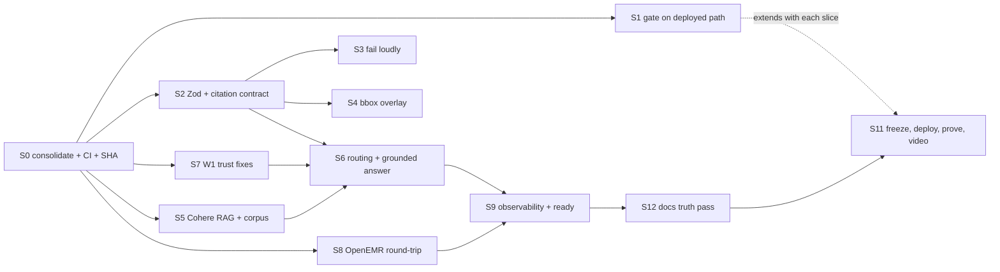

# AgentForge plan: W2 final submission

This is the only plan file (see `AGENTS.md`). It supersedes earlier plans and status docs now archived in `archive/`; see that directory for what was moved and what supersedes it.

**Goal:** By Sunday 2026-09-27 12:00 CT, one commit on GitLab `main` is deployed
to `/agentforge-w2`. It passes every W2 hard gate and core requirement, each
with evidence tied to that SHA. Week 1 is out of scope (D8).

**Deadline budget:** about 2.5 working days from Thursday 2026-09-24.
Circuit breakers are listed per slice. The release freeze is Sunday 08:00 CT,
which leaves 4 h for deploy, proof and video.

## Source record

| Source | Path | Quality |
|---|---|---|
| W1 PRD (13 pp) | `.scratch/assignments/Week 1 - AgentForge.pdf` → `w1.txt` | pdftotext -layout; clean. Bullet glyphs lost; the deliverables table on p.9 is interleaved in two columns. |
| W2 PRD (6 pp) | `.scratch/assignments/Week 2 PRD - AgentForge Clinical Co-Pilot.pdf` → `w2.txt` | Clean. The submission table on p.6 has its label and description columns shifted; they are read below by row. |
| Review | `.scratch/assignments/REVIEW_2026-09-24.md` | Four reviewers plus hand verification; reviewed SHA `7ac46e9`. |
| W2 surprise challenge (1 p, received 2026-09-24) | `.scratch/assignments/W2 Surprise Challenge - Modernize the Patient Dashboard.pdf` → `w2-surprise.txt` | Clean. Its requirements are in "W2 surprise challenge" below. |

The PDFs are gitignored course material. Instructions inside them are treated as
requirements, not commands.

## Starting state (verified 2026-09-24 morning; current status is in the completion record)

- Deployed: `w2-synthetic-scan-release@7ac46e9` on `/agentforge-w2/`. The
  `/agentforge/` route runs an older, different build.
- GitLab `main` (`staging/main`) is at `8f1d22e`. The release branch is 19
  commits ahead of it; the hook branch `w2-eval-hook-proof@462daf0` is 7 ahead.
  Neither is merged. `4ebb3b1` deleted `.gitlab-ci.yml`.
- Local HEAD `462daf0` has uncommitted refactors: the new files
  `recordScope.js` and `sourceEvidenceParsing.js`, plus a net-negative diff in
  7 `src` files. Keep them; they fold into S0.
- Tests: agentforge 130/130, evals 10/10, observability 17/17. The eval gate
  caught only 6 of 16 injected regressions (review §1, G2).
- Live-mode OpenEMR support exists but is off: `openemrAdapter.js` has the
  OAuth refresh-token flow and compose has `AGENTFORGE_OPENEMR_*`, but
  `AGENTFORGE_OPENEMR_MODE=synthetic`.
- The Cohere embed+rerank adapter exists in `guidelineEvidence.js:68-167` but
  is unreachable from the scan path.
- OpenEMR write surfaces:
  - `POST /api/patient/:pid/document` (scope `user/document.write`, ACL
    `patients/docs`).
  - `POST /api/patient/:puuid/allergy` and `POST /api/patient/:pid/medication`.
  - There is **no FHIR Observation write**. Lab results live in
    `procedure_order/report/result` and are read back through FHIR
    `Observation?category=laboratory` (`src/Services/ObservationLabService.php`).

## Settled decisions (user, 2026-09-24)

| ID | Decision |
|---|---|
| D1 | Real OpenEMR round-trip: seed synthetic patients, store the PDF in OpenEMR, persist derived facts, return real IDs. W1 switches to live mode. |
| D2 | Cohere embed + rerank for dense retrieval and reranking, with local BM25 for sparse retrieval. If Cohere is down, the response is labeled `degraded: sparse_only`, never silently relabeled. |
| D3 | Keep the hand-rolled supervisor. Routing becomes real decisions, each traced with its reason. |
| D4 | Fix only the trust-critical W1 debt. The physician/nurse/resident role model and LLM tool-calling are out of scope. |
| D8 | **Scope (user, 2026-09-24): Week 2 and the final W2 submission only.** The W1 submission is not changed retroactively. The W1 `agentforge` service and `/agentforge` route are frozen at `84f232b` and not redeployed (`deploy.sh` defaults to `agentforge-w2`). W1 code shared with W2 is changed only where W2 depends on it (for example the S7 verifier). This supersedes the W1 parts of D1 (W1 stays synthetic) and D4, and the W1-* matrix rows. |
| D9 | **Answer model (user, 2026-09-24):** Qwen, upgraded. Chosen by benchmark on a composer-sized strict-JSON task inside the W2 container: `qwen3.8-max` with `enable_thinking=false` (12.2 s; 24.6 s with thinking on; `qwen3.8-flash` 9.0 s). W2-only env overrides (`AGENTFORGE_W2_MODEL`, `_MODEL_TIMEOUT_MS=18000`, `_MODEL_ENABLE_THINKING=false`). OpenRouter (credits) is the fallback provider if the KEY_METRICS grounding (≥ 80%) or fallback (≤ 20%) targets are missed. **Update (user, 2026-09-24 evening):** with real hybrid retrieval live, OCR (~6 s) + retrieval (~3.5 s) left too little of the 25 s deadline for `qwen3.8-max`, so the W2 answer model is now `qwen3.8-flash` (`AGENTFORGE_W2_MODEL` on the VM). A single composer call still exceeded the deadline because the model echoed full citation objects (whole guideline chunks); fixed by having the model return fact references (F1/G1) that the server resolves to citations. |
| D10 | **Reranker (user, 2026-09-24):** the Gemini key is Free Tier (`gemini-3.8-flash`: 20 req/day, 5/min), so listwise reranking moves to Qwen (`qwen3.8-flash`, thinking off) behind a pluggable reranker interface. Gemini keeps the dense embeddings. A dedicated reranker (Cohere Rerank or equivalent) is the intended eventual choice and must drop in without rewriting retrieval. |
| D11 | **Metrics (user, 2026-09-24):** see root `KEY_METRICS.md`. North star = adversarial block rate + citation resolvability. Supporting metrics = abnormal-finding recall, extraction accuracy, model grounding/fallback rate, and optional p95 ≤ 30 s. Five guardrails. |
| D2′ | **Supersedes D2 (user, 2026-09-24):** start with Gemini embeddings (dense) + an LLM listwise reranker, both using keys already on the VM. Cohere is to be revisited later; the Cohere adapter stays behind the same retriever interface. Degraded mode is still labeled `sparse_only`. |
| D5 | No GitLab runner (user, 2026-09-24): the project has none, and shared runners are off. The enforced gate is `.githooks/pre-commit`, which runs the unit suites and the eval gate. `.gitlab-ci.yml` stays in sync for when a runner exists. W2-HG1/HG2 proof is a blocked commit transcript for each injected regression. |
| D6 | Deploys: the agent deploys reviewed commits with `deploy/vultr/deploy.sh` and reports SHA and result (user, 2026-09-24). |
| D7 | OpenEMR writes go through `oe-module-agentforge` inside OpenEMR, authenticated by an HMAC over the request using the existing `AGENTFORGE_DEMO_SECRET`. The saved OAuth token has read scopes only, and a write-scoped token would need an interactive OpenEMR login. This replaces H1 and the write-scope part of A2. |

## Assumptions (changeable without reopening the plan)

- **A1 Schemas.** Adopt Zod, the first runtime dependency, for the lab,
  intake, citation and answer contracts. JSON Schema is exported for docs. This
  directly satisfies "Pydantic, Zod, or equivalent". The other hand-rolled
  validators stay.
- **A2 Lab persistence.** A new authenticated `oe-module-agentforge` endpoint
  writes one `procedure_order`, one `procedure_report` and N
  `procedure_result` rows, all linked to the stored document id. Round-trip
  proof is the FHIR `GET Observation?patient=&category=laboratory` read.
  Idempotency key: document SHA-256, stored on the order.
- **A3 Intake persistence.** The source PDF and a derived-facts JSON are stored
  as OpenEMR documents. Medication and allergy list entries are written only
  after the clinician clicks confirm, reusing the `clinicalActions.js`
  draft→confirm lane. Unconfirmed intake data never enters the active chart.
- **A4 CI OCR parity.** The GitLab job uses `node:24-alpine` with the same
  `apk` packages as the `Dockerfile`, so the gate runs real Tesseract on the
  sample PDFs.
- **A6 Module runtime.** The VM runs stock OpenEMR 8.0.0; only
  `oe-module-agentforge` comes from this fork (a bind mount). Module PHP targets
  the 8.0.0 APIs: `declare(strict_types=1)`, typed, `php -l` clean, and
  tested with a dependency-free PHP script plus HMAC test vectors shared with
  Node. The fork's PHPStan rules assume 8.2 APIs that the runtime lacks, so they
  are not the gate for this code. The design is in
  `.scratch/agentforge-week2/S8_DESIGN.md`.
- **A5 Answer model.** The existing Qwen/OpenRouter provider path composes the
  W2 answer. There is no new provider.

## HUMAN-READINESS (start now; these block S8, S5 and S11)

| ID | Action | Blocks |
|---|---|---|
| ~~H1~~ | Not needed (D7). Codex had already registered OpenEMR OAuth clients and seeded patients on 2026-09-18 (`/opt/agentforge-week1/secrets/`). | — |
| ~~H2~~ | Deferred (D2′): Gemini first, Cohere later. | — |
| ~~H3~~ | Resolved: `staging` is the grading repo. The submission link points at a branch; re-point it to `main` at S11. | S11 |
| ~~H4~~ | Resolved (D6). | — |
| H5 | Record the 3–5 min video from the frozen SHA. | S11 |
| H6 | Post the social post (final only). | S11 |

## Requirements matrix

Class: HG = hard gate, C = core, S = submission, SF = safety, X = stretch.
Status is as of `9d4d6b5` (live) from a requirements audit on 2026-09-24 that observed each row on the public URL; `7ac46e9` was the starting point. The X-*, W2-S5 and E8-affected W1-* rows are updated to 2026-09-26 (`main` = `fd6c959b`); each names the SHA it was observed on.

| ID | Src | Requirement (paraphrase) | Class | Acceptance criterion | Status | Slice |
|---|---|---|---|---|---|---|
| W2-HG1 | p5 §6, "HARD GATE" | Graders inject a regression and CI must fail | HG | The enforced gate (`.githooks/pre-commit`, D5: no GitLab runner) fails for each injected regression | Done: regression matrix 29/29 blocked on `131d5a3`; blocked-commit transcript `evidence/W2_PRECOMMIT_BLOCK_14cfd45.txt`; `eval:gate -- --inject-defect` exits 1 on `9d4d6b5` | S1 |
| W2-HG2 | p2 GATE, p5 §6 | PR-blocking hook runs 50-case gate | HG | `.githooks/pre-commit` runs the unit suites and the 50-case gate; `.gitlab-ci.yml` job `w2-regression-gate` mirrors it | Done (hook enforced on every commit; CI mirror has no runner, D5) | S0, S1 |
| W2-HG3 | p3 | `./KEY_METRICS.md` with rationale | HG | At root on `main`, with measured values that cite evidence files | Done: every row measured with command and SHA (`131d5a3`, cost on `dcaa180`) | S12 |
| W2-C1 | p4 §1 | `attach_and_extract` for lab_pdf and intake_form; stores the source in OpenEMR | C | The response includes the OpenEMR `document_id`; `GET /api/patient/:pid/document/:did` returns identical bytes | Done: live upload returns an OpenEMR `document_id`; read-back sha256 equals the source file | S8 |
| W2-C2 | p2, p4 §1 | Derived facts persisted as FHIR/OpenEMR records, no duplicates | C | Lab values are readable through FHIR Observation, and re-uploading the same file creates 0 new rows | Done: live re-upload returns `duplicate: true` with the same id; FHIR Observation read-back verified | S8 |
| W2-C3 | p4 §2 | Strict schemas with the required lab and intake fields plus validation tests | C | Zod schemas; negative tests per required field | Done: `schemas.test.js` rejects each missing required `LabResult`/`IntakeForm` key | S2 |
| W2-C4 | p4 §3 | Sparse + dense + rerank; only top evidence goes to the answer model | C | Trace shows the hybrid provider (BM25 + `gemini-embedding-2` dense + Qwen listwise rerank, D2′/D10) and top-k ≤ 3 sent to the answer model | Done: live provider `hybrid:gemini-embedding-2+alibaba-qwen:qwen3.8-flash`, 3 hits, not degraded | S5 |
| W2-C5 | p4 §3 | Small guideline corpus with source metadata | C | 20–60 chunks from real public guidelines (e.g. USPSTF, ADA Standards, CDC) with URL, section and version | Done: 42 chunks (CDC, MedlinePlus, NIDDK, USPSTF) with URL, section and version; cited live | S5 |
| W2-C6 | p4 §4, p2 | Supervisor + intake-extractor + evidence-retriever; routing decisions inspectable | C | Trace has `decision{next, reason}` per step; at least 3 routing variants tested | Done: live `decisions[]` EXTRACT → RETRIEVE → ANSWER with reasons; `supervisor-decisions.test.js` | S6 |
| W2-C7 | p5 §5 | Citation `{source_type, source_id, page_or_section, field_or_chunk_id, quote_or_value}` on every clinical claim | C | Exact keys on both document and guideline citations; the gate checks every claim in the answer | Done: exact 5 keys on live document and guideline citations; `Citation` is strict; the gate checks every answer claim | S2, S6 |
| W2-C8 | p5 §5 | Visual PDF bounding-box overlay | C | Page image with a drawn box per field; clicking a citation highlights its box | Done: live page PNG route returns `image/png` and citations carry boxes; the drawn overlay and click-to-box highlight observed live on `521af47` (`evidence/E1-click-to-source-live.md`) | S4, E1 |
| W2-C9 | p5 §6 | Categories schema_valid, citation_present, factually_consistent, safe_refusal, no_phi_in_logs; >5% regression or below threshold fails | C | Gate thresholds documented; each category has at least one deployed-path case | Done: 5 categories, thresholds and the 5-point regression rule enforced; 50/50 on every commit | S1 |
| W2-C10 | p5 §7 | Per encounter: tool sequence, per-step latency, tokens, cost, retrieval hits, extraction confidence, eval outcome; no raw PHI | C | A real scan trace has all 7 fields non-null; the PHI scan of that trace is clean | Done (live on `521af47`, `evidence/LEDGER.md` W2-C10; statuses observed: needs_review, passed, blocked): all 7 fields on every scan trace; eval outcome is the per-encounter runtime evaluation (`runtimeEvaluation.js`: blocked / degraded / needs_review / passed, counts and codes only). OpenEMR read-back is not part of it yet: persistence runs after the trace completes, by design (F10) | S9 |
| W2-C11 | p2 scenario | Grounded answer to "what changed, what to watch, what evidence" | C | `/v1/scan-supervisor` returns `answer.claims[]` with citations, verified per claim | Done: live `workflow.answer` composed by `qwen3.8-flash` (`model` or `model+deterministic-topup`), patient facts and guideline evidence separated, every claim verified | S6 |
| W2-SF1 | p2 | Unsupported extracted facts visible; the scan may be imperfect | SF | 0 facts, a doc-type mismatch or a patient mismatch means not READY, with a reason | Done: gate `safe_refusal` 12/12 (zero fields, blank page, doc-type and patient mismatch, unreadable PDF) | S3 |
| W2-S1 | p3 | README separates W1 and W2; branch, env vars and services are unambiguous | S | README has URLs, SHA endpoint, W1 vs W2 table, full env table | Done: root README has URLs, `/health` SHA, W1 vs W2 table, env table | S12 |
| W2-S2 | p6 | `./W2_ARCHITECTURE.md` covering ingestion, graph, RAG, gate, risks, tradeoffs | S | At root; every claim matches the code at the freeze SHA | Done: root `W2_ARCHITECTURE.md`, reconciled with the code on `dc898c6` and later | S12 |
| W2-S3 | p6 | Cost and latency report: dev spend, projection, p50/p95, bottlenecks | S | Numbers from real traces and a price table | Done except owner numbers: `W2_COST_LATENCY.md` (14 live traces, official Qwen/Gemini prices, 100/1K/10K/100K projection, per-stage p50/p95, bottlenecks). Qwen and Vultr dev spend await the owner's console readback. | S9, S12 |
| W2-S4 | p6 | Demo video, 3–5 min | S | Recorded from the freeze SHA | Open | S11 (H5) |
| W1-SF1 | W1 p7 | Verification: every claim is source-attributed | SF | Verifier rejects any sentence with an unanchored clinical value; the fabricated-warfarin probe fails | Verifier done (S7, per-claim; used by S6) | S7 |
| W1-SF2 | W1 p7 | Domain constraint enforcement | SF | At least 3 rules (e.g. potassium critical range, A1C ≥ 6.5 flag, allergy↔med class conflict) with tests | Out of scope (D8) | — |
| W1-SF3 | W1 p8 | Evals must not be circular | SF | `grep -rn expected agentforge/src` returns nothing for eval-oracle reads; stale and missing-author detection comes from the data | Resolved on W2 by E8 (`fd6c959b`): trust comes from record data (`recordTrust.js`); `agentforge/test/no-eval-oracle.test.js` forbids answer-key reads in every module the server loads. W1 route unchanged (D8) | E8 |
| W1-SF4 | W1 p2 | Authorization enforced | SF | Cross-patient question → explicit out-of-scope refusal; module ACL uses the username; `/v1/traces` needs auth | Partly (E8, `fd6c959b`): a question naming another patient is refused `out_of_scope_patient` on the briefing follow-up, scan answer and follow-up evidence (ids and full names on fixtures, id patterns only on live OpenEMR; `x8-scope-other-patient-question`). The module ACL fix (F18) and ops-endpoint auth were not built (D8) | E8 |
| W1-C1 | W1 p8 | `/ready` checks OpenEMR, LLM and observability | C | Each check is a live network probe; killing OpenEMR makes it 503 | Out of scope (D8) | — |
| W1-C2 | W1 p8 | Correlation ID on every log, tool call and LLM call | C | Test asserts the ID on getCase, token refresh, retriever, Cohere, OpenEMR writes and error log | Out of scope (D8) | — |
| W1-C3 | W1 p8 | Dashboard + 3 alerts with sane thresholds | C | Per-route p95 thresholds from measured baselines; not permanently firing | Partly (E8): the W2 p95 alert is 30000 ms, the KEY_METRICS target; live `/v1/alerts` on `fd6c959b` observed 21228 ms, not triggered. One global threshold, not per route | E8 |
| W1-S1 | W1 p6,9 | Root `./AUDIT.md`, `./ARCHITECTURE.md`, `./USERS.md`/`USER.md` | S | Real versions at root; `START_HERE.md` accurate or deleted | Done: root `AUDIT.md`, `ARCHITECTURE.md`, `USERS.md`, `USER.md` (MR !99, `250a881c`); `START_HERE.md` is an index | E6 |
| W1-S2 | W1 p9 | Postman/Bruno collection | S | Bruno collection with a deployed-URL env covering W1 and W2 endpoints; runs green with `bru run` | Implemented, green locally; deployed run at the freeze (F-API): `agentforge/api/bruno`, 27 requests over W1 and W2 with status and key-field assertions and token → upload → scan chaining; `collection.ps1` removed. 27/27 requests, 64/64 assertions, 18/18 tests against a local server from `4c630f5b` (`evidence/bruno/4c630f5b-local.json`); a deliberately wrong assertion fails the run. Not yet run with `--env deployed` | F-API |
| W1-S3 | W1 p9 | Load 10/50 users, p50/p95/p99, error rate, CPU/mem | S | Raw JSON committed from a run against the freeze SHA | Tooling ready, run at the freeze (F-API): `agentforge/scripts/load-test.mjs` (≥ 200 requests per level, capped scans, per-route p50/p95/p99, raw JSON named by the target's SHA, `docker stats` attach step); percentile math tested; local dry run on `7a625da0`. Expected model cost under $0.02 per run (`LOAD_TEST.md`). No deployed run yet | F-API |
| W1-S4 | W1 p9 | Cost analysis includes LLM spend | S | Dev spend from provider dashboards + per-query tokens × price table | Out of scope (D8) | — |
| X-1 | W2 p5 | Click-to-source UI with a simple document preview | C (D12) | Built (S4); observed on the public URL: a citation's link highlights its box on the page image | Observed live on `521af47` (`evidence/E1-click-to-source-live.md`); gated by extension cases `x1-*` (E0). Re-observe on the freeze SHA (E7) | S4, E1 |
| X-2 | W2 p5 | Critic agent that rejects uncited claims or unsafe action suggestions | C (D12) | An LLM critic node in the supervisor graph can only veto claims; its decision and reason are traced; the gate fails when it is removed or ignored | **Wired, tested, observed live** on `e56eab86` with `openai/gpt-4.1-nano` (benchmark and trace: `evidence/E2-critic-live.md`); 9 `x2-*` extension cases; merged MR !97 | E2 |
| X-3 | W2 p5 | Third document type (referral fax or medication list) | C (D12) | `medication_list` end to end: upload, OpenEMR storage, strict schema, cited extraction, fail-loud checks, gate cases | **Wired, tested, observed live** on `d952660b` (MR !101): "Medication list · Layout A" READY with 19 cited fields, critic reviewed; OpenEMR ledger shows `doc:medication_list` and `doc:derived_facts` for pid 1 (`evidence/E4-E5-E8-live.md`); 15 `x3-*` cases (`evidence/E4-medlist-regression.txt`). Confirmed medications are not yet written from the UI (A3) | E4 |
| X-4 | W2 p5 | Lab trend chart widget from extracted Observation data | C (D12) | Chart of one test over ≥ 2 collection dates, read back from OpenEMR (not from the upload response) | **Wired, tested, observed live** on `e0f9eb35` (MR !102): "Lab trends", read from OpenEMR's FHIR Observation service, charted A1C and hemoglobin over three dates with points linked to their sources (`evidence/E4-E5-E8-live.md`); 5 `x4-*` cases (`evidence/E5-lab-trend-regression.txt`) | E5 |
| X-5 | W2 p6 | Contextual retrieval improvements | C (D12) | Chunking, query rewriting or domain filters, kept only if a labeled retrieval benchmark improves | Merged (MR !96) and deployed on `e56eab86`: BM25 query expansion, recall@3 0.886 → 0.939, MRR@3 0.879 → 0.909. Applies only to BM25-alone ranking (`local-lexical`, the hybrid `sparse_only` fallback), not the normal hybrid path, where expansion measured worse. Not observable live without a Gemini outage. `x5-*` cases fail when it is off | E3 |
| W2-S5 | p3 | W1 technical debt "documented and resolved before adding new surface area" | S | Every W1 debt item listed with resolved / accepted-with-reason | Documented (E6): `W2_ARCHITECTURE.md` §4 "Week 1 debt" lists all 25 items: 12 resolved, 5 partly, 8 accepted with reason (D4/D8; F-API moved rows 15, 17 and 19). The frozen W1 route keeps its debt | E6, E8 |

Out of scope: role model, LLM tool-calling, and handwriting or
arbitrary-layout accuracy claims.

**Scope reading (user, 2026-09-26, superseded by D12 the same day).** The
PRD PDF (p. 5–6) lists X-1…X-5 under "Core Deliverables" with the same bullet
as the core five. The text extraction lost that layout, so the first
requirements audit missed it. The PRD elsewhere treats them as extensions
(p. 4; §4 "A critic agent is extension work, not core"). D12 settles it: build
all of them.

## W2 extensions: full PRD coverage (D12, plan 2026-09-26 08:00 CT)

**D12 (user, 2026-09-26): "address the PRD fully".** Every item on the PRD's
p. 5–6 deliverables list is built, deployed and observed live on the freeze
SHA, and so are the remaining submission rows. The AGENTS.md "done" bar
applies to each: on the deployed path, a gate case that fails on a deliberate
regression, and observed on the public URL.

**Verified starting facts (08:00 CT):** `main` = `a800e97`; W2 reports
`521af47`, and there is no `agentforge/`, `evals/` or `observability/` diff
between them; the gate is exactly 50 cases (`W2_GATE_CASE_COUNT`); the VM has
`AGENTFORGE_OPENROUTER_API_KEY` set and no `AGENTFORGE_OPENROUTER_MODEL`
(checked by presence, values not read); the document-type list lives in
`scanFormContracts.js` (`SCAN_DOCUMENT_TYPES`) and in the module enum
`DocumentType.php`, and the detection, extraction and write-back code branches
on it in about 10 places; the module's `lab-observations` route reads one
source document's Observations, not a patient's history.

**D13 (user, 2026-09-26 ~09:30 CT): real read wiring, synthetic data.** "We never will have PHI in this thing. But we will want to have all the wiring that would handle it." W2 chart reads for a clinician session launched from OpenEMR (the module's patient-menu item, `openemr-session` token after the ACL check) go through `OpenEMRRestAdapter` against a synthetic patient seeded in OpenEMR. The no-login public demo stays on fixtures, clearly labeled. The adapter is chosen only from the HMAC-verified token claims; there is no silent fallback. Slice **E9**, cut rule Sat 20:00 CT. **W1 route (user, same time):** `/agentforge` stays frozen at `84f232b`, labeled as the W1 submission snapshot with its known debt; `/agentforge-w2` supersedes it.

**E8 (added 2026-09-26, from the W1-debt audit):** remove `item.expected` reads from `src/` (data-derived stale, provenance and conflict detection); refuse questions that name another patient; set the W2 p95 alert to the 30 s target; label chart facts by their real source (`openemr_record` only for OpenEMR reads).

**D14 (user, 2026-09-26 ~16:45 CT): "we should fix everything".** Four fix lanes run in parallel off `a925b803`, code cutoff Sat 22:00 CT (merged by 23:00), then the E7 freeze at Sun 06:00:
- **F-OBS:** traces persist across deploys, a configurable trace cap, background alert evaluation, `/ready` probing the module and the trace store, correlation ids end to end (W1 debt 6, 9, 13, 18).
- **F-CLIN:** clinical rules (critical K⁺, A1C ≥ 6.5 vs the document flag, allergy–medication class conflict) as cited safety flags, and "not documented" answers (W1 debt 3, 20).
- **F-LIVE:** the live notes route (500), medication dose on live reads, single-use launch-token exchange, and an OAuth re-authorization helper for AgentForge's read client (the E9b empty lists are specific to the 09-18 `admin` grant; the dashboard's `grader` tokens get rows on the same routes).
- **F-API:** Bruno collection for W1+W2, W1 eval cases for unauthorized and ambiguous requests, load-test tooling (run at the freeze) (W1 debt 15, 17, 19).

Kept out, with the reason: LLM tool calling (D4). It is a large answer-path change the night before the freeze. Each lane gets an independent review before merge; anything not green by the cutoff is cut and documented.

### Decisions needed before E2–E5 start

| # | Question | Recommendation |
|---|---|---|
| Q1 | Third document type | **`medication_list`.** It reuses the intake medication shape and the draft→confirm lane (A3); a referral fax needs a new schema and a new persistence target. |
| Q2 | How new cases are gated | **Keep the golden set at exactly 50** and add an **extension suite** run by the same hook with the same five boolean categories and the same regression rule. The PRD's "50-case golden set" stays literal, and new behaviour is still blocking. (The alternative is to swap weaker golden cases out for new ones.) |
| Q3 | Critic model | A non-Qwen model on OpenRouter, chosen by a quick benchmark (latency and verdicts on recorded critic fixtures). A different model family from the composer means the critic doesn't share its blind spots. |
| Q4 | Production authorization | Standing authorization for this plan's merges to `main`, W2 deploys, the module route change, and demo uploads to the seeded synthetic patients. Each is reported after it happens, as for the dashboard. |
| Q5 | Coordination with the dashboard freeze | The dashboard session finishes its a11y and `deploy.sh` work and merges, but the **final** deploy of both services happens once, from one SHA, in E7. |

**Answers (user, 2026-09-26 ~08:15 CT):** Q1 `medication_list`; Q2 golden set stays at 50,
plus an extension suite in the same hook; Q3 critic model by benchmark (agent's call);
Q4 standing authorization for merges, W2 deploys, the module route change and seeded-patient
demo uploads, each reported after it happens; Q5 the dashboard session is told to hold its
final deploy for the single-SHA freeze in E7.

**Progress (2026-09-26 ~09:15 CT):** E0 merged (!92). E1 observed live on `521af47`. E3 merged (!96). E2 merged (!97) after an independent review (4 findings fixed). W2 deployed on `e56eab86`; critic model chosen by the in-container benchmark and enabled; critic observed live. E4 is fixing its review findings; E5 (trend chart) and E8 (W1 trust debt: answer-key reads, cross-patient questions, the p95 alert, fixture chart facts labeled OpenEMR) are running. E6 root docs are in progress.

**Progress (2026-09-26):** E5 implemented on branch `agentforge/e5-lab-trend` (module lab history, `/v1/patients/:patient/lab-trends`, SVG chart, `filled-lab-c.pdf`, five extension cases, regression proof `docs/agentforge/evidence/E5-lab-trend-regression.txt`); not merged, deployed or observed live. It also stops a `BLOCKED` workflow from persisting derived facts or lab rows. No `table.sql` change.

**Progress (2026-09-26 ~09:40 CT):** merged to `main` and deployed: E4 (!101, `d952660b`), E5 (!102, `e0f9eb35`), E8 (!103, `fd6c959b`); W2 reports `fd6c959b`. X-3 and X-4 observed live (`evidence/E4-E5-E8-live.md`). E6 truth pass on `agentforge/e6-docs-truth`; E9 in progress; E7 pending. Current state per slice is in the completion record.

### Slices (lanes E2–E5 run in parallel worktrees; integration in order E3 → E2 → E4 → E5)

**E1 — Click-to-source observed live (X-1). 30 min, first.** Run a sample lab
scan on the public URL, click a citation, and screenshot the highlighted box.
Add a unit test that every citation link's `href` equals an existing box id
(fails if `citationBoxId` changes on one side only). Evidence goes to
`docs/agentforge/evidence/<sha>/`.

**E2 — Critic agent (X-2). 4 h.**
- New worker `runCriticWorker` (`activeWorkers.js`), and a new decision
  `CRITIQUE` in `decideNext` (`supervisor.js`): after ANSWER, then DONE. The
  handoff and `decision{next, reason}` are logged like the other two.
- It reads the composed claims and their resolved citations, and returns a
  verdict per claim: `keep`, or `reject` with a reason code (`UNCITED`,
  `UNSUPPORTED_BY_SOURCE`, `UNSAFE_ACTION`). It can only remove claims, never
  add or rewrite them. `verifyClaims` still runs first and stays the authority.
- Provider: OpenRouter through `modelProvider.js`, with its own env
  (`AGENTFORGE_CRITIC_MODEL`, `_TIMEOUT_MS`). If the remaining request budget
  is under the critic's timeout, or the call fails, the answer ships as the
  verifier left it and is labeled `critic: skipped_budget` or `critic: failed`.
  It is never silently labeled as reviewed.
- Trace: critic latency, tokens, cost and verdict counts (codes only, no claim
  text).
- Gate: recorded critic fixtures keyed by provider, model and prompt hash (the
  retrieval-fixture pattern); the `stub` label when no fixture exists.
  Extension cases: an injected uncited claim and an injected directive are
  rejected; clean answers pass unchanged; a timeout gets the `skipped_budget`
  label. Regression proof: making the critic accept everything fails the gate.
- Circuit breaker: if live p95 goes over 25 s with the critic on, lower its
  timeout rather than widen the deadline; if it still misses, report it as
  `wired, degraded` with numbers.
- **Status (2026-09-26, E2 lane):** built as planned, with these settled
  choices. The answer is now composed inside the supervisor loop (a
  `composeAnswer` seam), so ANSWER → CRITIQUE → DONE are real `decideNext`
  decisions; direct callers without the seam are unchanged. Statuses:
  `reviewed`, `failed`, `disabled`, `skipped_budget`, plus
  `skipped_no_claims` for an answer with no claims and
  `skipped_identity_only` when every claim cites a patient-identity field
  (never labeled reviewed).
  Review fixes (2026-09-26): a rejection bars every fact the rejected claim
  cited, so the top-up can never turn a veto into a rewrite; a later top-up
  for an unrelated gap is counted as `critic_topup_unreviewed`;
  `critic_rejected` is what was actually removed; the identity hold-back
  matches patient-identity fields only; `DEFAULT_MAX_STEPS` is 7 so the
  retry + critic path keeps a spare step. Gate cases use a scripted fake critic model, not
  recorded fixtures: they prove the veto wiring; model judgment is the
  benchmark's job. The planted claims are ones `verifyClaims` lets through (a
  guideline quote plus "The guideline recommends this for the patient.";
  "The patient has to be taking lisinopril 10 mg daily."). Not done at the
  time: a real model on the VM, the benchmark run, live observation.
  **Update:** all three done on `e56eab86` (`evidence/E2-critic-live.md`).

**E3 — Contextual retrieval (X-5). 3 h.**
- First, a labeled retrieval benchmark: about 20 queries built from the golden
  documents' abnormal findings and chief concerns, each with its relevant
  chunk ids. It reports recall@3 and MRR before any change.
- Then two deterministic changes, each kept only if the benchmark improves:
  (a) **contextual chunk headers**: publisher, title and section prepended to
  each chunk for BM25, and for the dense side only if the embeddings can be
  rebuilt within the Gemini free-tier quota (checked in
  `build-corpus-embeddings.mjs` first); (b) **query rewriting** from the
  extracted facts: test → condition terms from `clinicalVocabulary.js`, which
  adds no latency and sends no new text outside the process
  (`sanitizeForExternalModel` still applies).
- Re-record the retrieval fixtures. The before/after numbers go in
  `KEY_METRICS.md`. If neither change improves the benchmark, report that, and
  X-5 counts as attempted and measured, not done.
- **Result (2026-09-26, `ace4ff62`):** (a) headers changed no ranking (BM25
  already indexed title and section; the embeddings were already built from
  them), so they are off and no re-embedding is needed. (b) query expansion
  kept, BM25 only, with a skip rule when the query already names the
  condition; it is kept out of the hybrid rerank pool, so **no fixture
  re-recording is needed** (expanding the pool lowered pool recall and would
  change 5 of the 14 gate rerank requests). The expansion lists and the skip rule were
  chosen on the same 22 queries; there is no held-out set. Evidence:
  `W2_ARCHITECTURE.md` §3c, `KEY_METRICS.md`,
  `docs/agentforge/evidence/E3-retrieval-regression.txt`. Open: observe on the
  public URL (needs a `sparse_only` request or the `local-lexical` provider).

**E4 — Third document type, `medication_list` (X-3). 5 h, the widest change.**
- Contracts: add it to `SCAN_DOCUMENT_TYPES`; a strict Zod `MedicationList`
  (per item: name, dose, unit, frequency, route, and a source citation;
  plus list date and prescriber); negative tests per required key; JSON Schema
  export.
- Extraction: OCR label patterns in `pdfScanAdapter.js`; a third branch in
  `documentSafety.js` detection, so a doc-type mismatch between any pair of
  types is QUALIFIED; `typedExtraction.js`.
- Module: `DocumentType::MedicationList`; the source PDF and a derived-facts
  JSON are stored as OpenEMR documents; medications reach the chart only
  through the existing confirm lane. Tests in `tests/run.php`, `php -l` clean.
- Fixtures: `filled-medlist-a.pdf` (vector) and `-b.pdf` (rasterized) from
  `generate-golden-pdfs.mjs`, with truth in `manifest.json` and recorded OCR.
- UI: sample buttons and the doc-type selector.
- Extension cases: extraction accuracy, citations, a mislabeled type is
  refused, and no PHI in logs.
- Circuit breaker: if the module side isn't green by Sat 18:00, ship the
  document storage plus derived-facts JSON only, and document that.
- Status (2026-09-26 ~09:10 CT, branch `agentforge/e4-medlist` rebased on
  `250a881c`, after E2/E3/E6): **implemented and gated, not merged or deployed.** All bullets
  above are done; the circuit breaker was not needed. Decisions: the golden
  PDFs sit in a separate `extension-manifest.json` so the 50-case hash is
  unchanged (`63e8c8eb…`); a row part the list does not show is
  `not_found_on_form` plus a typed issue (never `complete`); the module's
  `clinical-list-items` accepts only `medication` items from a medication list.
  Review fixes: a drug-like line with no usable row label, or a gap in the row
  numbers, keeps the list QUALIFIED `extraction_incomplete` (`x3-sr-07`);
  medication-list words count toward detection only with a list anchor (title,
  prescriber, list date, numbered rows), so an intake with a medication table
  stays `intake_form`; a medication row citation must carry its box. The
  medication-list answer runs inside E2's ANSWER -> CRITIQUE step through
  `partitionAnswerInputs`.
  Open (same as intake, A3): the Node clinical-action lane does not call
  `clinical-list-items`, so confirmed medications are not yet written from the
  UI; nothing is auto-written. Evidence: `docs/agentforge/evidence/E4-medlist-regression.txt`.
  Still needed for "done": merge, deploy, and a live `medication_list` upload
  (E7 acceptance). **Update:** merged (!101) and observed live on
  `d952660b` (`evidence/E4-E5-E8-live.md`); E7 re-observes it on the freeze SHA.

**E5 — Lab trend chart (X-4). 3 h, after E4 merges (both touch `ui.js`).**
- Module: `lab-observations` also accepts `patient_uuid` without
  `source_document_id` and returns the patient's module-written lab
  Observations (still HMAC-authenticated and patient-scoped).
- A second synthetic lab for `fixture-patient-001` with an earlier collection
  date (`filled-lab-c.pdf`), so a test has ≥ 2 points.
- UI: an inline SVG chart per test (value against date, reference band,
  each point linked to its source document), drawn only from the read-back.
- Tests: the chart renders from a read-back bundle and never from the upload
  response; with 1 point it shows a "one result" state, not a line.

**E6 — Documentation (W2-S5 and the docs truth pass). 2 h, Sat evening.**
Update the `W2_ARCHITECTURE.md` §2 scope table (every row built), §3 for the
critic and the third type, `EVAL_GATE.md` (extension suite), `KEY_METRICS.md`
(retrieval before/after, critic veto rate), `W2_COST_LATENCY.md` (critic
cost and latency), and the README grader path. Add a W1-debt list to
`W2_ARCHITECTURE.md` §4: each item marked resolved (with commit) or accepted
(with reason). Correct this plan's stale completion record.

**E9 — Real OpenEMR chart reads through a module-launched session.** Owner:
"We never will have PHI in this thing. But we will want to have all the
wiring that would handle it." The data stays synthetic; the code path is the
real one. Circuit breaker: Sat 19:00 CT, else ship behind the off flag.
- **Status (2026-09-26, E9 lane):** implemented and tested, not deployed.
  The chart adapter is chosen per request from the HMAC-verified claims only
  (`chartSourceRouter.js`): launcher tokens (`openemr-module` /
  `openemr-session`) read `OpenEMRRestAdapter` when
  `AGENTFORGE_OPENEMR_LIVE_READS=on`, else they are refused with
  `openemr_live_reads_disabled`; demo tokens read fixtures. Labels: briefing
  `operations`, citation `source_type` (E8's scheme, cherry-picked), scan
  `chart_source`, trace `adapter`, UI badge. The launcher now mints a
  `write-source-document` token (docs write ACL + allowlist), passes the
  username to ACL checks and the user's uuid as `clinician_uuid` (both were
  wrong before). Seed: `deploy/vultr/seed/agentforge-live-chart-*.sql`
  (patient `AF-LIVE-01`), tested on the local dev stack (8.2.0-dev, not
  8.0.0). Evidence: `chart-source-router.test.js`, `live-chart-http.test.js`,
  `x9-live-chart-*` extension cases,
  `docs/agentforge/evidence/E9-live-chart-regression.txt`. Not done: seed and
  env on the VM, the OAuth refresh-token check, observation as `grader`
  (runbook in `deploy/vultr/README.md`). Known gaps: no medication dose from
  `lists`; the document route 404s without `path`, so `notes` fails.
  Rebased on `fd6c959b` (E4, E5, E8 final): labels come from one table,
  `chartSource.js`. A live read without
  `AGENTFORGE_LIVE_EXTERNAL_PROVIDER_APPROVED` makes no outbound call
  (critic `skipped_not_approved`, local BM25, no external OCR).
  Security review fixes: the launcher checks every ACO the REST reads
  enforce and mints live tokens only for `AGENTFORGE_LIVE_PATIENT_UUIDS`;
  egress needs approval and a designated patient; tokens are stripped from
  the address bar, responses are `no-store` / `no-referrer`; live responses
  say `synthetic_only: false`; a scan re-checks read scope; live reads on
  without OpenEMR settings keep `/ready` at 503; the unseed counts every
  pid-linked table. Accepted residuals (W2_ARCHITECTURE.md §3f): reads run
  as a service identity; 280 s bearer tokens, no single-use exchange
  (single-use added by F-LIVE).
- **E9b (2026-09-26):** on production (OpenEMR 8.0.0) the patient-scoped
  `medical_problem` and `allergy` routes return `[]` for patients with rows.
  The live adapter now reports that as `unverified_empty`
  (`openemr_scoped_list_empty`), which qualifies the briefing and puts the
  groups under the answer's needs review; never a confirmed "none".
  Unresolved upstream. Evidence: `chart-source-router.test.js` (E9b tests),
  `x9-live-chart-empty-list-unconfirmed`, `E9-live-chart-regression.txt` R9.
  Narrowed later that day: the dashboard gets rows from the same routes with
  `grader`'s tokens, so the empties are specific to AgentForge's `admin`
  grant (F-LIVE item 4).
- **F-LIVE (2026-09-26, branch `agentforge/f-live`):** implemented and
  tested, not deployed or observed. (1) Notes: the document route needs a
  category `path`, lists one category and returns rows without patient
  identity (500 on 8.0.0 without `path`), so the adapter no longer calls it
  and reports `notes` `not_requested` (`openemr_notes_route_unavailable`,
  zero attempts), which qualifies the briefing. (2) Medication dose: "dose
  not available from this OpenEMR route" (`lists` has no dose column;
  `lists_medication` is not joined); free-text `comments` is a separate
  "instructions/comment" fact. (3)
  Launch tokens are single-use: the first page load exchanges them for an
  in-memory session (HttpOnly/Secure/SameSite=Strict cookie + handles); a
  replayed link answers 401, a launch token on the API 403. (4)
  `scripts/openemr-authorize-read-client.mjs`: auth code + PKCE as `grader`,
  writes the provider's token cache; runbook step 7 in
  `deploy/vultr/README.md`. Security review follow-ups: https-only token
  and authorize URLs (the provider too), the cache is written only when the
  id token's `sub` is the expected user's `users.uuid`, atomic 0600 write,
  bare codes refused, refuses to run while `agentforge-w2` is up. Needs David's sign-in; the client's registered
  redirect URI is read on the VM (not in the repo). Evidence:
  `openemr-rest-adapter.test.js`, `launch-session.test.js`,
  `live-chart-http.test.js`, `openemr-authorize-read-client.test.js`,
  `evidence/F-LIVE-regression.txt`. The 50-case gate is unchanged; no
  extension cases were added.

**E7 — Freeze and prove (Sun 06:00–08:00).** One SHA on `main`. Deploy W2 and
the dashboard from it and confirm both `/health` SHAs. Extend
`w2-live-acceptance.mjs` with checks for the critic decision in the trace, a
`medication_list` upload, the trend read-back and the overlay; re-run it into
`LEDGER.md`. Take screenshots of the overlay, the trend chart and the critic
trace.

**E7 prep (2026-09-26, `agentforge/e7-acceptance`):** `w2-live-acceptance.mjs`
now also writes rows `W2-DASHBOARD-SHA`, `X-1`, `X-2`, `X-3`,
`X-3-MISLABEL`, `X-4`, `E8-CHART-LABEL`, `E8-SCOPE`, `E8-BADGE` and
`W2-ALERT-P95`; every id is in `PLANNED_CHECKS`, and a planned id with no row
fails the run. Upload budget is 7 (adds medlist-a, intake-as-medication_list,
lab-c). Tested offline only (`test/w2-live-acceptance.test.js`, including a
full run against a local fake deployment); regression proof in
`evidence/E7-acceptance-regression.txt`. Not yet run on the public URL: that
is the freeze run.

**E7 deploy notes (2026-09-26, dashboard session hand-off plus a read of `deploy.sh` on `main`):**
- Command: `AGENTFORGE_DEPLOY_SERVICES="dashboard agentforge-w2" deploy/vultr/deploy.sh` from the freeze SHA. It builds both images detached on the VM (log under `/tmp/agentforge-deploy-<stamp>/`), replaces both containers (`up -d --no-deps`) only if every build succeeds, then requires both `/health` endpoints to report the SHA. Two services in one run has not been exercised live yet.
- W1 is safe: `agentforge` is `image: agentforge-w1:84f232b` with no `build:`, and `compose build <services>` builds only the named services.
- If E4 or E5 change `oe-module-agentforge/table.sql`, set `AGENTFORGE_DEPLOY_APPLY_MODULE_SQL=1`. If the live smoke after the deploy doesn't see the new `DocumentType` case (a stale PHP opcache), redeploy with `AGENTFORGE_DEPLOY_RECREATE_OPENEMR=1`.
- Before the deploy, write `AGENTFORGE_CRITIC_MODEL` (chosen by `benchmark-critic-models.mjs` inside the container) into `/opt/agentforge-week1/.env`. Values are never printed.
- Production state that must not change: `rest_fhir_api=1`; the dashboard client is "Patient Dashboard BFF (production, v2 scopes)"; ACL 28 (`grader` view on admin/users); DASH-SYN-01/02 are pids 7/8 (`docs/legacy-audit/AUDIT-STATE.md`).
- Tag the freeze SHA after both health checks pass (`w2-final`), replacing the dashboard session's held `w2-dashboard-final`.

**Owner items (Sun 08:00–11:30):** Qwen and Vultr dev-spend numbers for
`W2_COST_LATENCY.md`; the demo video from the frozen SHA, now also showing
the critic and the trend chart; the social post; the submission link pointed
at `main`; the AI interview after submission.

### Schedule and stop rules

| When (CT) | What |
|---|---|
| Sat 08:30–09:00 | Q1–Q5 answered; E1; worktrees for E2–E5 |
| Sat 09:00–14:00 | E2, E3, E4 in parallel (TDD, a deliberate-regression proof per slice) |
| Sat 14:00–16:00 | Review, integrate E3 + E2, merge, deploy, live check |
| Sat 16:00–20:00 | E4 finish; E5; review, merge, deploy, live check |
| Sat 20:00–22:00 | E6 |
| Sun 06:00–08:00 | E7 freeze |
| Sun 08:00–11:30 | Owner items; submit by 12:00 |

- Priority if time runs short: E1 > E2 > E3 > E5 > E4. Any slice not green
  by Sat 20:00 is cut. Its row in the scope table then says "not built", and
  the gate is never loosened to let it through.
- Every lane runs the hook on every commit, and gets an independent review
  before merge.
- Stop and ask if a change would write to a non-seeded patient, or would
  widen the 25 s deadline.

## W2 surprise challenge: port the patient dashboard (approach decided 2026-09-25: `docs/legacy-audit/MIGRATION-REACT.md`, arc `docs/legacy-audit/arcs/ARC-01-DASHBOARD.md`)

Source: `w2-surprise.txt`. Port OpenEMR's patient dashboard, which is
server-rendered PHP (and whose UX was already refreshed in May 2025), to a
modern framework the team picks. The REST and FHIR APIs are the only data layer.
"You are not touching the backend. You are not redesigning the interface."
Due "by the end of the week", which we read as the W2 final, Sunday 12:00 CT.

| ID | Requirement (paraphrase) | Class | Acceptance criterion (proposed) | Status |
|---|---|---|---|---|
| W2D-1 | Login via OAuth2 / OpenID Connect | C | Browser sign-in through OpenEMR's authorization server via our BFF (confidential client, auth code + PKCE); tokens held server-side, never in the browser; the SPA is served same-origin by the BFF. Logout calls OpenEMR's end-session endpoint. Decided 2026-09-25 (client model B, `docs/legacy-audit/modules/README.md`): public clients can't obtain `user/` scopes. | **Done** (2026-09-25): BFF sign-in via a confidential OAuth client, deployed on `f8d7bdf` and observed by David as `grader` on the public URL (`docs/legacy-audit/VERIFICATION.md`). Regression proof: `docs/legacy-audit/evidence/slice-01-regression.txt`. |
| W2D-2 | Patient header: name, DOB, sex, MRN, active status; persistent | C | Values match OpenEMR's own dashboard for the same patient (MRN = `pubpid`). Visible on every card view. | **Fields done** (2026-09-25): name, DOB, sex, MRN and status (derived from `deceasedDateTime`) observed on `f8d7bdf` for DASH-SYN-01 (Active) and DASH-SYN-02 (Deceased). **Persistence:** until slice 01-06-04 the header scrolled away with the cards. It is now sticky: wired and tested on `agentforge/w2-dashboard` (`dashboard/test/web/StickyHeader.test.tsx`, `docs/legacy-audit/evidence/slice-06-04-header-regression.txt`), but not merged, deployed or observed yet. |
| W2D-3 | Clinical cards pulling live data from the **FHIR** API: Allergies, Problem List, Medications, Prescriptions, Care Team | C | Each card pulls live data from OpenEMR's existing API: FHIR where it matches the PHP card (`CareTeam`), standard REST where FHIR can't (Allergies, Problems, Medications, Prescriptions). Each REST choice is justified in W2D-7. Empty, error and loading states are distinct. | **Done** (2026-09-26): all five clinical cards deployed on `7b49460` and observed by David on the public URL. Sources per card: FHIR where it matches the PHP card (CareTeam), REST otherwise, each with the FHIR row or field that diverges (`PATIENT_DASHBOARD_MIGRATION.md` §4). Medications becomes hybrid in slice 01-06-04: the list stays REST, and dosage instructions come from FHIR `MedicationRequest`. That change is wired and tested, not deployed. It needs `user/MedicationRequest.rs` added to the production client registration; until then the card says the instructions couldn't be loaded. |
| W2D-4 | One more section, backed by the existing API (encounters, labs, vitals, immunizations, appointments or notes) | C | One section with live data. Choosing **lab results** reuses the S8 Observations persisted from uploads. | **Done**: Vitals (REST per-encounter route; the deleted set is never shown, `evidence/slice-05-01-regression.txt`), deployed on `7b49460` and observed by David. Patient notes has no read API. |
| W2D-5 | Feature parity with the original dashboard for these sections, with no redesign | C | Side-by-side screenshots against OpenEMR's dashboard for the same patient show the same fields and data. Differences are documented. | **Done**: per-card parity tests, a regression proof per slice, and side-by-side screenshots with a per-section comparison and timings (`docs/legacy-audit/evidence/parity/README.md`). Intended differences are listed there. |
| W2D-6 | Modern language and/or framework, with a stated reason for the choice | S | Framework chosen and justified in W2D-7. | Decided 2026-09-25: **React + TypeScript + Vite SPA with a Node (Fastify) BFF**, by weighted scoring (`docs/legacy-audit/MIGRATION-OPTIONS.md`, 110/135) |
| W2D-7 | `PATIENT_DASHBOARD_MIGRATION.md` in the repo (graded): why this framework, what we gained by leaving PHP, and the tradeoffs | HG | At the repo root, with gains and tradeoffs tied to this implementation (bundle size, auth model, testing, accessibility) rather than generic ones. | **Written** at the repo root (`PATIENT_DASHBOARD_MIGRATION.md`), with parity evidence, timings, a "Legacy cards not ported" table and per-card FHIR divergence rows. Reconciled with slice 01-06-04 on `agentforge/w2-dashboard`; it cites `/dashboard/health` for the deployed SHA instead of a hard-coded one. |
| W2D-8 | Backend untouched | Constraint | No OpenEMR PHP changes for the dashboard. Only configuration: enable the FHIR API and register an OAuth client. | **Held** (2026-09-26): `git diff --stat legacy-baseline HEAD -- '*.php' sql/` prints nothing on `agentforge/w2-dashboard`. No code or schema change. The production changes are configuration (the FHIR API, the dashboard OAuth client) and owner-approved synthetic data (the demo patients, and the care-team NPI/ACL seed `docs/legacy-audit/seed/prod-careteam-names.sql`). |

**Verified facts (deployed OpenEMR 8.0.0, 2026-09-24):**
- The FHIR R4 routes needed all exist: `Patient`, `AllergyIntolerance`,
  `Condition`, `MedicationRequest`, `Medication`, `CareTeam`, `Observation`,
  `Encounter`, `Immunization`, `Appointment`.
- **The FHIR API is disabled** (`globals.rest_fhir_api = 0`); the standard
  REST API is on. (Enabled on production 2026-09-25 for the dashboard port,
  owner approval; see `docs/legacy-audit/AUDIT-STATE.md`.)
- The three OAuth clients are AgentForge service clients. None is a public
  browser client with PKCE and a dashboard redirect URI.
- OAuth2 login is OpenEMR's own login and consent flow, so graders need
  OpenEMR credentials for a demo user.
- Public clients with PKCE are supported (`AuthorizationController.php`, "force
  PKCE for native and web apps"); registration is dynamic
  (`/oauth2/<site>/registration`) or via `interface/smart/register-app.php`.
  Standalone launch (`launch/patient`) and EHR launch both exist.
- The legacy cards are Twig under `templates/patient/card/`, rendered from
  `interface/patient_file/summary/demographics.php`; the header is pushed into
  the nav frame by JS, not a card. There is no lab-results card today (only the
  latest result in `labdata_fragment.php`).
- **Medications vs Prescriptions:** FHIR `MedicationRequest` is backed by a
  UNION of `prescriptions` and `lists` (type `medication`)
  (`PrescriptionService.php`). Prescriptions default to `intent=order`, list
  medications to `intent=plan`, so the two cards split on `intent`; both
  tables have an optional intent-override column, so this is a default, not
  a guarantee.
- **`Patient.active` is hardcoded `true`** (`FhirPatientService.php:212`).
  The header's "active status" must come from another signal (e.g.
  `deceasedDateTime`), and the difference must be documented.
- CORS (`CORSListener.php`) reflects any `Origin` with credentials allowed, so
  a same-origin path behind Caddy avoids relying on it.
- Recon was read-only (2026-09-24); the facts above were spot-checked in source.

**Decisions (owner, 2026-09-25; evidence in `docs/legacy-audit/`):** (1) framework: React + TypeScript + Vite SPA with a Node (Fastify) BFF, by weighted scoring; (2) hosting: same VM, a new `dashboard` container behind Caddy at `/dashboard`; (3) additional section: **vitals** (patient notes has no read API); (4) confidential OAuth client held by the BFF (public clients can't get `user/` scopes), with production registration and deploy pre-approved; (5) schedule: the arc above. Superseded text follows.

**Open decisions (as written 2026-09-24, superseded):**
1. **Framework.** Candidates include React + TypeScript + Vite, Angular
   (OpenEMR already ships Angular 1.8 in its UI, which is a migration-story
   angle), SvelteKit, and Vue. The pick drives the W2D-7 defense.
2. **Hosting.** The same VM behind Caddy on a new path (e.g. `/dashboard`), a
   static build served by Caddy, or a separate container.
3. **The one additional section**, with lab results as the natural tie-in to
   the W2 document flow.
4. **Approvals for the backend-config steps:** enabling `rest_fhir_api`,
   registering the public OAuth client, and a demo login for graders (a human
   step, since the agent cannot create accounts or enter passwords).
5. **Schedule.** Where this fits against S4–S6 before the Sunday freeze, and
   what gets cut if it doesn't fit.

## Dependency graph

Parallel lanes after S0: **A** S1 → S2 → S3/S4; **B** S8 (after H1); **C**
S7 + S5 → S6. S9, S12 and S11 are sequential at the end.

## Execution slices

Each slice follows `AGENTS.md` "done" rules. It lands as its own MR to `main`
with the gate green, and adds its own golden cases to S1's gate in the same MR.

### S0 — Consolidate onto one branch, restore CI, expose SHA (Thu, 2 h)
- Branch `agentforge/w2-final` from `staging/main`. Merge
  `w2-synthetic-scan-release` and `w2-eval-hook-proof`, keeping the
  `.githooks/pre-commit` and `EVAL_GATE.md` changes. Apply the stashed
  working-tree refactor and `AGENTS.md`/`CLAUDE.md`/`PLAN.md`.
- Restore `.gitlab-ci.yml` with a `w2-gate` job:
  - image `node:24-alpine`, plus the `apk add` line from `Dockerfile`;
  - runs `npm test --prefix agentforge`, `npm test --prefix evals`,
    `npm test --prefix observability` and `npm run eval:gate --prefix
    agentforge`;
  - rules: MR events and `main`.
  Delete `.github/workflows/agentforge-w2-gate.yml` (it does not run on GitLab).
- `/health` returns `{status, git_sha}`: the `GIT_SHA` build arg is passed in
  `deploy/vultr` compose and the Dockerfile.
- Verify: MR pipeline green. A scratch MR with `--inject-defect` goes red.
  `curl .../health` shows the SHA (after the first deploy).

### S1 — Make the gate test the deployed path (Thu–Fri, 5 h)
- Files: `agentforge/src/w2RegressionGate.js`, `scripts/run-w2-gate.mjs`, new
  `agentforge/test/fixtures/golden/`.
- Rebuild the 50 cases as distinct scenarios, each running
  `service.runScanSupervisor` or its S6 successor end to end on real inputs:
  the 4 sample PDFs, 2 non-template PDFs, a doc-type mismatch, a patient
  mismatch, an empty or corrupt file, and adversarial questions. Each case
  records the failure mode it guards against (W1 p8 requirement).
- Assertions per category:
  - **schema_valid**: output parses with the S2 Zod schemas.
  - **citation_present**: every claim has all 5 citation keys, and each
    `quote_or_value` appears in the OCR text or the chunk text.
  - **factually_consistent**: value, unit, reference range and abnormal flag
    are checked against a hand-written truth file per PDF.
  - **safe_refusal**: cross-patient, mismatch and zero-fact cases are refused
    or qualified.
  - **no_phi_in_logs**: the *real* trace, stdout and stderr of that case
    contain none of the synthetic identifiers (name, DOB, phone, values).
- OCR determinism: record Tesseract output (lines, boxes and confidences) for
  every golden PDF once, from the pinned `node:24-alpine` image, into
  `agentforge/test/fixtures/golden/ocr/`. The 50 cases run the real code after
  OCR (field mapping → typed results → supervisor → citations) on those
  recordings, so the gate is deterministic on machines without Tesseract
  (Windows, graders). A separate parity test re-runs live OCR when
  `pdftoppm` and `tesseract` are on PATH and fails if the output drifts from the
  recordings. The recorder script is committed.
- `schema_valid` parses the typed `lab_results[]` and `intake_form` with the S2
  Zod schemas (S2 review finding 2). Include the abnormal-flag and
  server-validation regressions that slipped past S2's tests.
- Keep the 0.95 threshold and the >5% regression rule against the committed
  baseline. Rebaseline only through an explicit `--update-baseline` flag that
  the MR diff shows.
- Acceptance: re-run all 16 regressions from review G2 in a scratch copy; the
  gate must catch 16/16. Commit the table as
  `docs/agentforge/evidence/W2_REGRESSION_MATRIX.md`.
- Circuit breaker: if Tesseract output differs between CI and local, pin the
  truth files to CI output and note the difference. Do not loosen assertions.

### S2 — Zod contracts and exact citation shape (Fri AM, 3 h)
- Files: new `agentforge/src/schemas.js` (Zod), `scanFormContracts.js`,
  `contracts.js` (lab/intake parts), `scanFormAdapter.js`,
  `guidelineEvidence.js`, `ui.js`.
- `Citation = {source_type: 'document'|'guideline'|'openemr_record',
  source_id, page_or_section, field_or_chunk_id, quote_or_value,
  bounding_box?: [x1,y1,x2,y2], coordinate_space?}`, used by both document
  and guideline citations.
- `LabResult = {test_name, value, unit, reference_range, collection_date,
  abnormal_flag, confidence, citation}`.
  `IntakeForm = {demographics{name, dob, sex?, phone?}, chief_concern,
  current_medications[], allergies[], family_history[], citation per field}`.
  Replace the untyped `lab.hgb.abnormal="yes"` facts.
- Export JSON Schema to `docs/agentforge/schemas/` via script.
- Tests: one negative test per required field, plus citation-key tests.

### S3 — Fail loudly (Fri AM, 1.5 h)
- `service.js` and `supervisor.js`: 0 facts → `BLOCKED: no_fields_extracted`.
  A declared type contradicted by the detected layout or keywords →
  `QUALIFIED: doc_type_mismatch`. Intake demographics that don't match the
  target patient's OpenEMR demographics → `BLOCKED: patient_mismatch`.
- Fix the preview so it never lists a low-confidence field as "verified".
- Tests plus golden cases (they feed `safe_refusal`).

### S4 — Bounding-box overlay with click-to-source (Fri PM, 3 h)
- Carry recorded page dimensions through the OCR envelope and extraction as
  optional `page_sizes`; older `.scan.txt` envelopes remain valid.
- Serve cached `pdftoppm -r 200` PNG pages through a signed-token,
  patient-scoped route. The preview positions boxes in percentage coordinates,
  links citations to `citationBoxId` targets, and separates low-confidence
  facts into the review section.
- Verification: page-size round trip, all-fact overlay/link checks, and HTTP
  scope/status/render checks pass locally. Deliberately swapping X/Y fails the
  geometry test. Status: wired, untested live (merged into `integrate/s4-s6`;
  not deployed); its public-URL screenshot belongs to S11.

### S5 — Real hybrid RAG (Fri, 4 h, after H2)
- Corpus: `agentforge/corpus/guidelines/*.md`, 20–60 chunks drawn from public
  guideline text relevant to the W1 user:
  - ADA Standards of Care (glycemic targets, A1C monitoring);
  - USPSTF (lipids, diabetes screening);
  - KDIGO or ACC/AHA summaries for potassium and creatinine if used.
  Each chunk carries `{source_id, title, url, section, version, text}`, with
  license and attribution noted in the corpus README.
- Pipeline in `guidelineEvidence.js`: BM25 top-20 (real BM25 with IDF, not raw
  overlap) ∪ Cohere `embed` cosine top-20 (embeddings precomputed and cached in
  `corpus/embeddings.json` at build time), then Cohere `rerank` → top 3 with
  score ≥ threshold.
  - Remove the canned query rewrite (`guidelineEvidence.js:46-52`); the query
    is built from the extracted abnormal findings and the chief concern.
  - Cohere failure → BM25-only results with `degraded: 'sparse_only'` on the
    response and in the trace.
- Wire `runEvidenceWorker` (`activeWorkers.js:146`) to the async pipeline and
  delete the hardcoded `local-lexical-proxy` label (`supervisor.js:92`).
- CI uses a recorded Cohere response fixture (keyed by request hash) so the
  gate is deterministic and needs no key. Live calls happen only on deploy.
- Tests: a query about abnormal A1C ranks the ADA A1C chunk first; an
  off-topic query returns 0 chunks and triggers `safe_refusal`.
- Status: wired, untested live (merged into `integrate/s4-s6`; not deployed).
  As built (D2′), dense and rerank use Gemini (`gemini-embedding-2`, flash
  listwise rerank) rather than Cohere; the gate uses the recorded/stub Gemini
  client, and degraded results are labeled `sparse_only`/`stub`.

### S7 — W1 trust fixes (Thu–Fri, 4 h; lane C, before S6)
- **Status (2026-09-26):** the verifier was done here (S7). The `expected`
  reads and the other-patient refusal were done later by E8 (`fd6c959b`),
  not by S7 as planned below. Domain rules, the module ACL fix and the ops
  token were not built (D8; see `W2_ARCHITECTURE.md` §4, "Week 1 debt").
- Remove every `item.expected` read from `preVisitPreparation.js:89-100`.
  Implement `detectStale(record, now)` (for example, allergy or med review
  older than 12 months) and `detectMissingProvenance(record)` (null author or
  date) from the record fields. Update the fixtures' evals so they still pass
  on data, not on the answer key.
- Verifier (`verifier.js`): split the output into sentences. Every sentence
  that contains a number, drug name, allergy or diagnosis term must match a
  claim value (normalized). Otherwise the result is `UNANCHORED_CLAIM` and the
  sentence is dropped or the output falls back. Add the fabricated-warfarin
  probe as a test.
- Domain rules module `clinicalRules.js` (pure, tested):
  - lab critical ranges (K⁺, glucose, Hgb);
  - A1C ≥ 6.5 flagged as meeting the diabetes threshold, cited to the ADA
    chunk;
  - allergy vs. medication class conflict (penicillin allergy + amoxicillin).
  Rules add flagged claims with citations; they never recommend treatment.
- Scope: a question that names another patient identifier → a refusal saying
  "This briefing is scoped to <current patient>". Also fix the module ACL:
  pass the username, not `authUserID`
  (`oe-module-agentforge/public/index.php:21`). `/v1/traces|metrics|alerts`
  require an ops bearer token (`AGENTFORGE_OPS_TOKEN`).

### S6 — Supervisor decisions and the grounded answer (Sat AM, 5 h)

Status: **wired, untested live**, merged into `integrate/s4-s6` after S4 and
S5 (not merged to `main`, not deployed). On the integrated tree all unit
suites and the 50-case gate pass locally and via `.githooks/pre-commit`
(counts in the completion record); see `docs/agentforge/W2_ARCHITECTURE.md`'s
"Supervisor decisions and the grounded answer (S6)" section for the decision
table, composer contract, and gate coverage. No model provider is configured
in this environment, so every locally observed `workflow.answer.composer` is
`deterministic-fallback`; the model and `model+deterministic-topup` paths are
exercised only by fake providers in tests and the gate, per an independent
review (2026-09-24) that also added: a per-call `maxTokens` for the answer
composer (the briefing lane's 300-token cap truncated the ~1.1-1.6k token
claims JSON); a deterministic top-up for facts/evidence a partial model
answer missed; `model_rejected_reason` carried through a fallback;
`trace.recordModelUsage` for the answer stage; a fix for `isRecordLookupQuestion`
false positives on guideline-seeking questions; skipping the real provider
entirely (no wasted retries) when it is already deterministic; a
per-request `AGENTFORGE_SCAN_DEADLINE_MS` deadline; `allowExternalLiveProvider`
enforcement for the composer; content-addressed, bounded extraction caching;
and answer-before-persist ordering at the HTTP boundary.

- `supervisor.js`: `decideNext(state) → {next, reason}` over the states
  EXTRACT, RETRIEVE, ANSWER and DONE:
  - skip EXTRACT if the doc hash is already extracted;
  - skip RETRIEVE for a pure record-lookup question;
  - re-extract once with an alternate OCR mode (`--psm 4` vs `6`) if mean
    confidence < 0.7, keeping whichever extraction has the higher mean
    confidence and never adopting a contract-invalid retry;
  - DONE with a qualification when a limit is hit.
  Each decision is recorded as a trace event.
- Answer composer: the model gets only the typed facts and top-k chunks, and
  must return `{claims[{kind, text, citations[]}]}` (Zod-validated). The
  output then goes through `verifyClaims` (claimBinding.js) per claim.
  Patient facts and guideline evidence are rendered in separate sections, as
  W2 p2 requires. Fallback is a deterministic, template-based answer built
  from the same facts and labeled as such.
- Patient-record facts (`service.js` `retrievePatientChartFacts`, shared by
  `retrieveFollowUpEvidence` and the S6 answer) carry the 5-key citation
  (S2 review finding 8). As built in S6 they all said
  `source_type: 'openemr_record'`; since E8 (`chartSource.js`) that label is
  used only for `OpenEMRRestAdapter` reads, and fixture reads say
  `synthetic_chart_fixture` / "Synthetic chart fixture".
- Tests: 26 supervisor-decision tests (`supervisor-decisions.test.js`), 21
  composer tests (`answer-composer.test.js`), 4 service/HTTP integration
  tests (`answer-service-integration.test.js`), and 5 gate cases carrying
  `expect.answer` assertions (fc-01, cp-05, fc-05, sr-07, fc-08).

### S8 — OpenEMR round-trip (Fri–Sat, 6 h, after H1; lane B)
Implemented per D7 and `.scratch/agentforge-week2/S8_DESIGN.md` (which replaced
the OAuth/REST-write plan that used to be here). Status: **wired, not yet
observed live** — the post-deploy smoke below has not run.
- `oe-module-agentforge/public/api.php` (internal only; Caddy answers 404 for the
  whole module directory except the W1 launcher
  page) with HMAC scheme v1 (key derived from `AGENTFORGE_MODULE_HMAC_SECRET`,
  held only by `openemr` and `agentforge-w2`; ±300 s skew, nonce replay table,
  signed canonical string incl. body sha256, query and context-token hash) and
  routes `documents` (POST/GET), `lab-results`, `lab-observations`,
  `clinical-list-items`, `health`. The actor comes from the module-signed
  context token (D-D) or the `synthetic-demo` fallback (D-E); every issuer is
  limited to `AGENTFORGE_DEMO_WRITE_PATIENT_UUIDS`, writes need a write-scoped
  token (a read token gets `persistence_not_authorized`), and
  the ledger and audit rows record the issuer.
- Documents reuse the existing categories "Lab Report" / "Medical Record" (D-B;
  no "AgentForge Uploads" category). Derived facts are a JSON document with
  `foreign_reference` to the source. Lab rows are one
  `procedure_order`/`_code`/`_report` plus N `procedure_result` rows with
  `document_id`; idempotency keys live in `agentforge_write_ledger`
  (`table.sql`), so a re-upload returns the same ids and adds 0 rows. Lab rows
  are `prelim` (unreviewed AI extraction; FHIR shows `status: unknown`).
- Read-back is OpenEMR's FHIR Observation service called in-process
  (`read_path: openemr-fhir-service-in-process`), not the `/fhir` HTTP API.
  The owner enabled that API on 2026-09-25 for the dashboard port; the
  read-back does not depend on it.
- `agentforge-w2` runs `AGENTFORGE_PERSISTENCE_MODE=openemr-module`; the upload
  response carries `openemr.document_id`, the scan-supervisor response carries
  `openemr: {document_id, derived_document_id, procedure_order_id,
  observation_ids[], read_path, read_back, duplicate}`. W1 `agentforge` stays
  synthetic (frozen; owner scope, 2026-09-24). Fixture mode is labelled
  `in-memory-synthetic` / `retrieve_synthetic_fixture_read`. The W1 launcher
  `public/index.php` is unchanged: F18 (ACL checked with the numeric user id)
  stays a documented W1 known issue.
- Not done: the Node clinical-action lane does not yet call
  `clinical-list-items` (module route and client method exist; A3 UI wiring
  open). The seed script and a REST `GET /api/patient/:pid/document/:did`
  cross-check (W2-C1 wording) are not implemented; byte identity is checked
  through the module's `Document::get_data()` read instead. The W2 UI
  (`ui.js`, owned by S1/S3) still calls `/v1/scan-supervisor` with the read
  token, so UI uploads store the source but report `persistence_not_authorized`
  for derived facts until it sends the write-scoped context.
- Tests: `php interface/modules/custom_modules/oe-module-agentforge/tests/run.php`
  (shared vectors `agentforge/test/fixtures/hmac-vectors.json`, skew, replay,
  idempotency with a stubbed DB, lab row plan, and the dispatcher with ACL,
  cross-patient, allowlist and secret-separation cases), run by
  `.githooks/pre-commit`;
  `agentforge/test/openemr-module-*.test.js` (vectors, client errors, server
  round-trip against a test-only fake module). PHPStan level 10 was not run
  (no dev stack; the fork's rules assume 8.2 APIs, A6).
- Post-deploy proof: `AGENTFORGE_DEPLOY_APPLY_MODULE_SQL=1
  AGENTFORGE_DEPLOY_RECREATE_OPENEMR=1 deploy/vultr/deploy.sh`, then
  `node agentforge/scripts/w2-openemr-smoke.mjs --base <public>/agentforge-w2`
  and, inside the `agentforge-w2` container, `node
  scripts/w2-openemr-smoke.mjs --module-checks`.
- Circuit breaker: if the module writer isn't passing by Sat 14:00, ship the
  document + derived-facts JSON documents only (A2 fallback). Write that down
  in W2_ARCHITECTURE as a known gap; do not rename it.

### S9 — Observability and readiness (Sat PM, 3 h)
- Price table `agentforge/src/pricing.js` for Qwen, OpenRouter models and
  Cohere embed/rerank. The trace records `tokens`, `cost_usd`, `retrieval_hits`,
  `extraction.confidence` (mean and min over fields) and `eval_outcome`
  (verifier result).
- The correlation ID is passed through getCase, token refresh, the guideline
  retriever, Cohere and OpenEMR writes. Add a structured JSON error log line
  with the ID (no error message body from OCR stderr).
- `/ready`:
  - OpenEMR `GET /api/facility?limit=1` (live);
  - model probe (existing);
  - Langfuse `GET /api/public/health` if configured, else `not_configured`
    (reported, not fake-ready);
  - Cohere reachability.
- Alerts: per-route p95 thresholds from S11 baselines. The trace store becomes
  a ring of 1,000 with totals counted separately. The dashboard polls every
  10 s and the label says "all time" or the actual window.
- S9 dashboard slice: polished responsive light/dark page, all-time KPI labels,
  alert thresholds/states, expandable per-encounter stage/handoff/retrieval/
  model detail, 10 s refresh, and a separately generated fake-data preview.
  Local acceptance is covered by `agentforge/test/observability-dashboard.test.js`;
  this does not establish deployed or public-URL verification.
  Local checks passed: `npm test --prefix agentforge` (230 passed, 2 skipped),
  `npm test --prefix evals` (10), `node --test observability/test/*.test.js`
  (25), and `npm run eval:gate --prefix agentforge` (50/50). The p95-to-median
  mutation failed its test as expected.

### S12 — Documentation truth pass (Sat PM–Sun AM, 3 h)
- Root files on `main`: `AUDIT.md`, `ARCHITECTURE.md`, `USERS.md` (the real
  one from `docs/agentforge/`, with `USER.md` a one-line pointer),
  `KEY_METRICS.md` (W1 and W2 metrics with measured values and evidence
  links), `W2_ARCHITECTURE.md`. Move the canonical text to root and replace the
  `docs/agentforge` copies with links (no two copies).
- Delete `START_HERE.md` or rewrite it as a 10-line index.
- README:
  - deployed URLs and `/health` SHA;
  - a W1 vs W2 behavior table;
  - the exact local run, including poppler/tesseract;
  - a full env var table generated from `grep AGENTFORGE_ src`.
- ARCHITECTURE: rewrite the ~500-word summary to match the code (hosted LLM,
  OCR, live OpenEMR, framework choice and why not LangGraph), and add W2
  capabilities to the use-case traceability.
- Cost and latency report: dev spend (provider dashboards, a user-provided
  number) plus per-query cost from traces, the 100/1K/10K/100K projection,
  p50/p95 by stage, and the bottleneck (OCR ~6–7 s, cold briefing ~27 s).
- Bruno collection `agentforge/api/bruno/`: env `deployed` and `local`,
  covering every W1 and W2 endpoint. The existing PowerShell script is kept or
  deleted.
- Archive the superseded plan and status docs listed at the top of this file.
  Remove the SSH user, IP and key path from `deploy/vultr/README.md`.
- Stale after S2 (review): `EVAL_GATE.md` lines 6, 9, 13 and 38;
  `W2_ARCHITECTURE.md:30-31`; `archive/W2_STAGE0_CONTRACT_PACKET.md:46-47`;
  `archive/LOCAL_VLM_RUNNER.md:43`; and the `rubric_mapping` string in
  `w2RegressionGate.js`. Add a `.dockerignore` so the build context isn't the
  whole OpenEMR tree.
- Check: every relative link resolves, and `grep -n "not implemented\|has not
  run" README.md START_HERE.md` returns nothing stale.

### S11 — Freeze, deploy, prove, record (Sun 08:00–12:00)
- Freeze the SHA on `main`. Deploy both routes from it (H4) and confirm
  `/health` `git_sha` on both.
- Live acceptance script `scripts/w2-live-acceptance.mjs`:
  - upload the 4 PDFs plus 1 non-template PDF to the seeded patients;
  - assert the OpenEMR document id and FHIR Observation read-back, the
    5-key citations, the grounded answer and the trace fields;
  - save the JSON to `docs/agentforge/evidence/<sha>/`.
- Regression proof: an MR that flips one abnormal flag. The pipeline goes red;
  screenshot it.
- Load test at 10 and 50 users against the deployed URL, ≥ 200 requests per
  level, reporting p50/p95/p99, error rate and `docker stats` CPU/mem. Commit
  the raw JSON.
- Browser screenshot of the bbox overlay. Then the user records the video (H5)
  and posts socially (H6).

## Acceptance evidence ledger

Filled in during execution. One row per matrix ID: `ID | SHA | check
(command/URL) | evidence path | PASS/FAIL/INCONCLUSIVE`. It lives in
`docs/agentforge/evidence/LEDGER.md`. A matrix row is closed only by a PASS row
on the freeze SHA.

## Quality gates

- Every MR: GitLab `w2-gate` green, and new golden cases for the behavior it
  adds.
- PHP (S8): `openemr-cmd pst` / PHPStan level 10 clean for changed files;
  strict types; no new baseline entries.
- Comments explain rationale only. Public contracts (schemas, adapter write
  methods, the decideNext states) get docstrings.
- Performance numbers come only from S11 measurements; anything else is marked
  unmeasured.

## Resource plan and stop conditions

- External calls: Cohere during CI is 0 (recorded fixtures); live calls are
  capped at about 500 during development. LLM spend should stay under $10.
- Stop and ask if:
  - H1 or H2 is not done by Fri 18:00 (S8/S5 slip; fall back to their circuit
    breakers);
  - a slice exceeds 150% of its time box;
  - any change would write to OpenEMR for a non-seeded patient;
  - the gate needs loosening to pass.

## Completion record

**Current (2026-09-26 ~09:40 CT).** GitLab `main` = `fd6c959b`, and
`/agentforge-w2/health` reports `fd6c959bfd7e8c0dbfa2347a0351cd3f09734bf7`.
`/dashboard/health` reports `abf81afe…` (an interim dashboard deploy; E7
redeploys both from one SHA). `/agentforge` is the frozen W1 snapshot
`84f232b` (D8, D13). Status uses the `AGENTS.md` bar; every "observed live"
names its SHA, and E7 re-observes all of them on the freeze SHA. Each slice
got an independent adversarial review, with findings fixed before merge
(E2: 4, E4: 2, E5: 1, E8: 3).

| Slice | MR, `main` after merge | Status | Evidence |
|---|---|---|---|
| E0 extension suite | !92, `bc53c976` | Wired (pre-commit hook runs it) and tested: 34 cases on `main`; the 50-case golden hash is unchanged (`63e8c8eb…`) | `evidence/E0-extension-gate-regression.txt`, `evidence/W2_EXTENSION_BASELINE_REPORT.json` |
| E1 click-to-source (X-1) | !93 (evidence) | Wired, tested (`x1-*`), observed live on `521af47` | `evidence/E1-click-to-source-live.md` |
| E3 contextual retrieval (X-5) | !96, `0a1f3e06` | Wired (BM25-alone paths only), tested (`x5-*`), deployed; not observable live without a Gemini failure | `evidence/E3-retrieval-regression.txt`; `KEY_METRICS.md` |
| E2 critic (X-2) | !97, `e56eab86` | Wired (enabled on the VM: `openai/gpt-4.1-nano`, 2500 ms timeout), tested (`x2-*`), observed live on `e56eab86` | `evidence/E2-critic-live.md`, `evidence/E2-critic-regression.txt` |
| E6 root docs | !99, `250a881c` | Done: root `AUDIT.md`, `ARCHITECTURE.md`, `USERS.md`, `USER.md` | `W2_ARCHITECTURE.md` §4 "Week 1 debt" items 21, 22, 24 |
| D13 plan | !100 | Decision recorded | This file, D13 |
| E4 `medication_list` (X-3) | !101, `d952660b` | Wired, tested (`x3-*`), observed live on `d952660b` | `evidence/E4-medlist-regression.txt`, `evidence/E4-E5-E8-live.md` |
| E5 lab trend (X-4) | !102, `e0f9eb35` | Wired, tested (`x4-*`), observed live on `e0f9eb35` | `evidence/E5-lab-trend-regression.txt`, `evidence/E4-E5-E8-live.md` |
| E8 W1 trust debt | !103, `fd6c959b` | Wired, tested (`no-eval-oracle.test.js`, `x8-*`, alert test), observed live on `fd6c959b` (chart facts labeled "Synthetic chart fixture"; p95 alert threshold 30000) | `evidence/E8-w1-trust-regression.txt`, `evidence/E4-E5-E8-live.md` |
| E6 docs truth pass | branch `agentforge/e6-docs-truth` | This pass; not merged at the time of writing | — |
| E9 real chart reads (D13) | MR !105 (`8c51e44a`), E9b MR !106 (`b942391f`) | **Observed live** on `b942391f` as `grader`: briefing and scan read the chart via `adapter: openemr`, critic reviewed, OpenEMR ledger writes for pid 9 with issuer `openemr-module`. Live only for designated synthetic patient `AF-LIVE-01`; problems and allergies unconfirmed (OpenEMR 8.0.0 finding, E9b); module enabled in OpenEMR on 2026-09-26 | `evidence/E9-live-chart-live.md`, `evidence/E9-live-chart-regression.txt` |
| F-OBS observability debt | branch `agentforge/f-obs` | Wired (W2 compose) and tested; not merged, not deployed, not observed live. Trace store on the `w2tracevolume` volume, `AGENTFORGE_TRACE_LIMIT` (500), background alert monitor, `/ready` probes the module/trace store/Langfuse, request correlation ids end to end (`W2_ARCHITECTURE.md` §4 #6, #9, #13, #18) | `evidence/F-OBS-regression.txt` |
| E7 freeze and proof | — | Pending: one SHA for W2 and the dashboard, live acceptance re-run into `LEDGER.md`, screenshots | — |
| Owner items | — | Pending: demo video, social post, Qwen and Vultr dev spend, submission link | — |

A read-only check of the production OpenEMR ledger (2026-09-26) found every
AgentForge write is for pid 1, and no cross-patient lab rows.

**Earlier record (2026-09-24 late evening CT, kept for history).** `main` =
`/agentforge-w2` = `9d4d6b5` at the time. The S11 row is superseded: live
acceptance ran 16/16 on `521af47` (`evidence/LEDGER.md`, `3ccfe1d8`), and the
freeze moved to E7. Every slice below passed an independent review before
merge.

| Slice | State | Evidence |
|---|---|---|
| S0 | Done, live | `/health` `git_sha`; MR !70 |
| S2 | Done, live | Zod contracts; live upload shows 5-key citations |
| S1+S3 | Done, live | Gate alone catches R1–R16, N1–N10, I1, U1, L0 (`W2_REGRESSION_MATRIX.md`); hook blocks (`W2_PRECOMMIT_BLOCK_V3.txt`) |
| S7 | Done (verifier only, D8) | `claim-binding.test.js` probes; `verifyClaims` awaits S6 as first caller |
| S8 | Done, live | `w2-openemr-smoke.mjs` 48/48 public + 8/8 module attack checks; DB shows 4 docs, 2 `prelim` results, 5 ledger rows after double uploads |
| R0–R5 refactor | **Done, live on `67b0844`** (MR !74). Full matrix on the merged tree: R0 passes, 29/29 regression rows fail the gate. Live: OpenEMR smoke 48/48, module attack checks 8/8, a legacy `LAB|` upload returns 400, `/v1/supervisor` returns 404. Workers: Sonnet (R2, R3), Haiku (R1, R4a, R4b, R5). Codex Luna headless `exec` could not run shell commands under the Windows sandbox. | Originally planned in | GitLab issue #4 (`davidslayback/agentforge-week1-staging`): pin W1 image, delete dead spikes, retire the legacy text path (it can't persist in deployed module mode and is not refused loudly; verified live), async scan supervisor with injected retriever, accumulating trace usage, archive superseded docs |
| S4 | Deployed; overlay not yet screenshot-verified live | Page PNG route, server-side overlay and `page_sizes` in the scan envelope (`slice/s4`, Codex). The public overlay screenshot is an S11 item. |
| S5 | Done, live | BM25 + `gemini-embedding-2` dense (precomputed 42 × 768 corpus vectors) + reciprocal-rank fusion + top-12 listwise rerank by `qwen3.8-flash` (D10). Live scans report hybrid retrieval, not degraded, and cite CDC "A1C Ranges". The gate replays real recorded embed/rerank fixtures, guarded by `COMPLETE.json`. |
| S6 | Done, live | `decideNext` loop + `composeGroundedAnswer`. The model cites short labels (F1/G1) that the server resolves before `verifyClaims` (`5ec7aa5`), and the prompt states the verifier's binding rules (`131d5a3`). Live on `131d5a3`, 12 runs over 4 golden PDFs: model grounding 121/121, fallback 0/12, p50 11.1 s, p95 22.1 s (`measure-live-metrics.mjs`). Before the prompt fix (`a91452b`): 60% grounding; a diagnostic showed no invented values, only rule mismatches. Trust probes 10/10. |
| S5 reranker seam | Done, live | `Reranker` interface (`reranker.js`): Qwen default, Gemini and Cohere adapters; `no_rerank` degraded mode; fixtures keyed by provider + model. Real fixtures recorded inside the W2 container (`c186a15`). Qwen price confirmed from the official Model Studio page and priced in traces since `dcaa180` ($0.0004–0.0006 per scan live). |
| S9 | Done, in the deployed tree | Dashboard (`slice/s9`, Codex) validated with fake data; alert-wording fix `5a756ff` with a test. Live screenshot is an S11 item. |
| S12 | Done, pending final review | `W2_ARCHITECTURE.md` + README reconciled with the code; `EVAL_GATE.md` retrieval prose updated; `KEY_METRICS.md` measured on `131d5a3` (recall 94.7% and extraction accuracy 93.6% miss their targets, from two known OCR limits). |
| Lab header identity fix | Done, live | `a91452b`: `readHeaderIdentity` read "<test> test name: <test>" as the patient's name, so every headerless lab (all `.scan.txt` labs) was BLOCKED `patient_mismatch` on the right chart. Found by the offline recall metric. `sv-11` now asserts QUALIFIED `patient_identity_unverified`; reverting the regex fails it. |
| S11 | Superseded (see above) | Live acceptance 16/16 on `521af47` (`LEDGER.md`); the freeze, screenshots, video, social post and submission link are E7 and owner items. |

Incidents, all fixed and recorded in commits:
- `git archive` on Windows shipped CRLF; `deploy.sh` now disables autocrlf.
- The OpenEMR restart made the bind-mounted module unreadable to Apache for
  about 10 minutes (W1 launcher included); `deploy.sh` now fixes ownership and
  fails the deploy if Apache cannot read the module.
- The S7 merge commit was made with `--no-verify`; the next commit's hook run
  covered the combined tree.

- S1 + S3, branch `agentforge/s1-gate` (not merged, not deployed; "wired,
  untested" on the public URL until S11). The gate runs the scan path on 10
  golden PDFs with recorded Tesseract OCR and catches 16/16 review regressions
  on its own (`docs/agentforge/evidence/W2_REGRESSION_MATRIX.md`,
  `node agentforge/scripts/run-regression-matrix.mjs`). Fail-loud:
  - BLOCKED: `no_fields_extracted`, `patient_mismatch`;
  - QUALIFIED: `doc_type_mismatch`, `patient_identity_unverified`,
    `extraction_incomplete`;
  - a cross-patient scan read returns 403.
  Patient demographics come from `FixtureAdapter.getPatientDemographics`; S8
  must add the same method to the OpenEMR adapter, or intake documents stay
  QUALIFIED `patient_identity_unverified` in live mode.
- S1/S3 review fixes (same branch).
  - The gate now also catches the reviewer's N1–N10 plus the new
    lab-identity and unreadable-PDF rows (see the matrix).
  - Lab-report header identity check; intake DOB mismatch; no chart record
    is `unverified`.
  - An unreadable PDF is a BLOCKED `document_unreadable` refusal (HTTP 422).
  - `/evals` serves the committed report.
  - Thresholds are hashed into the case set.
  - Server-spawning tests use one `waitForServer` helper.
