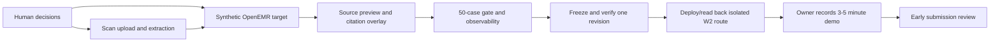

# Week 2 early submission execution plan

Date: 2026-09-23

Status: `PLANNED; implementation not started`
Source of truth: `Week 2 PRD - AgentForge Clinical Co-Pilot.pdf`, current
working-tree evidence, and `W2_EARLY_CHECKPOINT.md`. This plan supersedes only
the early-submission path in `W2_GAP_CLOSURE_EXECUTION_PLAN.md`; that document
continues to track final-submission work.

## Goal

Deliver a reproducible early-submission package for one frozen Week 2 revision:
a deployed core flow, rubric-aligned 50-case regression gate, observable
synthetic workflow, required key-metrics hard gate, and owner-recorded 3–5
minute demo with evidence tied to the same revision.

## Current state

- Repo HEAD is `462daf0b621b142f4c4ece4456a16f5825bcbbb6`; the working tree has
  unrelated and in-progress edits. Preserve them and inspect their diffs before
  implementation. Do not assume HEAD, working tree, and deployed revision are
  identical.
- `/agentforge-w2` is publicly deployed and has prior external evidence, but
  that image was built from `67f376ca4bca97f7a5e8fe58d4d33cca53d60d2e`.
  Current-candidate identity must be re-established after changes.
- The hook and `EVAL_GATE.md` are present. The documented gate has 50 cases,
  five PRD category names, threshold/regression rules, and a blocked-commit
  screenshot/transcript. The prior proof does not establish behavior of a
  changed candidate.
- Current document ingestion accepts UTF-8 `LAB|` / `INTAKE|` records. It does
  not read scanned/binary PDFs or run OCR/VLM. W2 document and fact storage is
  in-memory synthetic storage, not an OpenEMR round trip.
- Current browser/API evidence shows synthetic text-fixture extraction and
  worker handoffs. The public upload was performed by API client; click-to-source
  PDF preview/overlay and browser file-selection proof remain open.
- `docs/agentforge/KEY_METRICS.md` exists but is Week 1 definitions. The PRD
  names the hard-gate artifact `./KEY_METRICS.md`; that root-level deliverable
  is absent. W2 values must be measured or explicitly marked unmeasured.
- The 3–5 minute Week 2 recording remains open and owner-recorded.

## Assignment interpretation

The PRD's Early Submission checkpoint names four focus areas: deployed agent,
evaluation framework, observability, and demo video. The PRD also states
project-wide hard gates and core requirements that constrain the early package:

- `KEY_METRICS.md` is explicitly a hard gate.
- The app must ingest a scanned lab PDF and intake form, produce strict-schema
  facts with citations, and persist the source and derived facts through
  OpenEMR using demo/synthetic data.
- The citation contract includes a visual PDF bounding-box overlay.
- The gate covers 50 synthetic/demo cases and the five named boolean rubric
  categories; it blocks if any category regresses by more than 5 percentage
  points or falls below its pass threshold. `no_phi_in_logs` has zero tolerance
  in the current repo gate contract.
- Observability records tool sequence, step latency, token use, cost estimate,
  retrieval hits, extraction confidence, and eval outcome without raw PHI.
- The 3–5 minute video shows upload, extraction, evidence retrieval, citations,
  eval results, and observability.

The separate submission table also requests architecture/schema/eval artifacts,
a cost-and-latency report, and a publicly accessible application. The cost and
latency report is not singled out in the Early checkpoint schedule, but its
metrics feed the hard-gate metrics document and observability; record available
measurements and their limits in the early package rather than invent values.

## Workflow state

- **Current state:** evidence-backed gap closure plan is ready; implementation
  awaits the human decisions at the end of this document.
- **Next transition:** resolve the OCR/provider and OpenEMR target decisions,
  then execute slices 1–5 in dependency order.
- **Checkpoint artifact:** this file plus updated `W2_EARLY_CHECKPOINT.md` and
  evidence under `docs/agentforge/evidence/`.
- **Stop condition:** stop before any provider call, spend, public release,
  OpenEMR write, live clinical data, or submission unless the exact scope is
  authorized. Keep Week 1 `/agentforge` read-only and unchanged.

## Scope

### Included

- One supported synthetic lab PDF and one synthetic intake-form path through
  upload, extraction, citation review, follow-up, persistence/readback, and
  observability.
- A scan-reading path with typed extraction, uncertainty/missing-data handling,
  and source-region coordinates.
- A source-preview UI that navigates from a cited fact to the relevant PDF page
  and region.
- A 50-case labeled eval set covering complete, partial, missing, conflicting,
  refusal, citation, and log-redaction behavior, enforced by the installed Git
  hook.
- Root `KEY_METRICS.md`, current architecture/setup/environment-variable
  documentation, exact-revision verification, deployment readback, and demo
  evidence.

### Excluded

- PHI, non-synthetic patient data, live chart writes, or changes to Week 1's
  `/agentforge` route.
- Additional document types, trend charts, production-readiness claims, or
  unmeasured accuracy/cost/latency claims.
- Cohere or another paid/external provider unless the provider decision below is
  explicitly approved. Existing credentials do not imply permission to use
  them.
- GitLab publication, deployment updates, or assignment submission outside the
  exact already-approved route and scope; the final release decision below
  determines whether to refresh it.

## Settled decisions

- Keep the product synthetic-only for this work and preserve the Week 1 live
  chart read-only boundary.
- Keep only `lab_pdf` and `intake_form` in scope.
- Keep the evaluation gate deterministic at commit time; model/provider calls
  are not a prerequisite for every commit.
- Treat current public proof as candidate-scoped. Rebuild and read back the
  exact revision before recording or claiming early-submission completion.
- Do not represent current line-text parsing or in-memory storage as scanned-PDF
  ingestion or OpenEMR persistence.

## Assumptions

- The instructor's early checkpoint expects the assignment's stated hard gates
  and core flow to be demonstrated to the extent feasible, not merely a video
  of the narrower text-fixture proxy.
- A local or isolated demo OpenEMR instance seeded only with synthetic records
  is acceptable for demonstrating the required round trip. This needs
  confirmation before selecting the integration target.
- The current Node service, source-document contracts, supervisor/workers,
  deterministic verifier, eval gate, and evidence directory remain the intended
  implementation seams unless targeted inspection shows otherwise.
- The current working-tree changes are user-owned work. Review them in place;
  do not reset, stash, or overwrite them.

## Approach

Build one vertical slice at a time and preserve the existing deterministic
gate. First select a scan extraction route and a synthetic OpenEMR target.
Implement the end-to-end document path and source-region UI, then expand the
golden set and observability evidence. Freeze one revision only after local
verification. Deploy that exact revision to the isolated W2 route, run the
browser walkthrough, and have the owner record the required demo. Keep every
claim linked to revision-specific evidence.



## Seams and surfaces

- Ingestion/storage: `agentforge/src/sourceDocuments.js`,
  `sourceEvidenceParsing.js`, `labEvidence.js`, `intakeEvidence.js`, and the
  existing request/schema contracts.
- Workflow: `agentforge/src/supervisor.js`, extraction and retrieval workers,
  verifier, `agentforge/src/service.js`, and the current browser UI.
- OpenEMR boundary: `agentforge/src/openemrAdapter.js` plus existing synthetic
  adapter/test seams. Do not reuse the live read-only adapter for writes.
- Eval: `agentforge/src/w2RegressionGate.js`, gate runner, baseline report,
  `.githooks/pre-commit`, and `EVAL_GATE.md`.
- Observability: `agentforge/src/observations.js`, trace/redaction code,
  observability UI, and current evidence JSON.
- Submission docs: root `KEY_METRICS.md`, `docs/agentforge/W2_ARCHITECTURE.md`,
  `EVAL_GATE.md`, `README.md`, and `docs/agentforge/W2_EARLY_CHECKPOINT.md`.

## Execution slices

### 1. Reconcile requirements and freeze the working candidate

- **Depends on:** human decisions below.
- **Surfaces:** this plan, `W2_EARLY_CHECKPOINT.md`, current `git status`, PRD,
  existing source contracts and eval gate.
- **Inputs/outputs:** latest source requirements and working-tree diffs -> a
  small acceptance checklist, preserved user edits, and chosen candidate SHA.
- **Steps:** inspect current modified files; map every PRD early/hard-gate
  requirement to code, doc, or evidence; resolve contradictions between this
  plan and older status docs; record the approved OCR/provider and OpenEMR scope.
- **Verification:** requirement ledger has no unlabeled mandatory item; working
  tree remains intact; no candidate SHA is called verified before checks pass.
- **Documentation:** update only the early checkpoint and this plan after
  evidence changes.

### 2. Implement scanned-document extraction and persistence round trip

- **Depends on:** slice 1; approved provider/route and synthetic OpenEMR target.
- **Surfaces:** upload validation, PDF/image parsing seam, lab/intake extractors,
  strict output schemas, source-document storage, derived-fact persistence,
  and test fixtures.
- **Inputs/outputs:** committed synthetic scanned PDFs/forms with labels ->
  schema-valid facts or qualified/refused outcomes, each linked to source page,
  field, quote, and region; source and derived records can be read back with
  patient scope and deduplication intact.
- **Acceptance:** exercise at least one varied layout per supported type and
  complete/partial/missing/conflicting data; malformed or low-confidence
  extraction must qualify/withhold facts; citations must point to the correct
  source coordinates; source and derived records round-trip without duplicate
  or untraceable records; no raw source content enters logs.
- **Verification:** fixture-based unit/integration checks plus read-after-write
  using the isolated synthetic OpenEMR target. Do not claim OpenEMR round trip
  from in-memory adapter tests alone.
- **Documentation:** schemas, fixture provenance, supported PDF limits,
  confidence/refusal semantics, setup, and required environment variables.

### 3. Complete click-to-source demo flow and observability

- **Depends on:** slice 2.
- **Surfaces:** browser upload, extracted-fact view, source preview/overlay,
  grounded follow-up, worker handoffs, tracing and redaction.
- **Inputs/outputs:** a synthetic patient plus uploaded files -> reviewer can
  inspect each cited claim at its page/region and see qualified uncertainty,
  retrieval evidence, tool sequence, per-step latency, token/cost estimates,
  extraction confidence, and eval outcome.
- **Acceptance:** clean browser session proves both document types through the
  complete flow; citation selection opens the expected PDF page/region;
  incomplete or conflicting fields remain qualified; traces show worker
  handoffs and required metrics while excluding document text and identifiers.
- **Verification:** capture a redacted browser walkthrough record, trace sample,
  and no-PHI sentinel result on the candidate.
- **Documentation:** update README run path, observability descriptions, and
  `W2_EARLY_CHECKPOINT.md` with explicit evidence limits.

### 4. Align the 50-case golden set and gate to the PRD

- **Depends on:** slices 2–3.
- **Surfaces:** `agentforge/src/w2RegressionGate.js`, committed fixtures/labels,
  baseline JSON, runner, hook, and `EVAL_GATE.md`.
- **Inputs/outputs:** labeled synthetic document cases and expected responses ->
  exactly 50 runnable cases with the PRD categories
  `schema_valid`, `citation_present`, `factually_consistent`, `safe_refusal`,
  and `no_phi_in_logs`.
- **Acceptance:** cases exercise both file types and scan-derived coordinates,
  complete/partial/missing/conflicting data, retrieval, unsupported questions,
  refusals, and log redaction; each category has a documented threshold; the
  gate blocks if below threshold or regressed by more than 5 percentage points;
  `no_phi_in_logs` has zero tolerance; baseline hash mismatch fails closed.
- **Verification:** normal gate passes the complete set; injected meaningful
  regression exits nonzero; hook blocks a commit; report and corpus hash are
  committed and repeatable from a fresh clone.
- **Documentation:** root `EVAL_GATE.md` states inputs, install/run commands,
  categories, thresholds, environment, and committed blocked-commit proof.

### 5. Close hard-gate metrics and freeze one revision

- **Depends on:** slices 1–4.
- **Surfaces:** new root `KEY_METRICS.md`,
  `docs/agentforge/W2_ARCHITECTURE.md`, README, package/environment docs, and
  evidence bundle.
- **Inputs/outputs:** metrics definitions and measured candidate data -> root
  hard-gate doc with rationale, formulas, units, synthetic measurement scope,
  actual results or explicit `NOT MEASURED` values, and a reproducible report.
- **Acceptance:** key metrics document exists at the PRD-required root path;
  architecture explains ingestion, workers, retrieval, persistence, eval,
  observability, risks, and tradeoffs; report distinguishes measured from
  projected cost/latency; exact source SHA, gate result, and evidence paths are
  recorded together.
- **Verification commands:**

  ```powershell
  npm.cmd test --prefix agentforge -- --test-concurrency=1
  npm.cmd run eval:gate --prefix agentforge
  npm.cmd run eval:gate --prefix agentforge -- --inject-defect
  git diff --check
  ```
- **Expected result:** suite passes, normal gate passes all 50 cases, injected
  defect returns nonzero, no whitespace errors. These are planned checks, not
  results already obtained for future changes.
- **Documentation:** record runtime versions, installation, hook activation,
  required variables, metrics, SHA, and evidence in the root README and
  checkpoint doc.

### 6. Candidate deployment proof, demo, and submission handoff

- **Depends on:** slice 5 and release decision below.
- **Surfaces:** isolated `/agentforge-w2`, deployment descriptor, external
  health/readiness, browser interaction, release evidence JSON, demo recording.
- **Acceptance:** deploy the exact frozen SHA only to the approved isolated W2
  route; externally read back revision identity, health/readiness, upload of
  generated synthetic files, citation UI, traces, and public eval outcome; run
  the commit hook from a fresh clone; owner records a 3–5 minute video showing
  upload, extraction, retrieval, citations, eval, and observability; reviewer
  can retrieve video and evidence.
- **Stop conditions:** no deployment to `/agentforge`, no live data, no widened
  provider egress, no public posting or assignment submission under this plan.
  The owner decides whether to submit after reviewing the complete package.
- **Documentation:** update external proof only after readback; include exact
  SHA and distinguish browser upload from API evidence.

## Acceptance evidence ledger

| Requirement | Current evidence/status | Acceptance proof | Status after execution |
|---|---|---|---|
| Deployed W2 flow | Prior deployed SHA `67f376c`; text-fixture/API path | Current frozen SHA publicly read back with full browser flow | `OPEN` |
| Scanned lab PDF and intake form | UTF-8 line fixtures only | Synthetic scanned fixture extraction, typed output, citations, uncertainty | `OPEN` |
| OpenEMR source/derived-fact round trip | In-memory synthetic seam | Isolated synthetic OpenEMR write/readback, deduplication, patient scope | `OPEN` |
| Click-to-source overlay | Metadata exists; end-to-end overlay unproven | Browser click opens matching page and bounding region | `OPEN` |
| 50-case rubric gate | Gate/hook/proof exist; tied to earlier code | Five categories, thresholds, new scan cases, fresh-clone run and mutation block | `PARTIAL` |
| Observability | Prior synthetic traces | Candidate trace includes required fields and no raw content | `PARTIAL` |
| `KEY_METRICS.md` hard gate | Week 1 metric definitions nested under `docs/agentforge/` | Root W2 document with rationale and measured/unmeasured scope | `OPEN` |
| 3–5 minute demo | No W2 recording | Owner-recorded, reviewable video tied to frozen SHA | `OPEN` |
| Cost/latency reporting | Definitions and projections exist; W2 current measurements incomplete | Report actual dev spend and p50/p95; projections labeled separately | `OPEN` |

Do not mark a row `PASS` from a unit test when its acceptance proof requires
browser behavior, persistence readback, a public runtime, or an owner-created
recording.

## Resource plan and circuit breakers

- First pass is local, synthetic, and limited to the two required document
  types. Do not add provider calls or paid services before the decision below.
- Bound the initial vertical slice to one varied synthetic document per type,
  then expand to 50 labeled cases. Add OCR/VLM latency/cost measurement before
  expanding the corpus.
- Stop if the selected extraction path requires PHI, broad network egress,
  unapproved spending, a change to the Week 1 live boundary, or unbounded host
  resources.
- Preserve user WIP. No reset, stash, deletion, force push, publication, or
  submission is part of planning.
- Verification commands above run only during the implementation stage; no
  tests were run while writing this plan.

## Human decisions — resolve before execution

### 1. Scan extraction route and provider boundary

- **Why human-owned:** chooses quality/latency/cost and whether synthetic
  document images may leave the machine for a hosted VLM.
- **Current facts:** current parser handles UTF-8 record lines only; the PRD and
  assignment review require scan-form reading with source links and visible
  uncertainty. No live provider call is established by this plan.
- **Options:**
  1. Local OCR plus deterministic schema extraction; lowest egress risk and
     simplest reproducibility, but weaker handwriting/layout handling.
  2. Hosted VLM on generated synthetic forms; likely stronger layout reading,
     with API cost, latency, provider data handling, and environment-key work.
  3. Defer scanned extraction and submit the current text fixture; fastest, but
     knowingly leaves a core assignment requirement unmet.
- **Recommendation:** first try local OCR on generated synthetic scans; add a
  hosted VLM only if local OCR cannot meet labeled extraction and source-region
  criteria and the provider is explicitly approved.
- **Safe default if deferred:** no network call; keep the text fixture as
  baseline and mark scan ingestion `OPEN`, not complete.
- **Exact approval:** “I approve using [named local OCR / named hosted provider]
  on generated synthetic lab and intake documents only, with a maximum spend of
  [amount] through [date]. No patient data may be sent.”
- **Consequence:** this determines parsing implementation, env vars, test
  fixtures, observability, cost report, and whether provider quality can be
  claimed.
- **Stop condition:** no provider request or spend until route and any budget
  are explicitly selected; no real patient data under any option in this plan.

### 2. OpenEMR persistence target

- **Why human-owned:** the assignment calls for persistence through OpenEMR,
  while the current W2 storage is intentionally isolated and the Week 1 live
  chart path is read-only.
- **Current facts:** synthetic source/fact storage is in-memory. Existing
  OpenEMR adapters and test seams exist, but no W2 document-write/readback proof
  is recorded. Prior permission for the isolated W2 route does not authorize
  new live chart writes.
- **Options:**
  1. Use a local isolated OpenEMR instance seeded only with synthetic patients;
     strongest assignment fit without touching the public Week 1 service, with
     setup and integration cost.
  2. Use the already-deployed isolated synthetic service with a separately
     isolated synthetic OpenEMR backend; closer to demo reality, but requires
     explicit network/secrets/deployment scope and rollback checks.
  3. Keep in-memory persistence; simplest and safest, but does not satisfy the
     explicit OpenEMR round-trip requirement.
- **Recommendation:** option 1 for implementation and verification; consider
  option 2 only if required for the deployed demo and separately authorized.
- **Safe default if deferred:** no write operation; document the gap and retain
  current in-memory synthetic behavior.
- **Exact approval:** “I approve synthetic-only W2 document and derived-fact
  write/readback in [named isolated OpenEMR instance], using [synthetic account
  and scope], with no changes to `/agentforge` and no real patient data.”
- **Consequence:** selects adapter, credentials, deployment topology, and the
  acceptance evidence required for persistence.
- **Stop condition:** no OpenEMR write until target, synthetic dataset, access
  boundary, and rollback path are named.

### 3. Early package completeness and release action

- **Why human-owned:** decides whether to spend early-submission time closing
  project-wide core requirements and authorizes any refreshed public revision or
  submission.
- **Current facts:** schedule focus lists deployed agent, eval, observability,
  demo; the same PRD also labels `KEY_METRICS.md` a hard gate and includes scan,
  persistence, and click-to-source core requirements. The current deployed SHA
  is older than HEAD and current working-tree changes.
- **Options:**
  1. Complete all core/hard-gate slices above before early submission; best
     rubric alignment, largest schedule risk.
  2. Submit the verified narrower flow with a written gap disclosure; fastest,
     but knowingly leaves core requirements incomplete and risks failing the
     hard gates.
  3. Stage both: close required gates and demo first, then decide whether to
     include measured cost/latency detail or defer it to the final package;
     preserves checkpoint focus while recording the remaining submission-table
     gap.
- **Recommendation:** option 3; do not claim a core requirement is met without
  evidence. Treat the demo and hard gates as mandatory for early review.
- **Safe default if deferred:** continue local implementation only; do not
  refresh the public candidate, publish the recording, or submit.
- **Exact approval:** “I approve refreshing only the isolated `/agentforge-w2`
  route from frozen SHA [SHA] after the acceptance ledger passes, and I will
  review/submit the resulting early package. Do not alter `/agentforge`.”
- **Consequence:** authorizes the precise release target and establishes the
  submission sequence; it does not authorize PHI, new provider use, or live
  chart writes.
- **Stop condition:** no public update or assignment submission until the
  frozen SHA, evidence, and exact approved route are read back and reviewed.

## Next action

Resolve decisions 1 and 2 before implementing document extraction or
persistence. Then execute slices 1–5 locally and synthetically. Resolve decision
3 only after the concrete acceptance ledger and frozen-candidate evidence are
available for review.
