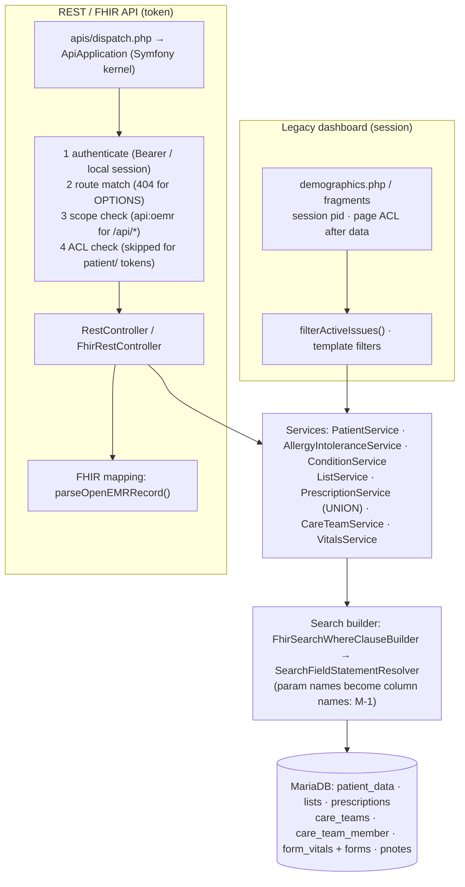

# Data flow — from a request to a row (the "layer cake")

Two stacks read the same tables: the legacy dashboard (session-based PHP) and
the REST/FHIR API (token-based) that the port will use. They share the service
layer but apply **different filters and permission checks**. That's why
parity has to be engineered in the client, not assumed.

## Layers, top to bottom

1. **Input.** Legacy: `$_GET['set_pid']` → session. API: route params (`:puuid`,
   `:pid`, `:eid`) + query params (FHIR search or raw REST keys).
2. **Authorization.** Legacy: per page/card, *after* the patient switch.
   API: per request: token → scope → ACL (`RestConfig::request_authorization_check`).
   For `patient/` tokens the ACL step is skipped and patient binding is the gate.
3. **Controller.** REST controllers call services directly. FHIR controllers
   call a `Fhir*Service`, which calls the domain service and maps rows to FHIR.
4. **Service / query building.** `BaseService::search()` with search fields.
   Several REST routes never pass query params through (their documented
   filters are dead). The prescription route passes *keys* through unvalidated.
5. **Storage.** Per-request `sqlStatement` / `QueryUtils`. **No transactions on
   the read paths.** None are needed for reads, but the Care Team save (legacy)
   writes team + members without one.

## Non-obvious properties

- **Filters differ by path.** The same `lists` rows are filtered by
  `filterActiveIssues()` (legacy), `activity=1` (FHIR Condition), a
  `clinicalStatus` mapping (FHIR AllergyIntolerance), or not at all (REST).
- **Deleted forms.** Legacy vitals joins `forms` by id alone (U-1); FHIR vitals
  never checks `deleted` (M-5); REST per-encounter vitals does (`deleted=0`).
- **Errors.** `ExceptionHandlerListener` returns exception text verbatim,
  including SQL on query errors. Validation errors can be HTTP 200.
- **Ordering.** Most FHIR services ignore `_sort` / `_count`; several REST
  queries have no `ORDER BY`. The client must sort.
- **Side channel.** With `api_log_option=2` (local), full response bodies,
  including PHI, are stored in `api_log`.
- **Synchronous, single request.** No caching layer; each card is at least one
  request, and the Rx object model issues at least 5 queries per row (N+1).
