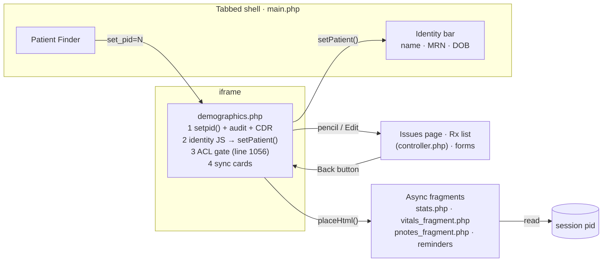

# UI flow — how a user reaches and uses the patient dashboard

## Navigation structure: shell + iframe + fragments

OpenEMR's UI is a **tabbed shell** (`interface/main/tabs/main.php`, Knockout.js)
that hosts each screen in an iframe. The patient dashboard is one of those
iframes. The shell owns the **persistent identity bar** (`attendantData`,
`patient_data_view_model.js`: name, pid, pubpid, DOB only). The dashboard pushes
values into it via `left_nav.setPatient()` (`demographics.php:916-930`).

Inside the iframe the dashboard is a **server-rendered page with asynchronous
holes**. Synchronous cards render as the PHP runs. Others are empty `
`s
that `placeHtml()` fills after load, by fetching fragment endpoints that read
the **session** patient rather than a patient id in the request. Navigation away
(the Issues page, the Rx edit list, forms) replaces the iframe, which is why
David found himself relying on the browser Back button (B-07).

## Lifecycle of one dashboard load

1. **Arrive.** Finder (or a URL) loads `demographics.php?set_pid=N`.
2. **Switch patient.** `setpid()` updates the session, writes the audit row and
   the recent-patients list. No authorization yet.
3. **CDR.** Allergy-conflict and reminder checks run synchronously; any popup is
   queued as an inline `<script>`.
4. **Head JS.** Identity data, the encounter list and the CSRF token go into the
   page; `setMyPatient()` updates the shell bar on `window.load`.
5. **Gate.** `patients/demo` is checked. On failure, "Not Authorized" is shown,
   but steps 2–4 have already happened.
6. **Cards.** Synchronous cards render in source order (per-card ACL, per-user
   collapse setting). `placeHtml()` then fetches the async fragments.
7. **Interact.** Collapse toggles save a user setting (`restoreSession` first,
   which fails outside the shell). Pencils navigate away inside the iframe.

## What the port changes structurally

| Legacy | Port |
|---|---|
| Patient identity is session state shared by every request | Patient id in the route and in every API call |
| Authorization after data, per page | OAuth scopes + ACL on every API request |
| Server HTML plus async HTML fragments | One client app; JSON from REST/FHIR |
| Shell iframe + Back button | Client-side routes inside the SPA |
| Identity bar: name, MRN, DOB | Brief's bar: + sex, + active status (derived; see DASHBOARD-HEADER) |
